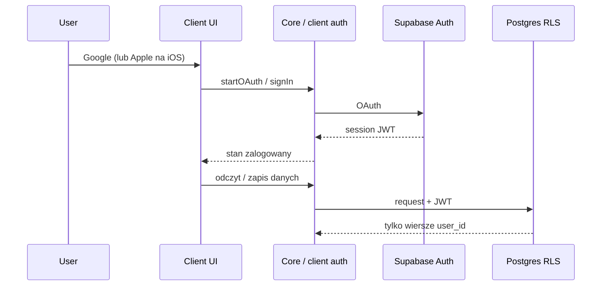

# Autentykacja

## Cel

Użytkownik ma **bezpieczne konto**, dzięki któremu po zmianie urządzenia odzyskuje swoje dane aplikacji (posiłki, treningi, pomiary). Nie budujemy sieci społecznościowej ani profilu publicznego — **minimum PII**.

## Decyzja

**Supabase Auth** + izolacja danych przez **RLS** na Postgresie.  
Backend: [ADR 0002](../decisions/0002-backend-supabase.md).  
Providery i PII: [ADR 0007](../decisions/0007-auth-providers-minimum-pii.md) (zamyka [OQ-02](../open-questions.md)).

| Element | Decyzja |
|---------|---------|
| IdP | **Google** (Android, iOS, web) |
| iOS / App Store | Dodatkowo **Sign in with Apple** (wymagane przy Google) |
| Sesja | JWT Supabase; odświeżanie przez SDK |
| Dane apki | Tabele z `user_id` + RLS |
| Poza MVP | Magic link, email+hasło, konta anonimowe |

Email z IdP trafia do `auth.users` — kompromis względem „zero PII”; nie budujemy na nim profilu produktu.

## Minimum PII — zasady

1. Nie zbieramy imienia, płci, daty urodzenia, telefonu ani adresu, **chyba że** przyszła funkcja tego wymaga — wtedy świadomie i dokumentujemy.
2. Nie kopiujemy emaila, display name ani avatara z IdP do tabel aplikacji.
3. `profiles` trzyma tylko to, co konieczne do działania apki (patrz niżej).
4. Brak analytics identyfikujących osobę na start.
5. Usunięcie konta usuwa tożsamość Auth i dane aplikacji użytkownika (zarys poniżej).

## Tabela `profiles`

Rekord aplikacji 1:1 z `auth.users` (`profiles.id` = `auth.users.id`). Szczegóły schematu: [data-model](../domain/data-model.md) i issue pierwszej migracji.

| Trzymamy | Nie trzymamy / nie zbieramy |
|----------|----------------------------|
| `id` (UUID = auth user) | Imię, nazwisko, display name |
| `created_at`, `updated_at` | Płeć, data urodzenia, telefon |
| Preferencje apki (np. jednostki `kg`/`lb`, ewentualnie locale UI) | Email (zostaje w `auth.users`, nie w `profiles`) |
| | Avatar / zdjęcie z IdP |
| | Adres, zgody marketingowe |

Preferencje to ustawienia produktu, nie dane identyfikujące osobę.

## Happy path logowania (zachowanie)

Poziom zachowania — bez SDK ani kodu. Po sukcesie: sesja JWT, wiersz `profiles` (trigger lub pierwszy zapis), dalsze requesty z RLS po `user_id`.

### Android

1. Użytkownik wybiera **Zaloguj przez Google**.
2. Systemowy / SDK flow Google → Supabase Auth wymienia token na sesję.
3. Aplikacja przechodzi do stanu zalogowanego; dane sync po `user_id`.

### iOS

1. Ekran logowania pokazuje **Sign in with Apple** oraz **Zaloguj przez Google** (oba wymagane przy Google w App Store).
2. Wybrany IdP → Supabase Auth → sesja JWT.
3. To samo konto Supabase co na innych platformach (ten sam email u dostawcy zwykle ten sam `auth.users`; edge case różnych IdP bez wspólnego emaila — poza MVP, użytkownik loguje się zawsze tym samym providerem albo akceptuje osobne konta do czasu linkowania).

### Web

1. Użytkownik wybiera **Zaloguj przez Google**.
2. Redirect OAuth (Supabase) → powrót na URL aplikacji z sesją.
3. Stan zalogowany w SPA; dane przez API + RLS jak na mobile.

## Usuwanie konta

Zarys na poziomie spec (implementacja w fazie auth/scaffold — osobny follow-up).

1. **Wejście:** ustawienia konta → „Usuń konto” → potwierdzenie (świadome, trudne do przypadkowego kliknięcia).
2. **Skutek:** usunięcie wszystkich wierszy aplikacji użytkownika (`user_id` / `profiles.id`) oraz usunięcie użytkownika w Supabase Auth (koniec sesji na wszystkich urządzeniach).
3. **Mechanizm (kierunek):** FK `ON DELETE CASCADE` z `profiles` / `auth.users` **albo** zaufana funkcja (Edge Function / service role) kasująca dane + Auth — wybór przy pierwszej migracji / scaffoldzie; **nie** kasowanie tylko z klienta przez klucz `anon`.
4. **Po usunięciu:** brak celowego przechowywania PII „na potem”; dumpy backupowe mogą chwilowo zawierać historyczne dane do wygaśnięcia retencji hostingu (patrz polityka backupów przy OQ-05 / data-and-sync).
5. **Store:** procedura ma być spójna z wymaganiami usuwania konta Apple / Google Play (ścieżka w apce, nie tylko „napisz do supportu”).

## Role i klucze

| Klucz | Gdzie | Do czego |
|-------|-------|----------|
| `anon` + project URL | Klienci; lokalny `.env*` (nie w git) | Publiczny dostęp ograniczony RLS |
| `service_role` | Tylko zaufany backend / admin (np. kasowanie konta); GitHub Secrets w CI | Omija RLS — **zakaz w apkach i w repo** |
| Sekrety OAuth (Google/Apple) | Dashboard Supabase Auth (+ secrets CI gdy trzeba) | Nie w repo, nie w klientach |

Hosting projektu, środowiska i pełna polityka sekretów: [ADR 0004](../decisions/0004-supabase-hosting.md), [data-and-sync](data-and-sync.md#hosting-i-backupy).

## Platformy — checklista konfiguracji (scaffold)

- **Android / web:** Google Cloud OAuth client + redirect URI Supabase.
- **iOS:** Google + Apple (Service ID / capability Sign in with Apple, URL schemes / entitlements).
- Sesja logicznie współdzielona przez to samo konto Supabase → sync danych ([data-and-sync](data-and-sync.md)).

## Poza zakresem teraz

- 2FA / passkeys
- SSO firmowe
- Konta rodzinne / współdzielone dzienniki
- Magic link, email+hasło, anonimowe konta
- Automatyczne linkowanie Google ↔ Apple przy różnych identyfikatorach

## Status

OQ-02 **decided** — [ADR 0007](../decisions/0007-auth-providers-minimum-pii.md).
