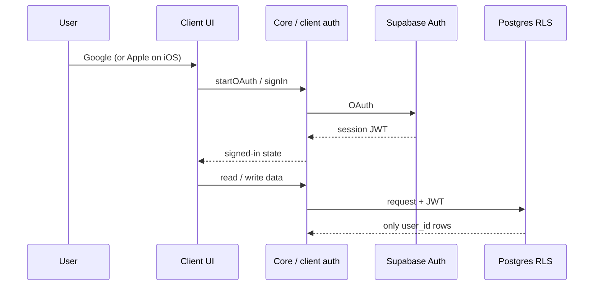

# Authentication

## Goal

The user has a **secure account** so that after changing devices they recover their app data (meals, workouts, measurements). We are not building a social network or public profile — **minimum PII**.

## Decision

**Supabase Auth** + data isolation via **RLS** on Postgres.  
Backend: [ADR 0002](../decisions/0002-backend-supabase.md).  
Providers and PII: [ADR 0007](../decisions/0007-auth-providers-minimum-pii.md) (closes [OQ-02](../open-questions.md)).

| Element | Decision |
|---------|----------|
| IdP | **Google** (Android, iOS, web) |
| iOS / App Store | Additionally **Sign in with Apple** (required when offering Google) |
| Session | Supabase JWT; refresh via SDK |
| App data | Tables with `user_id` + RLS |
| Beyond MVP | Magic link, email+password, anonymous accounts |

Email from the IdP lands in `auth.users` — a compromise vs “zero PII”; we do not build a product profile on it.

## Minimum PII — rules

1. We do not collect name, gender, date of birth, phone, or address **unless** a future feature requires it — then deliberately and documented.
2. We do not copy email, display name, or avatar from the IdP into app tables.
3. `profiles` holds only what the app needs to run (see below).
4. No person-identifying analytics at the start.
5. Account deletion removes Auth identity and the user’s app data (outline below).

## `profiles` table

App record 1:1 with `auth.users` (`profiles.id` = `auth.users.id`). SQL: [first migration spec](../specs/first-migration-profiles-rls.md); outline: [data-model](../domain/data-model.md).

| We keep | We do not keep / collect |
|---------|--------------------------|
| `id` (UUID = auth user) | First/last name, display name |
| `created_at`, `updated_at` | Gender, date of birth, phone |
| `preferred_units` (`kg`/`lb`); optionally UI locale later | Email (stays in `auth.users`, not in `profiles`) |
| | Avatar / photo from IdP |
| | Address, marketing consents |

Preferences are product settings, not person-identifying data.

## Sign-in happy path (behavior)

Behavior level — no SDK or code. After success: JWT session, `profiles` row (trigger or first write), further requests with RLS by `user_id`.

### Android

1. User chooses **Sign in with Google**.
2. System / SDK Google flow → Supabase Auth exchanges the token for a session.
3. App enters signed-in state; data syncs by `user_id`.

### iOS

1. Sign-in screen shows **Sign in with Apple** and **Sign in with Google** (both required when offering Google on the App Store).
2. Chosen IdP → Supabase Auth → JWT session.
3. Same Supabase account as other platforms (same provider email usually same `auth.users`; edge case of different IdPs without a shared email — beyond MVP; user always signs in with the same provider or accepts separate accounts until linking).

### Web

1. User chooses **Sign in with Google**.
2. OAuth redirect (Supabase) → return to the app URL with a session.
3. Signed-in state in the SPA; data via API + RLS like on mobile.

## Account deletion

Spec-level outline (implementation in auth/scaffold phase — separate follow-up).

1. **Entry:** account settings → “Delete account” → confirmation (deliberate, hard to click by accident).
2. **Effect:** delete all of the user’s app rows (`user_id` / `profiles.id`) and delete the user in Supabase Auth (end sessions on all devices).
3. **Mechanism (direction):** first migration sets FK `ON DELETE CASCADE` from `profiles` / user tables → `auth.users` ([spec](../specs/first-migration-profiles-rls.md)); full flow — [account-deletion spec](../specs/account-deletion.md) ([#13](https://github.com/MarekBiolik/GymManager/issues/13)). **Not** deletion only from the client via the `anon` key.
4. **After deletion:** no intentional “keep PII for later”; backup dumps may briefly hold historical data until hosting retention expires (see backup policy under OQ-05 / data-and-sync).
5. **Stores:** procedure must align with Apple / Google Play account-deletion requirements (in-app path, not only “email support”).

## Roles and keys

| Key | Where | Purpose |
|-----|-------|---------|
| `anon` + project URL | Clients; local `.env*` (not in git) | Public access limited by RLS |
| `service_role` | Trusted backend / admin only (e.g. account deletion); GitHub Secrets in CI | Bypasses RLS — **forbidden in apps and repo** |
| OAuth secrets (Google/Apple) | Supabase Auth dashboard (+ CI secrets when needed) | Not in repo, not in clients |

Project hosting, environments, and full secrets policy: [ADR 0004](../decisions/0004-supabase-hosting.md), [data-and-sync](data-and-sync.md#hosting-and-backups).

## Platforms — IdP configuration checklist

Full console checklist (Google Cloud, Apple Developer, redirect URI / deep link, secrets map): **[specs/idp-config-checklist.md](../specs/idp-config-checklist.md)** ([#12](https://github.com/MarekBiolik/GymManager/issues/12)).

Summary (aligned with ADR 0007):

| Client | IdP MVP | Console |
|--------|---------|---------|
| Android | Google | Android OAuth client (package + SHA-1) + Web client secret in Supabase |
| iOS | Google + Sign in with Apple | Google iOS client; Apple App ID + Services ID + `.p8` key |
| Web | Google | OAuth Web client; Site URL + Additional Redirect URLs |

Session logically shared via the same Supabase account → data sync ([data-and-sync](data-and-sync.md), [ADR 0008](../decisions/0008-sync-strategy-online-first.md)).

## Out of scope now

- 2FA / passkeys
- Corporate SSO
- Family accounts / shared journals
- Magic link, email+password, anonymous accounts
- Automatic Google ↔ Apple linking across different identifiers

## Status

OQ-02 **decided** — [ADR 0007](../decisions/0007-auth-providers-minimum-pii.md).
