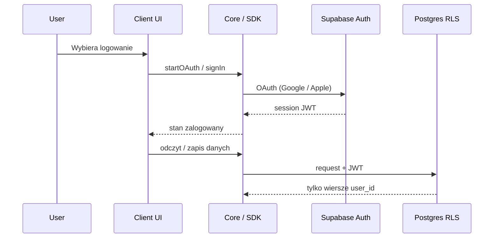

# Autentykacja

## Cel

Użytkownik ma **bezpieczne konto**, dzięki któremu po zmianie urządzenia odzyskuje swoje dane aplikacji (posiłki, treningi, pomiary). Nie budujemy sieci społecznościowej ani profilu publicznego — **minimum PII**.

## Wybrany fundament

**Supabase Auth** + izolacja danych przez **RLS** na Postgresie.  
Decyzja backendowa: [ADR 0002](../decisions/0002-backend-supabase.md).  
Szczegółowa metoda logowania: [OQ-02](../open-questions.md) (jeszcze otwarte).

## Kierunek (nie finalna decyzja)

| Element | Kierunek |
|---------|----------|
| Primary IdP | Google (wygodne, darmowe w Supabase) |
| iOS / App Store | Sign in with Apple **wymagane**, jeśli oferujemy Google |
| Sesja | JWT Supabase; odświeżanie przez SDK |
| Dane apki | Tabele z `user_id` + RLS |

Google przekazuje co najmniej email — to kompromis względem „zero informacji o userze”. Alternatywy (magic link, anonimowe + linkowanie) rozważymy przy zamykaniu OQ-02.

## Minimum PII — zasady

1. Nie zbieramy imienia, płci, daty urodzenia itd., **chyba że** funkcja produktu tego wymaga (np. wyliczenia) — wtedy świadomie i dokumentujemy.
2. `profiles` trzyma tylko to, co konieczne (np. `id`, `created_at`, preferencje apki).
3. Brak analytics identyfikujących osobę na start.
4. Usunięcie konta = usunięcie / anonimizacja wierszy użytkownika (procedura do opisania przy fazie 2).

## Przepływ (docelowy zarys)

## Role i klucze

| Klucz | Gdzie | Do czego |
|-------|-------|----------|
| `anon` + project URL | Klienci | Publiczny dostęp ograniczony RLS |
| `service_role` | Tylko zaufany backend / admin (jeśli kiedyś) | Omija RLS — **zakaz w apkach** |

## Platformy

- **Android / web:** Google Sign-In przez Supabase — ścieżka bazowa.
- **iOS:** Google + Apple; konfiguracja URL schemes / entitlements przy scaffoldingu.
- Sesja współdzielona logicznie przez to samo konto Supabase na wszystkich urządzeniach → sync danych.

## Poza zakresem teraz

- 2FA / passkeys (możliwe później)
- SSO firmowe
- Konta rodzinne / współdzielone dzienniki

## Zamknięcie tematu

Przed fazą 2: decyzja OQ-02 → aktualizacja tego dokumentu + ewentualny ADR `0004-auth-method`.
