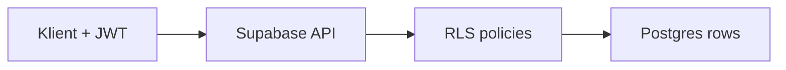

# Dane i synchronizacja

## Source of truth

**PostgreSQL (Supabase)** jest źródłem prawdy dla danych użytkownika po zsynchronizowaniu. Lokalny cache na urządzeniu jest optymalizacją UX (offline / szybkość), nie drugą „prawdą” — szczegóły strategii: [OQ-03](../open-questions.md).

## Zarys schematu

Pełniejszy model domenowy: [data-model](../domain/data-model.md). Na poziomie bazy (kierunek):

| Obszar | Przykładowe tabele | Uwagi |
|--------|-------------------|--------|
| Tożsamość | `profiles` (opcjonalnie, 1:1 z `auth.users`) | Minimum PII |
| Żywienie | `foods`, `food_entries` | Własne produkty + wpisy spożycia |
| Trening | `exercises`, `workouts` / `sessions`, `sets` | Historia sesji |
| Pomiary | `measurements` | Waga i inne metryki w czasie |
| Wspólne | `tags` (opcjonalnie) | Etykiety cross-cutting |

Wszystkie tabele użytkownika mają `user_id` (UUID → `auth.users`) i polityki **RLS**: użytkownik widzi/edytuje tylko swoje wiersze.

## Row Level Security (RLS)

- Klucz `anon` w kliencie jest OK — bezpieczeństwo opiera się na RLS + JWT, nie na ukrywaniu URL.
- Klucz `service_role` **nigdy** w aplikacjach klienckich ani w publicznym repo.
- Nowe tabele: migracja SQL **razem** z politykami RLS (konwencja CI).

## Sync (zarys — do doprecyzowania w OQ-03)

Kierunki do rozstrzygnięcia:

1. **Online-only na start** — prostsze; offline później.
2. **Local-first + kolejka** — lepsze UX w siłowni bez zasięgu; więcej złożoności (konflikty, zegary).
3. **Realtime Supabase** — live updates między urządzeniami gdy online.

Rekomendacja robocza do walidacji w fazie 2: zacząć od solidnego online + prosty lokalny cache odczytu; pełne offline-write dopiero gdy MVP modułów tego wymaga.

### Konflikty (gdy offline-write)

Kandydaci: last-write-wins na wiersz; merge per typ encji; „server wins”. Wybór per typ danych (wpis posiłku ≠ szablon ćwiczenia).

## Agregacje i historia

Tracker z rokiem+ historii (kalorie/dzień, trendy wagi, objętość treningu) naturalnie korzysta z **SQL** (widoki, `GROUP BY`, okna). To jeden z powodów wyboru Postgresa ([ADR 0002](../decisions/0002-backend-supabase.md)).

Agregacje ciężkie można materializować później (np. codzienne sumy) — nie w iteracji 1.

## Storage

Pliki (np. zdjęcia opakowań / postęp) → Supabase Storage + RLS na bucketach. Na razie opcjonalne; model plików dopiszemy przy potrzebie modułu.

## Migracje

- Katalog `supabase/migrations/` (faza 1).
- Każda zmiana schematu = migracja w PR.
- Zakaz „ręcznej” zmiany prod bez migracji.

## Hosting i backupy

[OQ-05](../open-questions.md) — cloud free tier vs self-host; polityka backupów przy wyborze środowiska.
