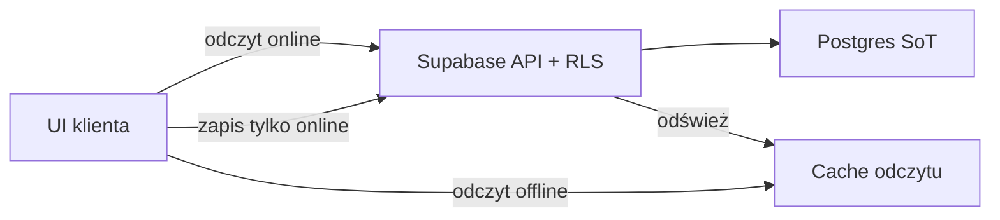

# Dane i synchronizacja

## Source of truth

**PostgreSQL (Supabase)** jest jedynym źródłem prawdy dla danych użytkownika. Lokalny cache na urządzeniu jest optymalizacją UX (szybkość / odczyt bez sieci), **nie** drugą prawdą. Decyzja: [ADR 0008](../decisions/0008-sync-strategy-online-first.md) (zamyka [OQ-03](../open-questions.md)).

Tożsamość zapisów: `user_id` = konto Supabase Auth ([ADR 0007](../decisions/0007-auth-providers-minimum-pii.md)); izolacja przez RLS.

## Zarys schematu

Pełniejszy model domenowy: [data-model](../domain/data-model.md). Na poziomie bazy (kierunek):

| Obszar | Przykładowe tabele | Uwagi |
|--------|-------------------|--------|
| Tożsamość | `profiles` (opcjonalnie, 1:1 z `auth.users`) | Minimum PII |
| Żywienie | `foods`, `food_entries` | Własne produkty + wpisy spożycia |
| Trening | `exercises`, `workouts` / `sessions`, `sets` | Historia sesji |
| Pomiary | `measurements` | Waga i inne metryki w czasie |
| Wspólne | `tags` (opcjonalnie) | Etykiety cross-cutting |

Wszystkie tabele użytkownika mają `user_id` (UUID → `auth.users`) i polityki **RLS**: użytkownik widzi/edytuje tylko swoje wiersze. Wspólne niezmienniki web + mobile (RLS / CHECK vs core/TS): [postgres-invariants](postgres-invariants.md).

## Row Level Security (RLS)

``mermaid
flowchart LR
  Client["Klient + JWT"]
  API["Supabase API"]
  RLS["RLS policies"]
  DB["Postgres rows"]
  Client --> API --> RLS --> DB
``

- Klucz `anon` w kliencie jest OK — bezpieczeństwo opiera się na RLS + JWT, nie na ukrywaniu URL.
- Klucz `service_role` **nigdy** w aplikacjach klienckich ani w publicznym repo.
- Nowe tabele: migracja SQL **razem** z politykami RLS (konwencja CI).

## Sync (MVP — ADR 0008)

Decyzja: **online-first + lokalny cache odczytu**. Szczegóły i alternatywy: [ADR 0008](../decisions/0008-sync-strategy-online-first.md).

### Model

| Element | MVP | Później |
|---------|-----|---------|
| Source of truth | Postgres | bez zmian |
| Odczyt | Sieć + cache; offline → cache | ewent. szerszy pre-fetch |
| Zapis / update / delete | Tylko online | Kolejka offline-write (osobny ADR) |
| Konflikty | LWW na wiersz (`updated_at`) — **jedna reguła** dla żywienia / treningu / pomiarów / `profiles` | Merge per typ encji jeśli LWW boli |
| Realtime | Opcjonalne odświeżanie UI | Nadal nie jako jedyny silnik sync |
| Tombstone / soft-delete | Nie (hard delete) | Przy offline-write |

### Zachowanie offline

- **Odczyt:** pokaż ostatnio zcache’owane dane; pusty cache → pusty stan + informacja o braku sieci.
- **Zapis:** zablokowany z komunikatem; **bez** cichej kolejki w MVP.
- **Sesja:** bez ważnego JWT brak dostępu do danych chronionych (patrz [auth](auth.md)).

### Klienci

| Klient | Ścieżka danych | Cache |
|--------|----------------|-------|
| Android / iOS | KMP repozytoria → `supabase-kt` | Cache odczytu w core (cienki helper; nie pełna kolejka) |
| Web | `supabase-js` ([ADR 0006](../decisions/0006-web-supabase-js-without-kmp-js.md)) | Cienki cache w pamięci / storage przeglądarki; **bez** równoległej domeny sync w TS |

Oba ścieżki piszą do **tego samego** Postgresa pod tym samym `user_id` — parity offline-write web↔mobile **nie** jest celem MVP (warunek revisit ADR 0006 pozostaje na później).

### Konflikty (MVP)

- **Reguła:** last-write-wins na **cały wiersz** według `updated_at`.
- **Świadomie jedna reguła** dla wszystkich typów encji na start — bez osobnych polityk food vs set vs measurement.
- Brak UI „rozstrzygnij konflikt”; przy dwóch urządzeniach online wygrywa późniejszy zapis.
- Schemat: każda tabela użytkownika ma `updated_at` (wejście do spec migracji #6).

### Realtime

Supabase Realtime jest **opcją** po „hello sync” (live refresh gdy drugie urządzenie zapisze). Baseline fazy 2: zapis/odczyt request–response + ręczne / lifecycle refresh wystarcza.

### Offline-write (poza MVP)

Gdy trening/żywienie w trybie airplane stanie się wymaganiem: kolejka, idempotencja, tombstone’y, revisit konfliktów (możliwe reguły per typ encji) — **nowy ADR**, nie rozszerzanie „po cichu” tego dokumentu. Track: [#20](https://github.com/MarekBiolik/GymManager/issues/20).

Kontrakt cache odczytu / hello sync (faza 2): [specs/hello-sync-read-cache.md](../specs/hello-sync-read-cache.md) ([#19](https://github.com/MarekBiolik/GymManager/issues/19)).

## Agregacje i historia

Tracker z rokiem+ historii (kalorie/dzień, trendy wagi, objętość treningu) naturalnie korzysta z **SQL** (widoki, `GROUP BY`, okna). To jeden z powodów wyboru Postgresa ([ADR 0002](../decisions/0002-backend-supabase.md)).

Agregacje ciężkie można materializować później (np. codzienne sumy) — nie w iteracji 1.

## Storage

Pliki (np. zdjęcia opakowań / postęp) → Supabase Storage + RLS na bucketach. Na razie opcjonalne; model plików dopiszemy przy potrzebie modułu.

## Migracje

- Katalog `supabase/migrations/` (faza 1 — [playbook](../plans/phase-1-scaffold-playbook.md)).
- Treść pierwszej migracji: [specs/first-migration-profiles-rls.md](../specs/first-migration-profiles-rls.md) ([#6](https://github.com/MarekBiolik/GymManager/issues/6); OQ-03 → [ADR 0008](../decisions/0008-sync-strategy-online-first.md)). Draft SQL w `docs/specs/sql/` = **NOT APPLIED**. Nie wymyślać schematu ad hoc w PR scaffoldu (#14). Apply 1:1 → [#21](https://github.com/MarekBiolik/GymManager/issues/21).
- Każda zmiana schematu = migracja w PR.
- Zakaz „ręcznej” zmiany prod bez migracji.

## Hosting i backupy

Decyzja: [ADR 0004](../decisions/0004-supabase-hosting.md) (zamyka [OQ-05](../open-questions.md)).

### Hosting

| Element | Na start | Upgrade path |
|---------|----------|--------------|
| Platforma | **Supabase Cloud** | — |
| Plan | **Free** | **Pro** gdy: potrzebujemy dostępnych daily backupów, braku pauzy projektu, więcej DB/storage, albo dane „nie do odtworzenia z pamięci” |
| Self-host | Nie | Opcja exit (Postgres dump → inny hosting), nie cel operacyjny |

### Środowiska

| Środowisko | Na start | Uwagi |
|------------|----------|--------|
| `dev` | **Jeden** projekt Cloud | Scaffolding, migracje, osobiste użycie trackera |
| `local` | Opcjonalnie `supabase start` | Praca nad schematem offline; nie zastępuje `dev` jako źródła prawdy sync |
| `staging` / `prod` | **Później** | Osobne projekty przy publicznej becie / wielu użytkownikach; prod zwykle na Pro |

Free: max 2 aktywne projekty; pauza po ~1 tygodniu bezczynności — odpauzować przed pracą.

### Sekrety

| Sekret | Gdzie wolno | Gdzie zakaz |
|--------|-------------|-------------|
| Project URL + `anon` | Klienci, lokalny `.env*` | Commitowanie nie jest „wyciekiem RLS”, ale **nie** commitujemy `.env*` — URL/klucze per środowisko trzymamy poza gitem |
| `service_role` | Wyłącznie lokalny admin / przyszły zaufany backend; GitHub Secrets w CI jeśli kiedyś potrzebne | Aplikacje klienckie, publiczne repo, logi CI |
| OAuth client secrets (Google/Apple) | Dashboard Supabase Auth + (gdy trzeba) GitHub Secrets | Repo, klienci |

Zasady:

1. `.env`, `.env.local`, `.env.*.local` — w `.gitignore` (już na `master`).
2. W dokumentacji i PR-ach: placeholdery (`YOUR_PROJECT_URL`), nigdy prawdziwe wartości.
3. CI: GitHub Secrets; żadnych sekretów w logach builda — [ci-cd](../conventions/ci-cd.md).

### Polityka backupów / restore

**Free (obecny plan):**

- Dashboard **nie udostępnia** automatycznych daily backupów do restore (to Pro+).
- **Okresowy dump logiczy** poza Cloud: `supabase db dump` (lub równoważny `pg_dump`) — minimum przed ryzykowaną migracją i regularnie gdy w `dev` są dane warte odzyskania.
- Dump + pliki migracji w git = ścieżka odtworzenia schematu; dump z danymi = odtworzenie zawartości.
- Po pauzie Free: odpauzowanie w dashboardzie; dane projektu pozostają, ale bez własnych dumpów nie mamy niezależnej kopii.

**Po upgrade do Pro:**

- Daily backups (retencja 7 dni) w Dashboard → Database → Backups.
- PITR (add-on) dopiero gdy RPO < ~1 dzień stanie się wymaganiem.

**Restore (poziom scaffold):**

1. Preferuj odtworzenie schematem z `supabase/migrations/` + ponowne załadowanie danych z dumpa.
2. Na Pro: restore z daily backup w dashboardzie według dokumentacji Supabase.
3. Drill restore (ćwiczenie na pustym projekcie) — follow-up [#9](https://github.com/MarekBiolik/GymManager/issues/9); nie blokuje decyzji hostingu.
4. Split `staging` / `prod` — follow-up [#10](https://github.com/MarekBiolik/GymManager/issues/10) przed publiczną betą.

### Exit path

Dane w standardowym Postgresie → eksport SQL / dump → inny Postgres lub self-host Supabase. Auth/API Supabase to warstwa do przepisania przy pełnym wyjściu; sam model danych nie jest zamknięty w proprietarnym store.
