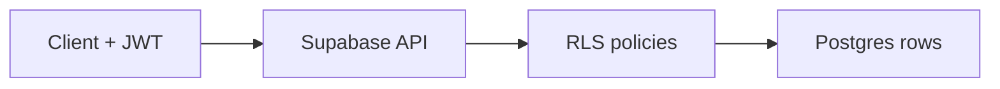
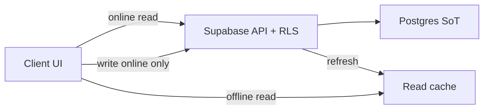

# Data and synchronization

## Source of truth

**PostgreSQL (Supabase)** is the only source of truth for user data. A local cache on the device is a UX optimization (speed / offline read), **not** a second truth. Decision: [ADR 0008](../decisions/0008-sync-strategy-online-first.md) (closes [OQ-03](../open-questions.md)).

Record identity: `user_id` = Supabase Auth account ([ADR 0007](../decisions/0007-auth-providers-minimum-pii.md)); isolation via RLS.

## Schema outline

Fuller domain model: [data-model](../domain/data-model.md). At the database level (direction):

| Area | Example tables | Notes |
|------|----------------|--------|
| Identity | `profiles` (optional, 1:1 with `auth.users`) | Minimum PII |
| Nutrition | `foods`, `food_entries` | Own products + intake entries; source = user catalog ([ADR 0009](../decisions/0009-food-data-source-own-first.md)) |
| Training | `exercises`, `workouts` / `sessions`, `sets` | Session history |
| Measurements | `measurements` | Weight and other metrics over time |
| Shared | `tags` (optional) | Cross-cutting labels |

All user tables have `user_id` (UUID → `auth.users`) and **RLS** policies: the user sees/edits only their rows. Shared web + mobile invariants (RLS / CHECK vs core/TS): [postgres-invariants](postgres-invariants.md).

## Row Level Security (RLS)

- The `anon` key in the client is OK — security rests on RLS + JWT, not on hiding the URL.
- The `service_role` key **never** in client apps or the public repo.
- New tables: SQL migration **together** with RLS policies (CI convention).

## Sync (MVP — ADR 0008)

Decision: **online-first + local read cache**. Details and alternatives: [ADR 0008](../decisions/0008-sync-strategy-online-first.md).

### Model

| Element | MVP | Later |
|---------|-----|--------|
| Source of truth | Postgres | unchanged |
| Read | Network + cache; offline → cache | optionally broader pre-fetch |
| Write / update / delete | Online only | Offline-write queue (separate ADR) |
| Conflicts | LWW per row (`updated_at`) — **one rule** for nutrition / training / measurements / `profiles` | Merge per entity type if LWW hurts |
| Realtime | Optional UI refresh | Still not the only sync engine |
| Tombstone / soft-delete | No (hard delete) | With offline-write |

### Offline behavior

- **Read:** show last cached data; empty cache → empty state + offline notice.
- **Write:** blocked with a message; **no** silent queue in MVP.
- **Session:** without a valid JWT, no access to protected data (see [auth](auth.md)).

### Clients

| Client | Data path | Cache |
|--------|-----------|--------|
| Android / iOS | KMP repositories → `supabase-kt` | Read cache in core (thin helper; not a full queue) |
| Web | `supabase-js` ([ADR 0006](../decisions/0006-web-supabase-js-without-kmp-js.md)) | Thin in-memory / browser storage cache; **no** parallel sync domain in TS |

Both paths write to the **same** Postgres under the same `user_id` — web↔mobile offline-write parity is **not** an MVP goal (ADR 0006 revisit criteria remain for later).

### Conflicts (MVP)

- **Rule:** last-write-wins on the **entire row** by `updated_at`.
- **Deliberately one rule** for all entity types at start — no separate food vs set vs measurement policies.
- No “resolve conflict” UI; with two online devices, the later write wins.
- Schema: every user table has `updated_at` (input to migration spec #6).

### Realtime

Supabase Realtime is an **option** after “hello sync” (live refresh when another device writes). Phase-2 baseline: request–response read/write + manual / lifecycle refresh is enough.

### Offline-write (beyond MVP)

When airplane-mode training/nutrition becomes a requirement: queue, idempotency, tombstones, conflict revisit (possible per-entity rules) — **new ADR**, not silent expansion of this document. Spec map: [offline-write-queue](../specs/offline-write-queue.md) ([#20](https://github.com/MarekBiolik/GymManager/issues/20)).

Read-cache / hello-sync contract (phase 2): [specs/hello-sync-read-cache.md](../specs/hello-sync-read-cache.md) ([#19](https://github.com/MarekBiolik/GymManager/issues/19)).

## Aggregations and history

A tracker with 1+ year of history (calories/day, weight trends, training volume) naturally uses **SQL** (views, `GROUP BY`, windows). That is one reason for choosing Postgres ([ADR 0002](../decisions/0002-backend-supabase.md)).

Heavy aggregations can be materialized later (e.g. daily sums) — not in iteration 1.

## Storage

Files (e.g. package photos / progress) → Supabase Storage + bucket RLS. Optional for now; file model when a module needs it.

## Migrations

- Directory `supabase/migrations/` (phase 1 — [#14](https://github.com/MarekBiolik/GymManager/issues/14) / [#21](https://github.com/MarekBiolik/GymManager/issues/21)).
- First migration content: [specs/first-migration-profiles-rls.md](../specs/first-migration-profiles-rls.md) ([#6](https://github.com/MarekBiolik/GymManager/issues/6); OQ-03 → [ADR 0008](../decisions/0008-sync-strategy-online-first.md)). Draft SQL in `docs/specs/sql/` = **NOT APPLIED**. Do not invent schema ad hoc in the scaffold PR (#14). Apply 1:1 → [#21](https://github.com/MarekBiolik/GymManager/issues/21).
- Every schema change = migration in a PR.
- No “manual” prod changes without a migration.

## Hosting and backups

Decision: [ADR 0004](../decisions/0004-supabase-hosting.md) (closes [OQ-05](../open-questions.md)).

### Hosting

| Element | At start | Upgrade path |
|---------|----------|--------------|
| Platform | **Supabase Cloud** | — |
| Plan | **Free** | **Pro** when: we need available daily backups, no project pause, more DB/storage, or data that cannot be reconstructed from memory |
| Self-host | No | Exit option (Postgres dump → other hosting), not an operational goal |

### Environments

| Environment | At start (phase 1) | After the split (before public beta) |
|-------------|--------------------|--------------------------------------|
| `local` | Optionally `supabase start` | Unchanged — offline migration work |
| `dev` | **One** Cloud project (scaffold + personal use) | Retired or **repurposed → staging** |
| `staging` | — | Separate Cloud project; first migration apply; Free OK |
| `prod` | — | Separate Cloud project; promote after staging smoke; **Pro** per criteria |

Free: max 2 active projects; pause after ~1 week idle — unpause before work. After the split we do not keep three active Free projects as the norm.

**When / naming / staging → prod migrations / Pro criteria:** [environment-split spec](../specs/supabase-staging-prod-split.md) ([#10](https://github.com/MarekBiolik/GymManager/issues/10)).

### Secrets

| Secret | Allowed where | Forbidden where |
|--------|---------------|-----------------|
| Project URL + `anon` | Clients, local `.env*` | Committing is not an “RLS leak”, but we **do not** commit `.env*` — URL/keys **per environment** stay out of git |
| `service_role` | Local admin only / trusted job; GitHub Secrets / **Environments** in CI | Client apps, public repo, CI logs |
| OAuth client secrets (Google/Apple) | Supabase Auth dashboard + (when needed) GitHub Secrets / Environments | Repo, clients |

Rules:

1. `.env`, `.env.local`, `.env.*.local` — in `.gitignore` (already on `master`).
2. In docs and PRs: placeholders (`YOUR_PROJECT_URL`), never real values.
3. CI: GitHub Secrets; after the split — **GitHub Environments** (`staging`, `production`) with separate `SUPABASE_URL` / `anon` / `service_role` — [ci-cd](../conventions/ci-cd.md), [split spec](../specs/supabase-staging-prod-split.md).
4. No secrets in build logs.

### Backup / restore policy

**Free (current plan):**

- The dashboard does **not** expose automatic daily backups for restore (that is Pro+).
- **Periodic logical dump** outside Cloud: `supabase db dump` (or equivalent `pg_dump`) — minimum before a risky migration and regularly when `dev` holds data worth recovering.
- Dump + migration files in git = schema recovery path; dump with data = content recovery.
- After Free pause: unpause in the dashboard; project data remains, but without our own dumps we have no independent copy.

**After upgrade to Pro:**

- Daily backups (7-day retention) in Dashboard → Database → Backups.
- PITR (add-on) only when RPO < ~1 day becomes a requirement.

**Restore (scaffold level):**

1. Prefer restore via schema from `supabase/migrations/` + reload data from dump.
2. On Pro: restore from daily backup in the dashboard per Supabase docs.
3. Restore drill (practice on an empty / local project) — [runbook](../runbooks/supabase-dump-restore.md) ([#9](https://github.com/MarekBiolik/GymManager/issues/9)); does not block the hosting decision.
4. `staging` / `prod` split — **spec:** [supabase-staging-prod-split](../specs/supabase-staging-prod-split.md) ([#10](https://github.com/MarekBiolik/GymManager/issues/10)); project provisioning = separate ticket before public beta.

### Exit path

Data in standard Postgres → SQL export / dump → another Postgres or self-hosted Supabase. Supabase Auth/API is a rewrite layer on full exit; the data model itself is not locked in a proprietary store.
