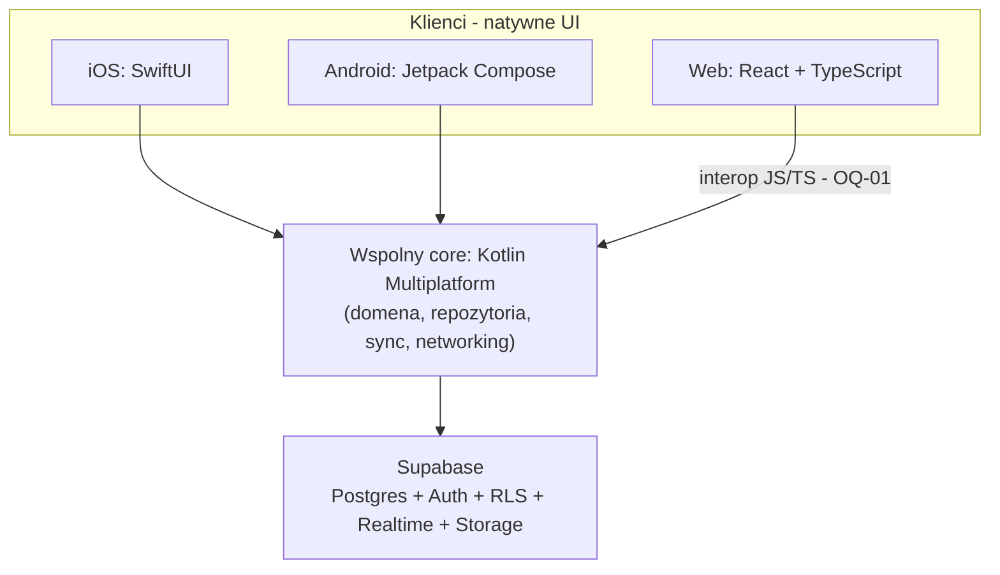

# Architektura — przegląd

## Idea w jednym zdaniu

Wspólny **core domenowy** (Kotlin Multiplatform) + **natywne UI** na iOS, Android i web + **Supabase** jako backend (Postgres, Auth, RLS, Realtime, Storage).

## Diagram



## Warstwy

| Warstwa | Odpowiedzialność | Nie robi |
|---------|------------------|----------|
| UI (per platforma) | Prezentacja, nawigacja, input, platformowe API (kamera, powiadomienia) | Reguł biznesowych, SQL, polityki auth |
| Core (KMP) | Model domenowy, use-case'y, repozytoria, sync, walidacje | Widgetów UI, layoutu |
| Supabase | Persistencja, Auth, izolacja RLS, Realtime, pliki | Logiki UI |

Granica core ↔ UI opisana w [shared-core](shared-core.md). Konsumowanie core przez klientów: [clients](clients.md).

## Docelowa struktura repozytorium

```
GymManager/
  core/                 # Kotlin Multiplatform
  apps/
    ios/                # SwiftUI
    android/            # Jetpack Compose
    web/                # React + TS (Vite)
  supabase/             # migracje, RLS, config
  docs/                 # ta dokumentacja
```

Scaffolding katalogów kodu — **faza 1** (roadmap). Iteracja 1 tworzy tylko `docs/`.

## Zasady architektoniczne

1. **Jedna prawda domenowa** — reguły biznesowe żyją w core (lub w Postgres/RLS tam, gdzie izolacja danych), nie w trzech UI.
2. **Cienkie UI** — klienci renderują i delegują; nie duplikują zapytań „na skróty”, chyba że OQ-01 świadomie zezwoli na wyjątek web.
3. **RLS first** — izolacja danych użytkownika na poziomie bazy, nie „ufamy klientowi”.
4. **Dokumentacja przed głębokim kodem** — nowe decyzje → ADR.
5. **AI później** — żadnych założeń AI w core/infra teraz.

## Powiązane dokumenty

- [Tech stack](tech-stack.md)
- [Shared core](shared-core.md)
- [Klienci](clients.md)
- [Dane i sync](data-and-sync.md)
- [Auth](auth.md)
- ADR: [0001](../decisions/0001-shared-core-kmp.md), [0002](../decisions/0002-backend-supabase.md), [0003](../decisions/0003-native-ui-per-platform.md)
