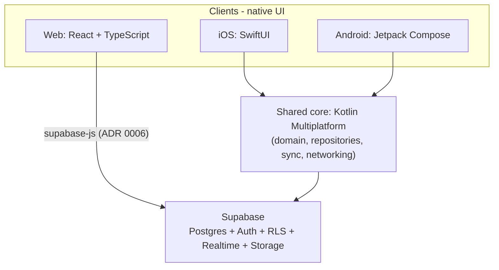

# Architecture — overview

## Idea in one sentence

Shared **domain core** (Kotlin Multiplatform) + **native UI** on iOS, Android, and web + **Supabase** as the backend (Postgres, Auth, RLS, Realtime, Storage).

## Diagram



## Layers

| Layer | Responsibility | Does not do |
|-------|----------------|-------------|
| UI (per platform) | Presentation, navigation, input, platform APIs (camera, notifications) | Business rules, SQL, auth policy |
| Core (KMP) | Domain model, use cases, repositories, sync, validation | UI widgets, layout |
| Supabase | Persistence, Auth, RLS isolation, Realtime, files | UI logic |

The core ↔ UI boundary is in [shared-core](shared-core.md). How clients consume core: [clients](clients.md). Web without a KMP binary: [ADR 0006](../decisions/0006-web-supabase-js-without-kmp-js.md).

## Target repository layout

Tooling / layout / versioning decision: [ADR 0005](../decisions/0005-monorepo-tooling.md).

```
GymManager/
  settings.gradle.kts   # Gradle multi-project: :core, :apps:android, …
  gradle/               # wrapper
  package.json          # root scripts (pnpm) — orchestration, not logic
  pnpm-workspace.yaml   # apps/web (+ optional TS packages later)
  scripts/              # thin CI/dev scripts (optional)
  core/                 # KMP: domain, use cases, data, sync
  apps/
    ios/                # Xcode + SwiftUI; consumes framework from core
    android/            # Jetpack Compose; Gradle dependency on :core
    web/                # React + TS + Vite (pnpm); supabase-js — ADR 0006
  supabase/             # SQL migrations, RLS, CLI config
  design/               # design-token SSOT + generator (ADR 0010)
  docs/                 # documentation and ADRs (decision source of truth)
```

### Top-level ownership

| Path | Responsibility | Build |
|------|----------------|-------|
| `core/` | Shared logic; **no** UI | Gradle (KMP) |
| `apps/android/` | Compose UI + Android wiring | Gradle (same root) |
| `apps/ios/` | SwiftUI + iOS wiring | Xcode; framework from Gradle/KMP |
| `apps/web/` | React/TS UI; Supabase via `supabase-js` (no KMP-JS) | pnpm / Vite |
| `supabase/` | Schema, RLS, local/linked project | Supabase CLI |
| `design/` | Token SSOT + generator → native theme outputs ([ADR 0010](../decisions/0010-design-tokens-ssot.md)) | Node (thin generator) |
| `docs/` | Vision, architecture, ADRs, conventions | — |
| Root scripts | `build` / `test` / `lint` across toolchains | pnpm / shell |

We do **not** introduce Nx/Turborepo at the start. Code-directory scaffolding is **phase 1** ([#14](https://github.com/MarekBiolik/GymManager/issues/14), [ADR 0005](../decisions/0005-monorepo-tooling.md)); this document describes the target layout.

## Architectural principles

1. **One domain truth** — business rules live in core (or in Postgres/RLS where isolation / shared invariants require it), not in three UIs. DB vs core/TS split: [postgres-invariants](postgres-invariants.md).
2. **Thin UI** — clients render and delegate; web may call Supabase via `supabase-js` without a KMP binary ([ADR 0006](../decisions/0006-web-supabase-js-without-kmp-js.md)), but **without** a parallel TS domain.
3. **RLS first** — user data isolation at the database, not “trust the client”.
4. **Docs before deep code** — new decisions → ADR.
5. **AI later** — no AI assumptions in core/infra now.

## Related documents

- [Tech stack](tech-stack.md)
- [Shared core](shared-core.md)
- [Clients](clients.md)
- [Data and sync](data-and-sync.md)
- [Shared Postgres invariants](postgres-invariants.md)
- [Auth](auth.md)
- ADRs: [0001](../decisions/0001-shared-core-kmp.md), [0002](../decisions/0002-backend-supabase.md), [0003](../decisions/0003-native-ui-per-platform.md), [0004](../decisions/0004-supabase-hosting.md), [0005](../decisions/0005-monorepo-tooling.md), [0006](../decisions/0006-web-supabase-js-without-kmp-js.md)
