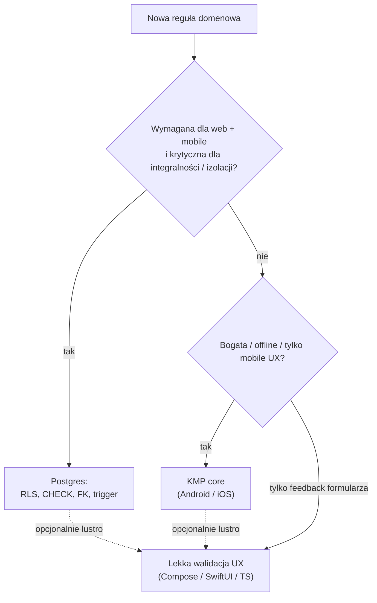

# Wspólne niezmienniki Postgres (web + mobile)

Konwencja operacyjna po [ADR 0006](../decisions/0006-web-supabase-js-without-kmp-js.md): web (`supabase-js`) i mobile (KMP `core`) **nie** dzielą binary domeny. Reguły, które muszą być prawdziwe dla **obu** klientów, egzekwujemy w **Postgres** (RLS, CHECK, FK, ewentualnie trigger) — nie przez równoległą domenę TypeScript.

To **nie** jest nowy ADR: decyzja „wspólne niezmienniki → DB” jest w ADR 0006. Tu: gdzie stawiać regułę, przykłady i checklista migracji (faza 1–2).

Zarys tabel: [data-model](../domain/data-model.md). Sync / SoT: [data-and-sync](data-and-sync.md), [ADR 0008](../decisions/0008-sync-strategy-online-first.md). **Brak** założenia KMP→JS/Wasm.

## Zasada w jednym zdaniu

| Pytanie | Odpowiedź |
|---------|-----------|
| Czy reguła musi bronić **bezpieczeństwa / integralności** także gdy klient jest złośliwy lub buggy? | **Postgres** (RLS / constraint / trigger) |
| Czy reguła jest bogata, kontekstowa albo potrzebna **przed** round-tripem (mobile UX, offline-read)? | **KMP core** (Android / iOS); na webie **nie** reimplementuj jako „domain services” |
| Czy to tylko komunikat formularza przed submit? | Lekka walidacja UX w UI / cienkiej TS — **lustrzana** względem DB lub core, nigdy jedyne źródło prawdy |



## Co MUSI żyć w Postgres

Egzekwowane przez bazę niezależnie od klienta (`supabase-js` lub `supabase-kt`). Migracja SQL = źródło prawdy schematu.

### 1. Izolacja `user_id` (RLS) — zawsze

Każda tabela użytkownika:

- kolumna `user_id` (UUID → `auth.users` / `profiles.id` — jak w [data-model](../domain/data-model.md)),
- `ENABLE ROW LEVEL SECURITY`,
- polityki **SELECT / INSERT / UPDATE / DELETE** w **tej samej** migracji co `CREATE TABLE` ([coding-standards](../conventions/coding-standards.md)).

Wzorzec (kierunek; dokładny SQL w specu migracji [#6](https://github.com/MarekBiolik/GymManager/issues/6)):

```sql
-- przykład polityki (szkic)
CREATE POLICY food_entries_select_own ON food_entries
  FOR SELECT USING (auth.uid() = user_id);

CREATE POLICY food_entries_insert_own ON food_entries
  FOR INSERT WITH CHECK (auth.uid() = user_id);

CREATE POLICY food_entries_update_own ON food_entries
  FOR UPDATE USING (auth.uid() = user_id)
  WITH CHECK (auth.uid() = user_id);

CREATE POLICY food_entries_delete_own ON food_entries
  FOR DELETE USING (auth.uid() = user_id);
```

**Nie** polegamy na tym, że TS lub Kotlin „zawsze ustawi `user_id` poprawnie”. Klient może wysłać cudzy UUID — RLS musi odrzucić.

### 2. Integralność wiersza (CHECK / NOT NULL / FK)

Proste, lokalne reguły kształtu danych — wspólne dla web i mobile:

| Rodzaj | Przykład | Mechanizm |
|--------|----------|-----------|
| Wymagane pola | `name` niepuste, `metric` niepusty | `NOT NULL` |
| Zakres liczb | `value > 0`, `amount > 0`, `reps >= 0`, `weight >= 0` | `CHECK` |
| Enum-y stabilne | `metric IN (...)` albo osobna tabela słownika | `CHECK` lub FK |
| Spójność czasów | `ended_at IS NULL OR ended_at >= started_at` | `CHECK` |
| Ownership referencji | `food_entries.food_id` → `foods` tego samego usera | FK + (gdy potrzeba) trigger / policy |
| Sync MVP | `created_at`, `updated_at` timestamptz | kolumny + trigger `updated_at` lub jawny SET ([ADR 0008](../decisions/0008-sync-strategy-online-first.md)) |

### 3. Trigger — tylko gdy constraint nie wystarczy

Używaj triggera, gdy:

- trzeba **wymusić** `updated_at = now()` przy UPDATE (jedna ścieżka dla obu klientów),
- trzeba zablokować zmianę `user_id` po INSERT,
- ownership cross-table nie da się wyrazić samym FK (np. `sets.session_id` musi należeć do tego samego `user_id`).

Unikaj triggerów z bogatą logiką biznesową („kompletność sesji”, polityki żywieniowe) — to kandydat do KMP albo późniejszego SQL widoku/agregacji, nie ukrytej domeny w PL/pgSQL na dzień 1.

## Co może żyć poza Postgres

### KMP `core` (Android / iOS)

- Use-case’y, orkiestracja repozytoriów, mapowanie DTO ↔ domena.
- Walidacje bogate / wielo-krokowe (np. „sesja kompletna”, reguły agregacji przed zapisem wielu wierszy).
- Cache odczytu / invalidacja ([ADR 0008](../decisions/0008-sync-strategy-online-first.md); kontrakt: [hello-sync-read-cache](../specs/hello-sync-read-cache.md)) — **nie** druga SoT.
- Komunikaty błędów domenowych pod UI natywne.

Core **nie** zastępuje RLS. Nawet poprawny core musi pisać przez JWT + RLS.

### Cienka warstwa web (TS)

**Wolno:** routing, stan UI, typy ze schematu, mapowanie wierszy → widok, lekka walidacja formularza lustrzana względem CHECK/RLS.

**Nie wolno:** pakietu „domain services” równoległego do core; traktowania walidacji tylko-w-TS jako security boundary; omijania RLS ([clients](clients.md), [ADR 0006](../decisions/0006-web-supabase-js-without-kmp-js.md)).

### UI (wszystkie platformy)

Formatowanie, jednostki prezentacyjne, disable przycisku zapisu offline (MVP), lokalne drafty formularza **przed** submit — bez trwałego commit poza Postgres w MVP.

## Przykłady: `food_entries` i `measurements`

Encje jak w [data-model](../domain/data-model.md). Poniżej **podział odpowiedzialności**, nie finalny SQL (ten idzie do [#6](https://github.com/MarekBiolik/GymManager/issues/6) / migracji modułów).

### `food_entries`

| Reguła | Gdzie | Dlaczego |
|--------|-------|----------|
| Wiersz widoczny/edytowalny tylko dla właściciela | **RLS** na `user_id` | Krytyczne web + mobile; klient niezaufany |
| `amount > 0` (lub `>= 0` jeśli dozwolone zero) | **CHECK** | Prosty niezmiennik wspólny |
| `eaten_at` NOT NULL | **NOT NULL** | Integralność historii |
| Snapshot makro w momencie wpisu (kolumny NOT NULL wg decyzji migracji) | **schemat + CHECK** zakresów (≥ 0) | Oba klienty muszą zapisać spójny snapshot |
| `food_id` NULL albo wskazuje `foods` tego usera | **FK** + RLS na `foods`; ewent. trigger ownership | Zapobiega podpięciu cudzego produktu |
| Komunikat „podaj ilość” przed submit | UX (Compose / SwiftUI / TS) | Lustro CHECK; nie jedyna ochrona |
| Policzenie „czy dzień jest kompletny żywieniowo” | **Nie w DB na start**; ewent. później widok SQL / use-case core | Reguła produktowa, nie security |

### `measurements`

| Reguła | Gdzie | Dlaczego |
|--------|-------|----------|
| Izolacja per user | **RLS** | Jak wyżej |
| `value > 0` | **CHECK** | Wspólny niezmiennik |
| `metric` z dozwolonego zbioru (`body_weight_kg`, `waist_cm`, …) | **CHECK** lub FK do słownika | Ten sam zestaw na web i mobile bez duplikacji enumów w TS+Kotlin jako SoT |
| `measured_at` NOT NULL | **NOT NULL** | Oś czasu pomiarów |
| Formatowanie `kg` vs `lb` w UI | UI / preferencje `profiles` | Prezentacja; kanoniczna wartość w DB w uzgodnionej jednostce |
| Trend / rolling average | Zapytanie SQL / widok (później); nie logika tylko-w-TS | SoT = Postgres ([data-and-sync](data-and-sync.md)) |

### Wzorzec dla kolejnych tabel (`sets`, `sessions`, …)

1. RLS + `user_id` w tej samej migracji.
2. CHECK/NOT NULL dla lokalnych niezmienników liczbowych i czasowych.
3. Ownership FK / trigger, jeśli dziecko musi należeć do tego samego usera co rodzic.
4. Bogate reguły sesji treningowej → KMP; na webie tylko to, co już broni DB, plus lustro UX.

## Checklista migracji (faza 1–2)

Przy każdej nowej tabeli użytkownika w `supabase/migrations/` (i w [specu pierwszej migracji](../specs/first-migration-profiles-rls.md) / [#6](https://github.com/MarekBiolik/GymManager/issues/6)):

- [ ] `user_id` (lub `profiles.id` 1:1) + FK do Auth / profiles
- [ ] `created_at`, `updated_at` timestamptz ([ADR 0008](../decisions/0008-sync-strategy-online-first.md))
- [ ] RLS włączone + 4 polityki (select/insert/update/delete) lub równoważny zestaw
- [ ] INSERT `WITH CHECK` wymusza `auth.uid() = user_id` (brak „ufamy body”)
- [ ] UPDATE nie pozwala zmienić właściciela (`USING` + `WITH CHECK`)
- [ ] CHECK / NOT NULL dla prostych niezmienników z tej noty / data-model
- [ ] Indeksy startowe pod typowe zapytania (`(user_id, eaten_at)`, `(user_id, measured_at)`, …)
- [ ] Brak założenia, że web dostanie walidację z KMP — jeśli reguła jest wspólna i krytyczna, jest w SQL
- [ ] Opis w PR migracji: które reguły są w DB, które świadomie tylko w core (jeśli jakieś)

## Antywzorce

1. **Domena TS równoległa do core** — agregacje biznesowe, polityki żywieniowe, „kompletność sesji” tylko w `apps/web`.
2. **Walidacja tylko w kliencie** — CHECK pominięty, bo „formularz i tak pilnuje”.
3. **RLS „na później”** — tabela bez polityk w pierwszej migracji.
4. **Ukryte założenie KMP-JS** — scaffold lub docs sugerujące, że web „dostanie core za darmo” bez revisit ADR 0006.
5. **Trigger zamiast CHECK** — gdy wystarczy prosty warunek wiersza.

## Powiązane

- [ADR 0006](../decisions/0006-web-supabase-js-without-kmp-js.md) — decyzja web bez KMP-JS; preferencja Postgres dla wspólnych niezmienników
- [clients](clients.md), [shared-core](shared-core.md), [data-and-sync](data-and-sync.md)
- [data-model](../domain/data-model.md), [coding-standards](../conventions/coding-standards.md) (SQL)
- Spec pierwszej migracji: [first-migration-profiles-rls](../specs/first-migration-profiles-rls.md) ([#6](https://github.com/MarekBiolik/GymManager/issues/6))
- Apply SQL: [#21](https://github.com/MarekBiolik/GymManager/issues/21)
