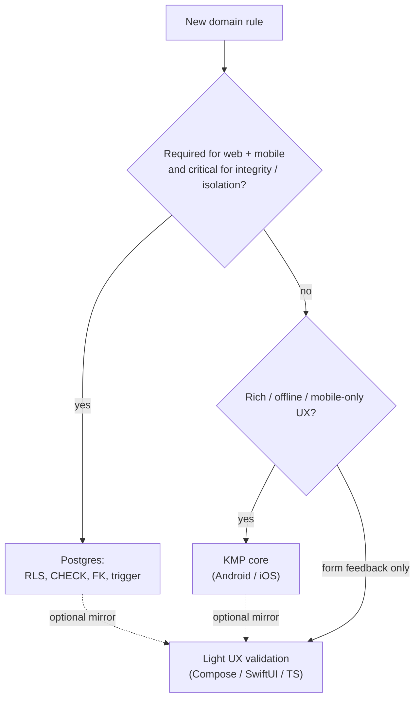

# Shared Postgres invariants (web + mobile)

Operational convention after [ADR 0006](../decisions/0006-web-supabase-js-without-kmp-js.md): web (`supabase-js`) and mobile (KMP `core`) do **not** share a domain binary. Rules that must hold for **both** clients are enforced in **Postgres** (RLS, CHECK, FK, optionally trigger) — not via a parallel TypeScript domain.

This is **not** a new ADR: the “shared invariants → DB” decision is in ADR 0006. Here: where to place a rule, examples, and a migration checklist (phases 1–2).

Table outline: [data-model](../domain/data-model.md). Sync / SoT: [data-and-sync](data-and-sync.md), [ADR 0008](../decisions/0008-sync-strategy-online-first.md). **No** assumption of KMP→JS/Wasm.

## Rule in one sentence

| Question | Answer |
|----------|--------|
| Must the rule defend **security / integrity** even when the client is malicious or buggy? | **Postgres** (RLS / constraint / trigger) |
| Is the rule rich, contextual, or needed **before** a round-trip (mobile UX, offline-read)? | **KMP core** (Android / iOS); on web **do not** reimplement as “domain services” |
| Is it only a form message before submit? | Light UX validation in UI / thin TS — **mirroring** DB or core, never the sole source of truth |



## What MUST live in Postgres

Enforced by the database regardless of client (`supabase-js` or `supabase-kt`). SQL migration = schema source of truth.

### 1. `user_id` isolation (RLS) — always

Every user table:

- `user_id` column (UUID → `auth.users` / `profiles.id` — as in [data-model](../domain/data-model.md)),
- `ENABLE ROW LEVEL SECURITY`,
- **SELECT / INSERT / UPDATE / DELETE** policies in the **same** migration as `CREATE TABLE` ([coding-standards](../conventions/coding-standards.md)).

Pattern (direction; exact SQL in migration spec [#6](https://github.com/MarekBiolik/GymManager/issues/6)):

```sql
-- example policy (sketch)
CREATE POLICY food_entries_select_own ON food_entries
  FOR SELECT USING (auth.uid() = user_id);

CREATE POLICY food_entries_insert_own ON food_entries
  FOR INSERT WITH CHECK (auth.uid() = user_id);

CREATE POLICY food_entries_update_own ON food_entries
  FOR UPDATE USING (auth.uid() = user_id)
  WITH CHECK (auth.uid() = user_id);

CREATE POLICY food_entries_delete_own ON food_entries
  FOR DELETE USING (auth.uid() = user_id);
```

We do **not** rely on TS or Kotlin “always setting `user_id` correctly”. The client may send someone else’s UUID — RLS must reject it.

### 2. Row integrity (CHECK / NOT NULL / FK)

Simple, local data-shape rules — shared for web and mobile:

| Kind | Example | Mechanism |
|------|---------|-----------|
| Required fields | non-empty `name`, non-empty `metric` | `NOT NULL` |
| Numeric range | `value > 0`, `amount > 0`, `reps >= 0`, `weight >= 0` | `CHECK` |
| Stable enums | `metric IN (...)` or a dictionary table | `CHECK` or FK |
| Time consistency | `ended_at IS NULL OR ended_at >= started_at` | `CHECK` |
| Reference ownership | `food_entries.food_id` → same user’s `foods` | FK + (when needed) trigger / policy |
| Sync MVP | `created_at`, `updated_at` timestamptz | columns + `updated_at` trigger or explicit SET ([ADR 0008](../decisions/0008-sync-strategy-online-first.md)) |

### 3. Trigger — only when a constraint is not enough

Use a trigger when:

- you must **force** `updated_at = now()` on UPDATE (one path for both clients),
- you must block changing `user_id` after INSERT,
- cross-table ownership cannot be expressed with FK alone (e.g. `sets.session_id` must belong to the same `user_id`).

Avoid triggers with rich business logic (“session completeness”, nutrition policies) — candidates for KMP or a later SQL view/aggregation, not a hidden PL/pgSQL domain on day 1.

## What may live outside Postgres

### KMP `core` (Android / iOS)

- Use cases, repository orchestration, DTO ↔ domain mapping.
- Rich / multi-step validation (e.g. “session complete”, aggregation rules before writing many rows).
- Read cache / invalidation ([ADR 0008](../decisions/0008-sync-strategy-online-first.md); contract: [hello-sync-read-cache](../specs/hello-sync-read-cache.md)) — **not** a second SoT.
- Domain error messages for native UI.

Core does **not** replace RLS. Even correct core must write through JWT + RLS.

### Thin web layer (TS)

**Allowed:** routing, UI state, schema types, row → view mapping, light form validation mirroring CHECK/RLS.

**Not allowed:** a “domain services” package parallel to core; treating TS-only validation as a security boundary; bypassing RLS ([clients](clients.md), [ADR 0006](../decisions/0006-web-supabase-js-without-kmp-js.md)).

### UI (all platforms)

Formatting, presentation units, disable write button offline (MVP), local form drafts **before** submit — without durable commit outside Postgres in MVP.

## Examples: `food_entries` and `measurements`

Entities as in [data-model](../domain/data-model.md). Below is a **responsibility split**, not final SQL (that goes to [#6](https://github.com/MarekBiolik/GymManager/issues/6) / module migrations).

### `food_entries`

| Rule | Where | Why |
|------|-------|-----|
| Row visible/editable only by owner | **RLS** on `user_id` | Critical for web + mobile; untrusted client |
| `amount > 0` (or `>= 0` if zero allowed) | **CHECK** | Simple shared invariant |
| `eaten_at` NOT NULL | **NOT NULL** | History integrity |
| Macro snapshot at entry time (NOT NULL columns per migration decision) | **schema + CHECK** ranges (≥ 0) | Both clients must write a coherent snapshot |
| `food_id` NULL or points to same user’s `foods` | **FK** + RLS on `foods`; optionally ownership trigger | Prevents attaching someone else’s product |
| “Enter amount” message before submit | UX (Compose / SwiftUI / TS) | Mirrors CHECK; not the only protection |
| “Is the nutrition day complete?” | **Not in DB at start**; optionally later SQL view / core use case | Product rule, not security |

### `measurements`

| Rule | Where | Why |
|------|-------|-----|
| Per-user isolation | **RLS** | As above |
| `value > 0` | **CHECK** | Shared invariant |
| `metric` from allowed set (`body_weight_kg`, `waist_cm`, …) | **CHECK** or FK to dictionary | Same set on web and mobile without TS+Kotlin enums as SoT |
| `measured_at` NOT NULL | **NOT NULL** | Measurement timeline |
| `kg` vs `lb` formatting in UI | UI / `profiles` preferences | Presentation; canonical DB value in agreed unit |
| Trend / rolling average | SQL query / view (later); not TS-only logic | SoT = Postgres ([data-and-sync](data-and-sync.md)) |

### Pattern for later tables (`sets`, `sessions`, …)

1. RLS + `user_id` in the same migration.
2. CHECK/NOT NULL for local numeric and time invariants.
3. Ownership FK / trigger if a child must belong to the same user as the parent.
4. Rich training-session rules → KMP; on web only what DB already defends, plus UX mirror.

## Migration checklist (phases 1–2)

For every new user table in `supabase/migrations/` (and in the [first migration spec](../specs/first-migration-profiles-rls.md) / [#6](https://github.com/MarekBiolik/GymManager/issues/6)):

- [ ] `user_id` (or 1:1 `profiles.id`) + FK to Auth / profiles
- [ ] `created_at`, `updated_at` timestamptz ([ADR 0008](../decisions/0008-sync-strategy-online-first.md))
- [ ] RLS enabled + 4 policies (select/insert/update/delete) or equivalent set
- [ ] INSERT `WITH CHECK` forces `auth.uid() = user_id` (no “trust the body”)
- [ ] UPDATE does not allow changing owner (`USING` + `WITH CHECK`)
- [ ] CHECK / NOT NULL for simple invariants from this note / data-model
- [ ] Starting indexes for typical queries (`(user_id, eaten_at)`, `(user_id, measured_at)`, …)
- [ ] No assumption that web gets validation from KMP — if a rule is shared and critical, it is in SQL
- [ ] PR description: which rules are in DB, which deliberately only in core (if any)

## Anti-patterns

1. **TS domain parallel to core** — business aggregations, nutrition policies, “session completeness” only in `apps/web`.
2. **Client-only validation** — CHECK skipped because “the form already guards it”.
3. **RLS “later”** — table without policies in the first migration.
4. **Hidden KMP-JS assumption** — scaffold or docs suggesting web “gets core for free” without revisiting ADR 0006.
5. **Trigger instead of CHECK** — when a simple row condition would suffice.

## Related

- [ADR 0006](../decisions/0006-web-supabase-js-without-kmp-js.md) — web without KMP-JS; prefer Postgres for shared invariants
- [clients](clients.md), [shared-core](shared-core.md), [data-and-sync](data-and-sync.md)
- [data-model](../domain/data-model.md), [coding-standards](../conventions/coding-standards.md) (SQL)
- First migration spec: [first-migration-profiles-rls](../specs/first-migration-profiles-rls.md) ([#6](https://github.com/MarekBiolik/GymManager/issues/6))
- Apply SQL: [#21](https://github.com/MarekBiolik/GymManager/issues/21)
