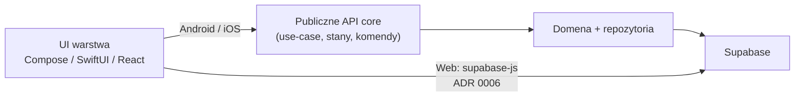

# Wspólny core (Kotlin Multiplatform)

## Rola

`core` to jedyne miejsce na:

- model domenowy (encje, value objects, reguły),
- use-case'y / serwisy aplikacyjne,
- kontrakty repozytoriów i ich implementacje wobec Supabase,
- logikę sync / mapowanie DTO ↔ domena,
- walidacje niezależne od UI.

Core **nie** zawiera widgetów, kolorów, nawigacji ani layoutu.

Na **webie** (dzień 1) core **nie** jest linkowany jako binary — patrz [ADR 0006](../decisions/0006-web-supabase-js-without-kmp-js.md). Wspólne niezmienniki krytyczne dla web + mobile egzekwuj w Postgres (RLS / CHECK), nie przez ukrytą duplikację w TS — konwencja i checklista: [postgres-invariants](postgres-invariants.md).

## Targety kompilacji (zamierzone)

| Target | Konsumowany przez |
|--------|-------------------|
| Android (JVM/Android) | `apps/android` |
| iOS (framework / XCFramework) | `apps/ios` (Swift) |
| JS / Wasm | **nie w scope dnia 1** — web używa `supabase-js` ([ADR 0006](../decisions/0006-web-supabase-js-without-kmp-js.md)); target możliwy dopiero po revisit |

Android i iOS są ścieżką „pewną”. Web **nie** jest automatycznym konsumentem binary core.

## Granica (seam) core ↔ UI



**UI może:**

- wywoływać publiczne API core (komendy, zapytania, obserwacja stanu) — **Android / iOS**,
- na **webie**: wołać Supabase przez `supabase-js` zgodnie z [ADR 0006](../decisions/0006-web-supabase-js-without-kmp-js.md) (bez binary KMP),
- mapować stan / wiersze na widoki,
- obsługiwać platformowe uprawnienia i nawigację.

**UI nie powinno:**

- omijać RLS ani używać `service_role` w kliencie,
- zawierać reguł typu „jak liczyć makro dnia” czy „kiedy sesja jest kompletna” (także w TS na webie),
- budować równoległej „domeny” poza core (mobile) / poza uzgodnionymi constraintami DB (web),
- znać zbędnych szczegółów schematu poza kontraktem potrzebnym do mapowania UI.

## Proponowany podział pakietów (zarys, faza 1)

```
core/
  domain/          # encje, reguły, błędy domenowe
  application/     # use-case'y, porty
  data/            # implementacje repo, DTO, supabase client
  sync/            # cache odczytu / invalidacja (MVP ADR 0008; kontrakt: specs/hello-sync-read-cache.md); kolejka offline-write później
```

Moduł Gradle: pojedynczy `:core` w multi-project root (ew. późniejszy split na `:core:domain` / `:core:data` dopiero gdy zysk > koszt). Integracja i wersjonowanie: [ADR 0005](../decisions/0005-monorepo-tooling.md). Scaffold **nie** dodaje targetu JS/Wasm, dopóki ADR 0006 nie zostanie zrevisited.

## Testowanie

Core jest **głównym miejscem testów jednostkowych** — reguły domenowe i use-case'y bez UI. Patrz [testing](../conventions/testing.md).

## Decyzja

Uzasadnienie wyboru KMP: [ADR 0001](../decisions/0001-shared-core-kmp.md).  
Interop web (bez KMP-JS na start): [ADR 0006](../decisions/0006-web-supabase-js-without-kmp-js.md).
