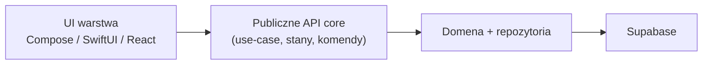

# Wspólny core (Kotlin Multiplatform)

## Rola

`core` to jedyne miejsce na:

- model domenowy (encje, value objects, reguły),
- use-case'y / serwisy aplikacyjne,
- kontrakty repozytoriów i ich implementacje wobec Supabase,
- logikę sync / mapowanie DTO ↔ domena,
- walidacje niezależne od UI.

Core **nie** zawiera widgetów, kolorów, nawigacji ani layoutu.

## Targety kompilacji (zamierzone)

| Target | Konsumowany przez |
|--------|-------------------|
| Android (JVM/Android) | `apps/android` |
| iOS (framework / XCFramework) | `apps/ios` (Swift) |
| JS / Wasm | `apps/web` — **warunkowo**, patrz [OQ-01](../open-questions.md) |

Android i iOS są ścieżką „pewną”. Web jest otwartym ryzykiem interop.

## Granica (seam) core ↔ UI



**UI może:**

- wywoływać publiczne API core (komendy, zapytania, obserwacja stanu),
- mapować stan domenowy na widoki,
- obsługiwać platformowe uprawnienia i nawigację.

**UI nie powinno:**

- pisać SQL / wołać Supabase z pominięciem polityki projektu (wyjątek web możliwy dopiero po zamknięciu OQ-01),
- zawierać reguł typu „jak liczyć makro dnia” czy „kiedy sesja jest kompletna”,
- znać szczegółów RLS / schematu tabel.

## Proponowany podział pakietów (zarys, faza 1)

```
core/
  domain/          # encje, reguły, błędy domenowe
  application/     # use-case'y, porty
  data/            # implementacje repo, DTO, supabase client
  sync/            # kolejka offline, reconciler (po OQ-03)
```

Nazwy i moduły Gradle — do ustalenia przy scaffoldingu (OQ-04).

## Testowanie

Core jest **głównym miejscem testów jednostkowych** — reguły domenowe i use-case'y bez UI. Patrz [testing](../conventions/testing.md).

## Decyzja

Uzasadnienie wyboru KMP: [ADR 0001](../decisions/0001-shared-core-kmp.md).
