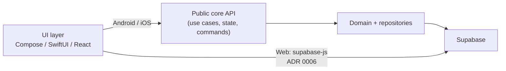

# Shared core (Kotlin Multiplatform)

## Role

`core` is the only place for:

- domain model (entities, value objects, rules),
- use cases / application services,
- repository contracts and their Supabase implementations,
- sync logic / DTO ↔ domain mapping,
- UI-independent validation.

Core does **not** contain widgets, colors, navigation, or layout.

On **web** (day 1) core is **not** linked as a binary — see [ADR 0006](../decisions/0006-web-supabase-js-without-kmp-js.md). Shared invariants critical for web + mobile are enforced in Postgres (RLS / CHECK), not via hidden TS duplication — convention and checklist: [postgres-invariants](postgres-invariants.md).

## Compilation targets (intended)

| Target | Consumed by |
|--------|-------------|
| Android (JVM/Android) | `apps/android` |
| iOS (framework / XCFramework) | `apps/ios` (Swift) |
| JS / Wasm | **not in day-1 scope** — web uses `supabase-js` ([ADR 0006](../decisions/0006-web-supabase-js-without-kmp-js.md)); target only after revisit |

Android and iOS are the “sure” path. Web is **not** an automatic consumer of the core binary.

## Seam: core ↔ UI



**UI may:**

- call the public core API (commands, queries, state observation) — **Android / iOS**,
- on **web**: call Supabase via `supabase-js` per [ADR 0006](../decisions/0006-web-supabase-js-without-kmp-js.md) (no KMP binary),
- map state / rows to views,
- handle platform permissions and navigation.

**UI should not:**

- bypass RLS or use `service_role` in the client,
- contain rules like “how to compute day macros” or “when a session is complete” (including in TS on web),
- build a parallel “domain” outside core (mobile) / outside agreed DB constraints (web),
- know unnecessary schema details beyond the contract needed for UI mapping.

## Proposed package split (outline, phase 1)

```
core/
  domain/          # entities, rules, domain errors
  application/     # use cases, ports
  data/            # repo implementations, DTOs, supabase client
  sync/            # read cache / invalidation (MVP ADR 0008; contract: specs/hello-sync-read-cache.md); offline-write queue later — [spec #20](../specs/offline-write-queue.md)
```

Gradle module: single `:core` in the multi-project root (optional later split into `:core:domain` / `:core:data` only when benefit > cost). Integration and versioning: [ADR 0005](../decisions/0005-monorepo-tooling.md). The scaffold does **not** add a JS/Wasm target until ADR 0006 is revisited.

## Testing

Core is the **primary place for unit tests** — domain rules and use cases without UI. See [testing](../conventions/testing.md).

## Decision

Rationale for KMP: [ADR 0001](../decisions/0001-shared-core-kmp.md).  
Web interop (no KMP-JS at start): [ADR 0006](../decisions/0006-web-supabase-js-without-kmp-js.md).
