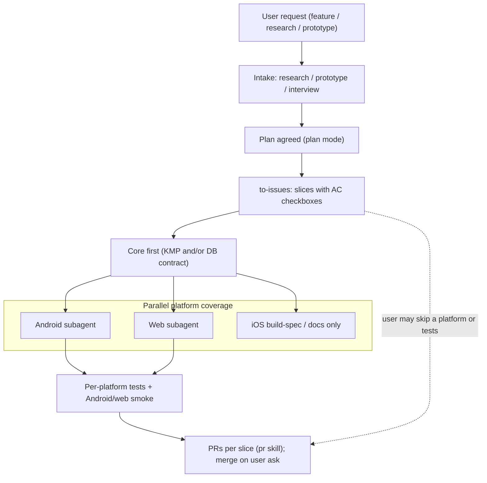

# Agent development environment and delivery flow

How agents work on GymManager after architecture foundations: areas, Cursor-native orchestration, core-first then parallel-platform delivery, simulator strategy, and model-budget guidance.

This document is **dev-process** convention. It does **not** define product AI features (roadmap phase 7). Individual area skills and env setup runbooks are authored under separate issues (see [Issue map](#issue-map)); this file is the living overview they must stay consistent with.

## Areas

| Area | Path / surface | Role | Runtime today |
|------|----------------|------|---------------|
| **core** | `core/` (KMP) | Shared domain, use cases, repositories, sync | Unit tests once scaffold exists ([#14](https://github.com/MarekBiolik/GymManager/issues/14)) |
| **android** | `apps/android/` | Jetpack Compose UI + Android wiring | Build + AVD / `adb` on Windows |
| **web** | `apps/web/` | React + TypeScript + Vite; `supabase-js` ([ADR 0006](../decisions/0006-web-supabase-js-without-kmp-js.md)) | Vite build + browser checks |
| **ios** | `apps/ios/` | SwiftUI + framework wiring from KMP | **Build-spec / docs only** until Mac access is decided |
| **supabase / db** | `supabase/` | Migrations, RLS, local CLI | Local `supabase start` + migration/RLS checks (after [#14](https://github.com/MarekBiolik/GymManager/issues/14) / [#21](https://github.com/MarekBiolik/GymManager/issues/21)) |
| **ux** | Design / interaction contracts across clients | Layout, flows, accessibility intent — not a parallel domain | Specs and review; no store release gate alone |
| **qa / test** | Per-area test runners | Unit (core), UI smoke (android/web), RLS | Follows [testing](testing.md); iOS runtime tests deferred |

Ownership of code paths matches [overview](../architecture/overview.md). Thin UI, one domain truth — [shared-core](../architecture/shared-core.md), [clients](../architecture/clients.md).

## Delivery flow

### Rules

1. **Intake → plan → issues** — New work starts with an intake skill (`research`, `prototype`, and/or `interview`) when needed, then an agreed plan, then `to-issues`. Issue AC checkboxes are the agent’s done-list ([workflow rule](../../.cursor/rules/workflow-issue-pr-commit.mdc)).
2. **Core first** — Shared KMP behavior and/or Postgres+RLS contract lands before platform UIs fan out, so Android / web / iOS build on a stable seam.
3. **Then parallel platforms** — After core is ready, cover platforms in parallel via on-demand subagents when possible.
4. **Then test** — Per-platform tests and smoke (Android emulator / web) gate PRs unless the user skips tests.
5. **Skip gate** — The user may explicitly skip a platform, skip tests, or both. Do not invent skips; ask if unclear.
6. **Issue → PR → commit → merge** — Existing project rules; merge only when the user asks.

## Orchestration (Cursor-native)

Lead agent (the open chat) plans, decides, and dispatches. Heavy work goes to **on-demand** subagents via the `Task` tool — not long-running role sessions.

| Need | Subagent / skill |
|------|------------------|
| Search codebase | `explore` |
| Core KMP / shared logic | general-purpose or area skill (when authored) with core framing |
| Android UI / Compose | area skill / subagent with android framing |
| Web UI / React | area skill / subagent with web framing |
| UX review / design intent | area skill / subagent with ux framing |
| Build / emulator / test runs | qa / emulator runners (when authored) |
| Break plan into issues | `to-issues` |
| Open PR | `pr` |
| Review | `code-review` |
| Test-first feature work | `tdd` |
| Cross-skill orchestration | `task-manager` |

No persistent advisor files, NOW/inbox/facts mailboxes, or marketing roles. See [Borrowings and rejections](#borrowings-and-rejections).

### Model-budget guideline

- **Cheap / fast models** — codebase search, build/test invocation, mechanical edits, emulator smoke glue.
- **Strong models** — hard design, domain seams, sync/RLS decisions, ambiguous product calls.
- Prefer **dispatching** easy work to cheaper helpers rather than switching the whole lead session mid-task (session model cache does not transfer cleanly across models).

Exact model pins live in area skills when those skills are authored; this convention only states the principle.

### Status / handoff (thin)

For a multi-agent slice, keep a **short** status note (issue comment or PR description section): in progress, waiting on, next step. Do not maintain a parallel persistent “company” file tree for agent mail.

## Simulator and runtime strategy

| Surface | Status | Notes |
|---------|--------|-------|
| **Android** | Testable on Windows | AVD emulator + `adb`: build, install, launch, basic smoke. Env + runner skill = separate issues. |
| **Web** | Testable | Node LTS + pnpm + Vite; production build in CI; interactive/browser checks via browser tools. |
| **iOS** | Build-spec / docs only | No local Mac. Align with scaffold playbook step C: Xcode project + framework wiring docs; CI need not green iOS on Linux day one. **Runtime build + Simulator** deferred to Mac-access decision (cloud macOS runner vs physical Mac) — own issue / ADR. |
| **Supabase / DB** | Testable after scaffold | Local CLI (`supabase start`), migration validate / `db lint`, RLS tests with two user JWTs per [testing](testing.md). Depends on [#14](https://github.com/MarekBiolik/GymManager/issues/14) and migration [#21](https://github.com/MarekBiolik/GymManager/issues/21). |

Skill definitions and orchestration docs can be written **before** app code exists. Emulator smoke, web build checks, local Supabase, and full QA runners are only **exercisable** after the monorepo scaffold lands.

## Borrowings and rejections

Inspired by an external multi-platform agent write-up (PilcrowMD-style org), kept selectively:

**Borrow**

- Per-area role framing (core / android / web / ios / ux / qa)
- Model-budget awareness (cheap for search/build/test; strong for hard decisions)
- Thin status/handoff per slice

**Reject**

- Persistent advisor role files and long-lived Desktop “cofounder” sessions as the control plane
- NOW / inbox / facts message-passing between agents
- Marketing / public-comms agent roles in this repo’s agent env
- Duplicating that project’s Claude Desktop vs Claude Code split as a hard requirement (Cursor chat + subagents is enough)

## Skills and rules reused in the flow

| Artifact | Role |
|----------|------|
| `research` | Intake when facts must be gathered |
| `prototype` | Intake when a throwaway probe answers a design question |
| `interview` | Stress-test undecided branches before locking a plan |
| `to-issues` | Plan → GitHub issues with AC |
| `pr` | PR body / open PR |
| `code-review` | Standards + spec review |
| `tdd` | Test-first implementation |
| `task-manager` | Drive work across skills when the path is unclear |
| `.cursor/rules/workflow-issue-pr-commit.mdc` | Issue → PR → commit → merge |
| `.cursor/rules/commit-after-steps.mdc` | Focused commits |
| `.cursor/rules/english-public-artifacts.mdc` | English for public artifacts |
| `.cursor/rules/docs-current-state.mdc` | Docs = current state |

Area env + skill packages are tracked under the [Issue map](#issue-map).

| Skill / rule | Path |
|--------------|------|
| Orchestration | `.cursor/skills/platform-delivery/` + `.cursor/rules/platform-delivery.mdc` |
| Core (KMP) | `.cursor/skills/core-kmp/` (env: `references/env-checklist.md`) |

## Issue map

| Topic | Issue |
|-------|-------|
| Umbrella — agent env + delivery flow | [#41](https://github.com/MarekBiolik/GymManager/issues/41) |
| Orchestration skill + rule | [#42](https://github.com/MarekBiolik/GymManager/issues/42) |
| Core (KMP) env + skill | [#43](https://github.com/MarekBiolik/GymManager/issues/43) |
| Android env + skill | [#44](https://github.com/MarekBiolik/GymManager/issues/44) |
| Web env + skill | [#45](https://github.com/MarekBiolik/GymManager/issues/45) |
| iOS env + skill (build-spec first) | [#46](https://github.com/MarekBiolik/GymManager/issues/46) |
| Supabase/DB env + skill | [#47](https://github.com/MarekBiolik/GymManager/issues/47) |
| UI/UX env + skill | [#48](https://github.com/MarekBiolik/GymManager/issues/48) |
| Mac access / iOS simulator decision | [#49](https://github.com/MarekBiolik/GymManager/issues/49) |
| Android emulator runner | [#50](https://github.com/MarekBiolik/GymManager/issues/50) |
| QA/testing env + skill | [#51](https://github.com/MarekBiolik/GymManager/issues/51) |

## Related

- [Testing](testing.md)
- [CI/CD](ci-cd.md)
- [Coding standards](coding-standards.md)
- [Architecture overview](../architecture/overview.md)
- [Phase 1 scaffold playbook](../plans/phase-1-scaffold-playbook.md)
- Scaffold implement: [#14](https://github.com/MarekBiolik/GymManager/issues/14); first migration: [#21](https://github.com/MarekBiolik/GymManager/issues/21)
