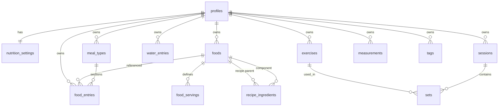

# Data model (outline)

Conceptual outline plus phase-3 nutrition shape. Field-level SQL lives in migrations / [nutrition-module](../specs/nutrition-module.md).

**First migration (profiles + RLS + `measurements` smoke):** [specs/first-migration-profiles-rls.md](../specs/first-migration-profiles-rls.md) — applied as [#21](https://github.com/MarekBiolik/GymManager/issues/21).

## Entity diagram (working)

`profiles.id` = `auth.users.id` (UUID). Every user table has `user_id` (or `profiles.id` 1:1) + RLS.

## Entities

### profiles

Minimal app record linked to the Auth account. PII and account-deletion rules: [auth](../architecture/auth.md), [ADR 0007](../decisions/0007-auth-providers-minimum-pii.md). SQL columns: [first migration spec](../specs/first-migration-profiles-rls.md).

- `id` (UUID, PK, = auth user)
- `created_at`, `updated_at`
- `preferred_units` (`kg`/`lb`) — UI preference; **phase 3 UI uses kg/g only**
- **not:** email, display name, avatar, gender, date of birth (email only in `auth.users`)

### nutrition_settings

1:1 with profile. Macro/calorie goals and body/water preferences ([nutrition-module](../specs/nutrition-module.md)).

- `user_id` (PK, FK → auth user)
- `calorie_target_kcal`, `protein_target_g`, `carbs_target_g`, `fat_target_g`
- `height_cm` (nullable)
- `water_target_ml` (nullable)
- `created_at`, `updated_at`

**Weight** is not stored here — use `measurements` with `metric = body_weight_kg`.

### meal_types

Per-user diary sections (editable/reorderable). Seeded defaults: breakfast, 2nd breakfast, lunch, snack, dinner.

- `id`, `user_id`
- `name`, `position`
- `created_at`, `updated_at`

### foods

User-owned products / recipes. **SoT for catalog:** own rows only. Hybrid import copies from OFF into this table ([ADR 0011](../decisions/0011-food-data-hybrid-in-phase-3.md)).

- `id`, `user_id`
- `name`
- nutrition values **per 100 g**: `protein_g`, `carbs_g`, `fat_g` (derived kcal in domain)
- `default_serving_g` (optional)
- `is_recipe` (boolean)
- `is_favorite` (boolean)
- `last_used_at` (nullable timestamptz) — ranking for recent list; **not** eviction
- `external_source` / `external_id` (nullable) — provenance after import
- `created_at`, `updated_at`

### food_servings

Flexible units per food (portion, teaspoon, … → grams).

- `id`, `user_id`, `food_id`
- `label`, `grams`, `position`
- `created_at`, `updated_at`

### food_entries

Intake entries (1+ year history).

- `id`, `user_id`
- `food_id` (nullable if snapshot-only edge case; prefer set)
- `meal_type_id`
- `eaten_on` (date) — diary day in the user’s local calendar sense (store as `date`)
- `amount` (numeric) + `unit` (`g` | `serving`) + optional `food_serving_id`
- `grams` (resolved)
- macro snapshot at entry time: `protein_g`, `carbs_g`, `fat_g`, `kcal`
- `created_at`, `updated_at`

### recipe_ingredients

- `id`, `user_id`
- `recipe_food_id`, `component_food_id`
- `grams`
- `created_at`, `updated_at`

### water_entries

- `id`, `user_id`
- `drunk_on` (date)
- `amount_ml`
- `created_at`, `updated_at`

### exercises

User exercise catalog (or system + custom — decide in phase 4).

- `id`, `user_id` (nullable if global system)
- `name`, optionally muscle group / tags
- `created_at`, `updated_at`

### sessions

Training session (execution in time). Table name `sessions` instead of ambiguous `workouts` — confirm at implementation.

- `id`, `user_id`
- `started_at`, `ended_at` (nullable)
- `note` (optional)
- `created_at`, `updated_at`

### sets

Sets in a session.

- `id`, `user_id`, `session_id`, `exercise_id`
- `position` (order)
- `reps`, `weight`, optionally `rpe` / `is_warmup`
- `created_at`, `updated_at`

### measurements

Body measurements. **In the first migration** (RLS smoke) — [spec](../specs/first-migration-profiles-rls.md).

- `id`, `user_id`
- `metric` (e.g. `body_weight_kg`, `waist_cm`)
- `value` (numeric)
- `measured_at`
- `created_at`, `updated_at`

### tags (optional)

Cross-cutting labels (exercises, meals). M:N via join tables — only when needed.

## Shared schema conventions

- UUID as PK (`gen_random_uuid()`) — fixed in [first migration spec](../specs/first-migration-profiles-rls.md); not ULID.
- `timestamptz` for timestamps; diary day as `date` where calendar-day semantics matter.
- Soft-delete only if there is a case (e.g. undo); default **hard delete**. Tombstone for offline sync — only with offline-write ([ADR 0008](../decisions/0008-sync-strategy-online-first.md)).
- Every user table: `created_at`, `updated_at` (timestamptz) — LWW per row in MVP sync; `updated_at` set by `set_updated_at` trigger.
- Indexes: `(user_id, eaten_on)`, `(user_id, measured_at DESC)`, `(session_id, position)`, `(user_id, last_used_at DESC)`, etc.
- Where to enforce shared web + mobile rules (RLS / CHECK vs KMP / thin TS): [postgres-invariants](../architecture/postgres-invariants.md).

## Aggregations (direction)

Views or queries:

- macro sum / day per user,
- measurement series in a date range,
- training volume / week,
- water sum / day.

Materialized daily tables — optional optimization later.

## Out of outline scope

- Full training tables (phase 4); exact first-migration types → [spec](../specs/first-migration-profiles-rls.md); CHECK vs core split: [postgres-invariants](../architecture/postgres-invariants.md)
- Sharing data between users
- Imperial unit conversion UI
