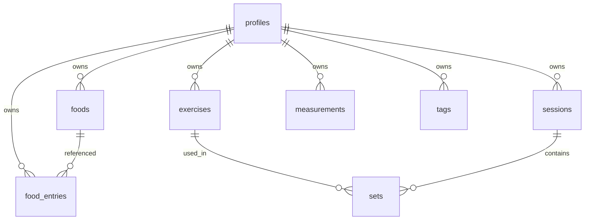

# Data model (outline)

This is a **conceptual outline**, not a final SQL migration. Field, index, and aggregation-view details come with module phases (3–5).

**First migration (profiles + RLS + `measurements` smoke):** [specs/first-migration-profiles-rls.md](../specs/first-migration-profiles-rls.md) — SPEC ONLY; apply = [#21](https://github.com/MarekBiolik/GymManager/issues/21).

## Entity diagram (working)

`profiles.id` = `auth.users.id` (UUID). Every user table has `user_id` + RLS.

## Entities

### profiles

Minimal app record linked to the Auth account. PII and account-deletion rules: [auth](../architecture/auth.md), [ADR 0007](../decisions/0007-auth-providers-minimum-pii.md). SQL columns: [first migration spec](../specs/first-migration-profiles-rls.md).

- `id` (UUID, PK, = auth user)
- `created_at`, `updated_at`
- `preferred_units` (`kg`/`lb`) — UI preference, not PII
- **not:** email, display name, avatar, gender, date of birth (email only in `auth.users`)

### foods

User-owned products / meals.

- `id`, `user_id`
- `name`
- nutrition values (per 100 g or per serving — TBD)
- `serving_size` / unit
- `created_at`, `updated_at`
- optionally: external id (e.g. OpenFoodFacts) — [OQ-07](../open-questions.md)

### food_entries

Intake entries (1+ year history).

- `id`, `user_id`
- `food_id` (nullable if snapshot without reference)
- `eaten_at` (timestamptz)
- `amount` + unit
- macro snapshot at entry time (resilient to later Food edits)
- `created_at`, `updated_at`

### exercises

User exercise catalog (or system + custom — decide in phase 4).

- `id`, `user_id` (nullable if global system)
- `name`, optionally muscle group / tags
- `created_at`, `updated_at`

### sessions

Training session (execution in time). Table name `sessions` instead of ambiguous `workouts` — confirm at implementation.

- `id`, `user_id`
- `started_at`, `ended_at` (nullable)
- `note` (optional)
- `created_at`, `updated_at`

### sets

Sets in a session.

- `id`, `user_id`, `session_id`, `exercise_id`
- `position` (order)
- `reps`, `weight`, optionally `rpe` / `is_warmup`
- `created_at`, `updated_at`

### measurements

Body measurements. **In the first migration** (RLS smoke) — [spec](../specs/first-migration-profiles-rls.md).

- `id`, `user_id`
- `metric` (e.g. `body_weight_kg`, `waist_cm`)
- `value` (numeric)
- `measured_at`
- `created_at`, `updated_at`

### tags (optional)

Cross-cutting labels (exercises, meals). M:N via join tables — only when needed.

## Shared schema conventions

- UUID as PK (`gen_random_uuid()`) — fixed in [first migration spec](../specs/first-migration-profiles-rls.md); not ULID.
- `timestamptz` for all dates.
- Soft-delete only if there is a case (e.g. undo); default **hard delete**. Tombstone for offline sync — only with offline-write ([ADR 0008](../decisions/0008-sync-strategy-online-first.md)).
- Every user table: `created_at`, `updated_at` (timestamptz) — LWW per row in MVP sync; `updated_at` set by `set_updated_at` trigger.
- Indexes: `(user_id, eaten_at)`, `(user_id, measured_at DESC)` (already in first migration), `(session_id, position)`, etc.
- Where to enforce shared web + mobile rules (RLS / CHECK vs KMP / thin TS): [postgres-invariants](../architecture/postgres-invariants.md).

## Aggregations (direction)

Views or queries:

- macro sum / day per user,
- measurement series in a date range,
- training volume / week.

Materialized daily tables — optional optimization later.

## Out of outline scope

- Full nutrition / training tables (phases 3–4); exact first-migration types → [spec](../specs/first-migration-profiles-rls.md); CHECK vs core split: [postgres-invariants](../architecture/postgres-invariants.md)
- OpenFoodFacts import
- Sharing data between users
