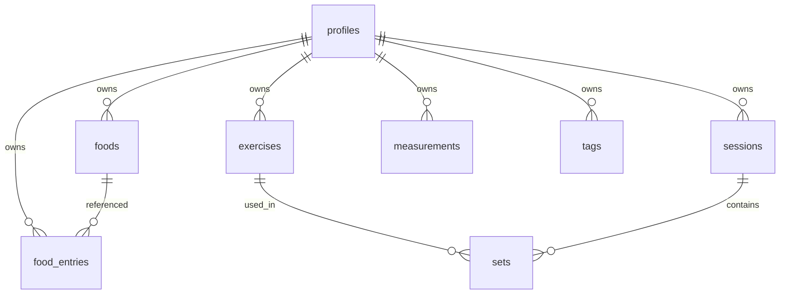

# Model danych (zarys)

To **zarys koncepcyjny**, nie finalna migracja SQL. Szczegóły pól, indeksów i widoków agregujących — przy fazach modułów (3–5) i pierwszej migracji w fazie 1.

## Diagram encji (roboczy)

`profiles.id` = `auth.users.id` (UUID). Każda tabela użytkownika ma `user_id` + RLS.

## Encje

### profiles

Minimalny rekord aplikacji powiązany z kontem Auth. Zasady PII i usuwania konta: [auth](../architecture/auth.md), [ADR 0007](../decisions/0007-auth-providers-minimum-pii.md).

- `id` (UUID, PK, = auth user)
- `created_at`, `updated_at`
- preferencje UI / jednostki (`kg`/`lb`) — bez PII
- **nie:** email, display name, avatar, płeć, data urodzenia (email tylko w `auth.users`)

### foods

Własne produkty / posiłki użytkownika.

- `id`, `user_id`
- `name`
- wartości odżywcze (na 100 g lub na porcję — do ustalenia)
- `serving_size` / jednostka
- `created_at`, `updated_at`
- opcjonalnie: zewnętrzne ID (np. OpenFoodFacts) — [OQ-07](../open-questions.md)

### food_entries

Wpisy spożycia (historia rok+).

- `id`, `user_id`
- `food_id` (nullable, jeśli snapshot bez referencji)
- `eaten_at` (timestamptz)
- `amount` + jednostka
- snapshot makro w momencie wpisu (odporność na późniejszą edycję Food)
- `created_at`, `updated_at`

### exercises

Katalog ćwiczeń użytkownika (lub systemowy + własne — do decyzji w fazie 4).

- `id`, `user_id` (nullable jeśli globalne systemowe)
- `name`, opcjonalnie grupa mięśniowa / tagi
- `created_at`, `updated_at`

### sessions

Sesja treningowa (wykonanie w czasie). Nazwa tabeli `sessions` zamiast niejednoznacznego `workouts` — do potwierdzenia przy implementacji.

- `id`, `user_id`
- `started_at`, `ended_at` (nullable)
- `note` (opcjonalnie)
- `created_at`, `updated_at`

### sets

Serie w sesji.

- `id`, `user_id`, `session_id`, `exercise_id`
- `position` (kolejność)
- `reps`, `weight`, opcjonalnie `rpe` / `is_warmup`
- `created_at`, `updated_at`

### measurements

Pomiary ciała.

- `id`, `user_id`
- `metric` (np. `body_weight_kg`, `waist_cm`)
- `value` (numeric)
- `measured_at`
- `created_at`, `updated_at`

### tags (opcjonalnie)

Etykiety cross-cutting (ćwiczenia, posiłki). Relacje M:N przez tabele łączące — dopiero gdy potrzeba.

## Wspólne konwencje schematu

- UUID jako PK (lub ULID — decyzja przy migracji).
- `timestamptz` dla wszystkich dat.
- Soft-delete tylko jeśli jest case (np. undo); domyślnie **hard delete**. Tombstone pod sync offline — dopiero przy offline-write ([ADR 0008](../decisions/0008-sync-strategy-online-first.md)).
- Każda tabela użytkownika: `created_at`, `updated_at` (timestamptz) — LWW na wiersz w MVP sync.
- Indeksy: `(user_id, eaten_at)`, `(user_id, measured_at)`, `(session_id, position)` itd.

## Agregacje (kierunek)

Widoki lub zapytania:

- suma makro / dzień dla użytkownika,
- seria pomiarów w zakresie dat,
- objętość treningowa / tydzień.

Materializowane tabele dzienne — opcjonalna optymalizacja później.

## Poza zakresem zarysu

- Dokładne typy SQL i CHECK constraints
- Import z OpenFoodFacts
- Udostępnianie danych między użytkownikami
