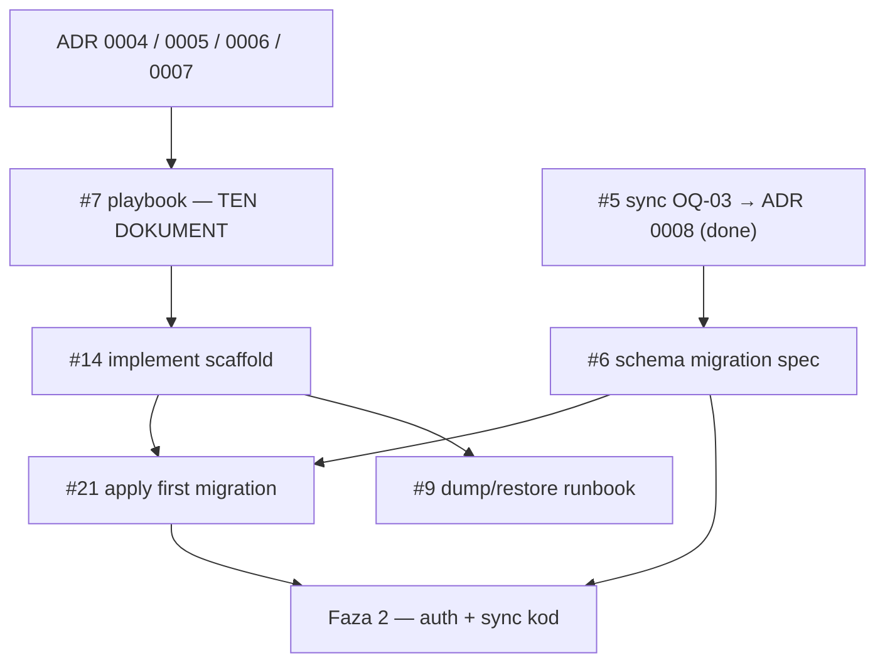

# Playbook: scaffolding monorepo (faza 1)

Plan wykonania fazy 1 — **kolejność kroków, kryteria done, CI, Supabase `dev`**.  
Ten dokument **nie** tworzy layoutu w git; implementacja = [#14](https://github.com/MarekBiolik/GymManager/issues/14).

Zamyka zakres planistyczny [#7](https://github.com/MarekBiolik/GymManager/issues/7).

## Cel

Puste, **budujące się** projekty w monorepo + podpięty Supabase Cloud (`dev`) + szkielet CI na PR — bez logiki domenowej, bez Auth UI, bez produkcyjnych migracji „na klik”.

## Non-goals (wyraźna granica)

| Nie robimy w tym playbooku / w #14 | Gdzie to żyje |
|------------------------------------|---------------|
| Pisanie / mergowanie kodu scaffoldu w ramach #7 | Ten ticket = tylko docs; kod = #14 |
| Target **KMP → JS/Wasm** albo założenie, że web konsumuje binary core | [ADR 0006](../decisions/0006-web-supabase-js-without-kmp-js.md); komentarz na #7 |
| Równoległa domena TypeScript w `apps/web` | ADR 0006 + [clients](../architecture/clients.md) |
| Nx / Turborepo / publikacja core do rejestru | [ADR 0005](../decisions/0005-monorepo-tooling.md) |
| Osobne `staging` / `prod` Cloud | [ADR 0004](../decisions/0004-supabase-hosting.md), [#10](https://github.com/MarekBiolik/GymManager/issues/10) |
| Pełny Auth UI + IdP w apkach | Faza 2; checklista IdP [#12](https://github.com/MarekBiolik/GymManager/issues/12) |
| Spec SQL pierwszej migracji (treść tabel/RLS) | [#6](https://github.com/MarekBiolik/GymManager/issues/6) — **wejście**, nie output #7/#14 |
| Runbook dump/restore (operacyjny drill) | [#9](https://github.com/MarekBiolik/GymManager/issues/9) — po pojawieniu się `supabase/` |
| Domains features (żywienie / trening / pomiary) | Fazy 3–5 |

## Decyzje wejściowe (zamknięte)

| Temat | Issue | ADR / docs |
|-------|-------|------------|
| Hosting Cloud Free → Pro, jeden `dev`, sekrety, dumpi | [#1](https://github.com/MarekBiolik/GymManager/issues/1) CLOSED | [ADR 0004](../decisions/0004-supabase-hosting.md) |
| Layout monorepo, Gradle + pnpm + Xcode, bez Nx | [#2](https://github.com/MarekBiolik/GymManager/issues/2) CLOSED | [ADR 0005](../decisions/0005-monorepo-tooling.md), [overview](../architecture/overview.md) |
| Web = `supabase-js`, **bez** KMP-JS day one | [#3](https://github.com/MarekBiolik/GymManager/issues/3) CLOSED | [ADR 0006](../decisions/0006-web-supabase-js-without-kmp-js.md) |
| Auth providers + minimum PII (kontekst pod `profiles`) | [#4](https://github.com/MarekBiolik/GymManager/issues/4) CLOSED | [ADR 0007](../decisions/0007-auth-providers-minimum-pii.md) |

## Kolejność zależności (issues)



**Zasada sekwencji #6 ↔ #14**

1. **#14 może wystartować** zaraz po zmergowaniu playbooku (#7): puste projekty, CI, `supabase/` z config CLI, link do Cloud `dev`.
2. **Treść pierwszej migracji** (`profiles` + baseline RLS + ewentualnie 1–2 tabele) pochodzi ze **specu #6** — nie wymyślać schematu ad hoc w PR scaffoldu.
3. #5 / OQ-03 jest **decided** ([ADR 0008](../decisions/0008-sync-strategy-online-first.md)); #6 może iść. Dopóki #6 OPEN: w #14 trzymaj `supabase/migrations/` puste albo tylko plik-placeholder uzgodniony w PR; **nie** aplikuj „tymczasowego” schematu produkcyjnego.
4. Po zamknięciu #6 i istnieniu `supabase/` z #14: implementacja migracji = [#21](https://github.com/MarekBiolik/GymManager/issues/21) (SQL 1:1 ze specu + apply na `dev`).

## Docelowe drzewo (przypomnienie)

Zgodnie z [overview](../architecture/overview.md) / ADR 0005:

```
GymManager/
  settings.gradle.kts
  gradle/
  package.json              # root scripts
  pnpm-workspace.yaml
  scripts/                  # opcjonalnie
  core/                     # KMP — Android + iOS targets ONLY (bez JS/Wasm)
  apps/android/
  apps/ios/
  apps/web/                 # pnpm + Vite + React; supabase-js
  supabase/
  docs/                     # już istnieje
```

## Kroki scaffoldu (dla #14)

Wykonuj **w tej kolejności**. Każdy krok ma własny Definition of Done. Preferuj jeden PR na logiczną paczkę (A–C razem OK; D może iść osobno jeśli secrets/CI blokują).

### Krok 0 — Przygotowanie maintainer’a (poza kodem)

- [ ] Konto Supabase; projekt Cloud = **`dev`** (Free) — ADR 0004
- [ ] JDK 17+ (lub wersja wymagana przez wybrany AGP w kroku A)
- [ ] Android SDK / emulator lub device (weryfikacja `:apps:android`)
- [ ] Node LTS + **pnpm**
- [ ] Supabase CLI
- [ ] Xcode (macOS) do weryfikacji `apps/ios` — na Windows CI iOS może być „docs-only / skip”
- [ ] Placeholdery sekretów lokalnych: `.env.local` (gitignore) z `SUPABASE_URL`, `SUPABASE_ANON_KEY` — **bez** `service_role` w klientach

**Done when:** maintainer może utworzyć projekt Cloud i ma toolchainy lokalne; żadnych sekretów w git.

### Krok A — Gradle: `core` + `apps/android`

1. Root Gradle wrapper + `settings.gradle.kts` z `:core`, `:apps:android`.
2. `core/` — pusty moduł KMP z targetami **Android + iOS** (framework export). **Zakaz:** `js()`, `wasmJs()` ani zależności webowe w `core`.
3. `apps/android/` — minimalny Compose „Hello” zależny od `:core`.
4. `core/VERSION` lub wpis w `gradle.properties` (placeholder, np. `0.0.0-SNAPSHOT`).
5. Uzupełnij `.gitignore` pod Gradle/Android (build/, `.gradle`, lokalne keystore itd.).

**Done when:**

- `./gradlew :core:build` (lub równoważny target JVM/Android) przechodzi lokalnie.
- `./gradlew :apps:android:assembleDebug` (lub `:apps:android:build`) przechodzi.
- W `core` **brak** konfiguracji targetu JS/Wasm.

### Krok B — `apps/web` (pnpm + Vite + supabase-js)

1. `pnpm-workspace.yaml` → `apps/web`.
2. Vite + React + TypeScript skeleton.
3. Zależność `@supabase/supabase-js`; cienki client helper czytający URL/anon z env (`import.meta.env`) — **bez** domain services.
4. Strona placeholder (np. „GymManager web”) bez Auth UI.

**Done when:**

- `pnpm install` + `pnpm --filter <web> build` (lub skrypt root) przechodzi.
- Brak importów / workspace’ów sugerujących konsumpcję KMP z weba.
- README lub komentarz w `apps/web` wskazuje ADR 0006 (supabase-js only).

### Krok C — `apps/ios` + eksport frameworka

1. Projekt Xcode w `apps/ios/` (SwiftUI Hello).
2. Instrukcja w `apps/ios/README.md` (lub `docs/`): jak zbudować XCFramework / podpiąć framework z Gradle KMP.
3. Na macOS: jednorazowa weryfikacja linkowania; na agentach bez macOS — instrukcja + „skipped in CI” jest OK dla fazy 1.

**Done when:** Xcode project istnieje; dokument podpięcia frameworka jest wykonalny na Macu; CI nie wymaga zielonego iOS na Linux runnerze day one.

### Krok D — Root scripts + lint baseline

1. Root `package.json` (lub `scripts/`) z komendami: `build`, `test`, `lint` wywołującymi Gradle + pnpm (i opcjonalnie Supabase lint gdy dostępne).
2. Minimalny ktlint/Spotless **albo** Gradle check placeholder; ESLint+Prettier dla web — wersje przypięte w scaffoldzie.
3. Te same nazwy komend co w CI (poniżej).

**Done when:** z roota da się odpalić build/test/lint lokalnie bez ręcznego wchodzenia w każdy toolchain; dokumentacja komend w README root lub tutaj (link).

### Krok E — Supabase: katalog + attach `dev`

1. `supabase init` → `supabase/config.toml`, pusty `supabase/migrations/`.
2. `supabase link` do projektu Cloud `dev` (project ref w lokalnym ignore / nie commitować tokenów access).
3. `.env.example` w root lub `apps/web` z placeholderami URL + anon (bez prawdziwych wartości).
4. Checklist maintainer’a (w PR #14 lub krótka sekcja README `supabase/`):
   - [ ] Projekt `dev` istnieje i nie jest spauzowany
   - [ ] URL + anon w lokalnym `.env*`
   - [ ] `service_role` tylko w menedżerze haseł / nigdy w repo
   - [ ] Przed ryzykowną migracją: dump (szczegóły → #9)
5. **Migracja SQL:** dodaj dopiero gdy #6 dostarczy spec; do tego czasu nie pushuj ad-hoc schematu.

**Done when:** `supabase/` w repo; link do `dev` udokumentowany; sekrety poza gitem; migracje czekają na #6 (lub są 1:1 ze specu jeśli #6 już CLOSED).

### Krok F — Szkielet CI (GitHub Actions)

Dodaj workflow na PR do `master` (np. `.github/workflows/ci.yml`). Oczekiwania minimalne:

| Job / krok | Wymagane day one | Uwagi |
|------------|------------------|-------|
| Checkout + JDK + Gradle cache | tak | Build `:core` + `:apps:android` |
| Unit testy `core` | tak (nawet puste) | `./gradlew :core:test` lub równoważne |
| Setup Node + pnpm | tak | `pnpm install --frozen-lockfile` gdy lockfile istnieje |
| Build web | tak | Vite production build |
| Lint Kotlin | tak jeśli skonfigurowane w A/D | W przeciwnym razie TODO w workflow + issue |
| Lint TS | tak jeśli ESLint w B/D | j.w. |
| `supabase db lint` / migrate dry-run | opcjonalnie day one | Włącz gdy CLI + migracje istnieją |
| Build iOS / Xcode | nie na Linux | macOS runner później albo ręcznie |
| Deploy / CD | nie | Faza później |

**Sekrety CI day one:** zwykle **żadne** do samego builda klientów (anon nie musi być w CI, jeśli web build nie wymaga prawdziwego projektu). Gdy smoke pod `dev` — tylko GitHub Secrets, nigdy logować wartości.

**Done when:**

- PR z samym scaffoldem jest zielony na wymaganych jobach.
- [ci-cd](../conventions/ci-cd.md) checklist „Definition of done dla pipeline” spełniona lub zaktualizowana o realne nazwy jobów.
- Branch protection na `master` można włączyć po pierwszym zielonym runie (maintainer).

### Krok G — Weryfikacja końcowa (checklista „buduje się”)

- [ ] Drzewo zgodne z ADR 0005 / overview
- [ ] Brak Nx/Turborepo; brak publikacji core
- [ ] Brak KMP JS/Wasm w `core` i brak konsumpcji core z weba
- [ ] Root scripts działają
- [ ] CI zielone na PR
- [ ] Supabase `dev` podpięty lokalnie; brak sekretów w git
- [ ] Playbook (#7) uznany za wykonany względem checklist powyższych
- [ ] Roadmapa faza 1 — punkty „done when” poniżej odhaczone lub przeniesione świadomie

## Minimalny CI — kontrakt dla agentów (#14)

Po pojawieniu się kodu, PR **musi** przejść:

1. **Gradle:** build `core` (Android/JVM) + `apps/android`.
2. **pnpm:** install + build `apps/web`.
3. **Testy:** unit `core` (mogą być puste, ale task musi istnieć i być zielony).
4. **Lint:** jeśli narzędzia są w repo — fail on error; nie dodawać „warn-only forever”.
5. **Supabase:** gdy jest ≥1 migracja — walidacja w CI (`db lint` / start local + apply) zanim merge.

PR nie przechodzi przy padającym buildzie core, android lub web.

## Auth smoke w fazie 1 — doprecyzowanie

Roadmapa wspomina „Auth smoke-test”. W praktyce:

| Element | Faza 1 (#14) | Później |
|---------|--------------|---------|
| Projekt Auth włączony w Supabase `dev` | opcjonalnie checkbox maintainer’a | — |
| Konfiguracja Google/Apple IdP | nie w #14 | [#12](https://github.com/MarekBiolik/GymManager/issues/12) + faza 2 |
| Login UI / hello sync | nie | faza 2 |

Nie blokuj merge scaffoldu na działającym OAuth.

## Definition of Done — cała faza 1

Faza 1 jest **zamknięta**, gdy:

1. Playbook (ten dokument) zmergowany i aktualny względem ADR 0004–0006.
2. [#14](https://github.com/MarekBiolik/GymManager/issues/14) zaimplementowane i zmergowane — puste projekty budują się; CI szkielet na PR.
3. Supabase Cloud `dev` podpięty; sekrety poza repo; katalog `supabase/` istnieje.
4. Spec [#6](https://github.com/MarekBiolik/GymManager/issues/6) **zmergowany** i migracja SQL zastosowana przez [#21](https://github.com/MarekBiolik/GymManager/issues/21).
5. Brak targetu KMP-JS/Wasm; web wyłącznie przez `supabase-js`.
6. Roadmapa poniżej odzwierciedla ten stan; follow-upy (#9 dump, #12 IdP) otwarte świadomie, nie ukryte w „done”.

## Mapowanie na tickety

| Ticket | Rola względem tego playbooku |
|--------|------------------------------|
| [#7](https://github.com/MarekBiolik/GymManager/issues/7) | Plan — ten dokument + update roadmapy |
| [#14](https://github.com/MarekBiolik/GymManager/issues/14) | Implementacja kroków A–G |
| [#6](https://github.com/MarekBiolik/GymManager/issues/6) | Spec migracji = wejście do #21 (treść SQL) |
| [#21](https://github.com/MarekBiolik/GymManager/issues/21) | Implementacja / apply migracji ze specu #6 |
| [#5](https://github.com/MarekBiolik/GymManager/issues/5) | Done — OQ-03 → ADR 0008; odblokowuje treść #6 |
| [#9](https://github.com/MarekBiolik/GymManager/issues/9) | Runbook dump po `supabase/` z #14 (nie po samym #7) |
| [#12](https://github.com/MarekBiolik/GymManager/issues/12) | IdP — po scaffoldzie, przed pełnym auth w fazie 2 |

## Powiązane

- [Roadmapa — faza 1](../roadmap.md)
- [CI/CD](../conventions/ci-cd.md)
- [Overview](../architecture/overview.md)
- [Tech stack](../architecture/tech-stack.md)
- ADR [0004](../decisions/0004-supabase-hosting.md), [0005](../decisions/0005-monorepo-tooling.md), [0006](../decisions/0006-web-supabase-js-without-kmp-js.md), [0007](../decisions/0007-auth-providers-minimum-pii.md), [0008](../decisions/0008-sync-strategy-online-first.md)
