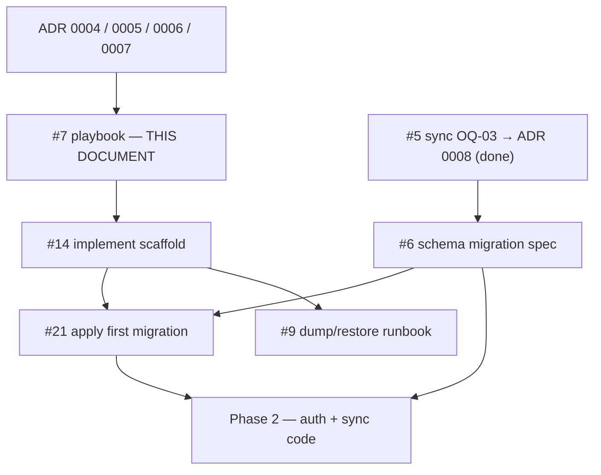

# Playbook: monorepo scaffolding (phase 1)

Phase-1 execution plan — **step order, done criteria, CI, Supabase `dev`**.  
This document does **not** create the layout in git; implementation = [#14](https://github.com/MarekBiolik/GymManager/issues/14).

Closes the planning scope of [#7](https://github.com/MarekBiolik/GymManager/issues/7).

## Goal

Empty, **building** projects in the monorepo + attached Supabase Cloud (`dev`) + CI skeleton on PR — without domain logic, Auth UI, or production migrations “by click”.

## Non-goals (hard boundary)

| Not in this playbook / #14 | Where it lives |
|----------------------------|----------------|
| Writing / merging scaffold code under #7 | This ticket = docs only; code = #14 |
| **KMP → JS/Wasm** target or assuming web consumes the core binary | [ADR 0006](../decisions/0006-web-supabase-js-without-kmp-js.md); comment on #7 |
| Parallel TypeScript domain in `apps/web` | ADR 0006 + [clients](../architecture/clients.md) |
| Nx / Turborepo / publishing core to a registry | [ADR 0005](../decisions/0005-monorepo-tooling.md) |
| Separate `staging` / `prod` Cloud | [split spec](../specs/supabase-staging-prod-split.md) ([#10](https://github.com/MarekBiolik/GymManager/issues/10)); [ADR 0004](../decisions/0004-supabase-hosting.md) |
| Full Auth UI + IdP in apps | Phase 2; IdP checklist [spec](../specs/idp-config-checklist.md) ([#12](https://github.com/MarekBiolik/GymManager/issues/12)) |
| First migration SQL spec (table/RLS content) | [first-migration-profiles-rls](../specs/first-migration-profiles-rls.md) / [#6](https://github.com/MarekBiolik/GymManager/issues/6) — **input**, not #7/#14 output; apply = #21 |
| Dump/restore runbook (operational drill) | [runbook](../runbooks/supabase-dump-restore.md) / [#9](https://github.com/MarekBiolik/GymManager/issues/9) — after `supabase/` appears |
| Domain features (nutrition / training / measurements) | Phases 3–5 |

## Input decisions (closed)

| Topic | Issue | ADR / docs |
|-------|-------|------------|
| Cloud Free → Pro hosting, one `dev`, secrets, dumps | [#1](https://github.com/MarekBiolik/GymManager/issues/1) CLOSED | [ADR 0004](../decisions/0004-supabase-hosting.md) |
| Monorepo layout, Gradle + pnpm + Xcode, no Nx | [#2](https://github.com/MarekBiolik/GymManager/issues/2) CLOSED | [ADR 0005](../decisions/0005-monorepo-tooling.md), [overview](../architecture/overview.md) |
| Web = `supabase-js`, **no** KMP-JS day one | [#3](https://github.com/MarekBiolik/GymManager/issues/3) CLOSED | [ADR 0006](../decisions/0006-web-supabase-js-without-kmp-js.md) |
| Auth providers + minimum PII (context for `profiles`) | [#4](https://github.com/MarekBiolik/GymManager/issues/4) CLOSED | [ADR 0007](../decisions/0007-auth-providers-minimum-pii.md) |

## Dependency order (issues)



**#6 ↔ #14 sequencing rule**

1. **#14 may start** right after the playbook (#7) merges: empty projects, CI, `supabase/` with CLI config, link to Cloud `dev`.
2. **First migration content** (`profiles` + baseline RLS + optionally 1–2 tables) comes from **spec #6** — do not invent schema ad hoc in the scaffold PR.
3. #5 / OQ-03 is **decided** ([ADR 0008](../decisions/0008-sync-strategy-online-first.md)); spec #6 = [docs/specs/first-migration-profiles-rls.md](../specs/first-migration-profiles-rls.md). In #14 keep `supabase/migrations/` empty until [#21](https://github.com/MarekBiolik/GymManager/issues/21); **do not** apply a “temporary” production schema.
4. After spec #6 merges and `supabase/` exists from #14: migration implementation = [#21](https://github.com/MarekBiolik/GymManager/issues/21) (SQL 1:1 with the spec / `docs/specs/sql/` + apply on `dev`).

## Target tree (reminder)

Per [overview](../architecture/overview.md) / ADR 0005:

```
GymManager/
  settings.gradle.kts
  gradle/
  package.json              # root scripts
  pnpm-workspace.yaml
  scripts/                  # optional
  core/                     # KMP — Android + iOS targets ONLY (no JS/Wasm)
  apps/android/
  apps/ios/
  apps/web/                 # pnpm + Vite + React; supabase-js
  supabase/
  docs/                     # already exists
```

## Scaffold steps (for #14)

Execute **in this order**. Each step has its own Definition of Done. Prefer one PR per logical pack (A–C together OK; D may go separately if secrets/CI block).

### Step 0 — Maintainer prep (outside code)

- [ ] Supabase account; Cloud project = **`dev`** (Free) — ADR 0004
- [ ] JDK 17+ (or version required by chosen AGP in step A)
- [ ] Android SDK / emulator or device (verify `:apps:android`)
- [ ] Node LTS + **pnpm**
- [ ] Supabase CLI
- [ ] Xcode (macOS) to verify `apps/ios` — on Windows CI, iOS may be “docs-only / skip”
- [ ] Local secret placeholders: `.env.local` (gitignore) with `SUPABASE_URL`, `SUPABASE_ANON_KEY` — **no** `service_role` in clients

**Done when:** maintainer can create a Cloud project and has local toolchains; no secrets in git.

### Step A — Gradle: `core` + `apps/android`

1. Root Gradle wrapper + `settings.gradle.kts` with `:core`, `:apps:android`.
2. `core/` — empty KMP module with **Android + iOS** targets (framework export). **Forbidden:** `js()`, `wasmJs()`, or web dependencies in `core`.
3. `apps/android/` — minimal Compose “Hello” depending on `:core`.
4. `core/VERSION` or `gradle.properties` entry (placeholder, e.g. `0.0.0-SNAPSHOT`).
5. Extend `.gitignore` for Gradle/Android (build/, `.gradle`, local keystores, etc.).

**Done when:**

- `./gradlew :core:build` (or equivalent JVM/Android target) passes locally.
- `./gradlew :apps:android:assembleDebug` (or `:apps:android:build`) passes.
- `core` has **no** JS/Wasm target configuration.

### Step B — `apps/web` (pnpm + Vite + supabase-js)

1. `pnpm-workspace.yaml` → `apps/web`.
2. Vite + React + TypeScript skeleton.
3. Dependency `@supabase/supabase-js`; thin client helper reading URL/anon from env (`import.meta.env`) — **no** domain services.
4. Placeholder page (e.g. “GymManager web”) without Auth UI.

**Done when:**

- `pnpm install` + `pnpm --filter <web> build` (or root script) passes.
- No imports / workspaces suggesting KMP consumption from web.
- README or comment in `apps/web` points to ADR 0006 (supabase-js only).

### Step C — `apps/ios` + framework export

1. Xcode project in `apps/ios/` (SwiftUI Hello).
2. Instructions in `apps/ios/README.md` (or `docs/`): how to build XCFramework / wire the framework from Gradle KMP.
3. On macOS: one-time link verification; on agents without macOS — instructions + “skipped in CI” is OK for phase 1.

**Done when:** Xcode project exists; framework wiring docs are executable on a Mac; CI does not require green iOS on a Linux runner day one.

### Step D — Root scripts + lint baseline

1. Root `package.json` (or `scripts/`) with `build`, `test`, `lint` calling Gradle + pnpm (and optionally Supabase lint when available).
2. Minimal ktlint/Spotless **or** Gradle check placeholder; ESLint+Prettier for web — versions pinned in the scaffold.
3. Same command names as in CI (below).

**Done when:** from root you can run build/test/lint locally without manually entering each toolchain; command docs in root README or linked here.

### Step E — Supabase: directory + attach `dev`

1. `supabase init` → `supabase/config.toml`, empty `supabase/migrations/`.
2. `supabase link` to Cloud `dev` (project ref in local ignore / do not commit access tokens).
3. `.env.example` in root or `apps/web` with URL + anon placeholders (no real values).
4. Maintainer checklist (in PR #14 or short `supabase/` README section):
   - [ ] `dev` project exists and is not paused
   - [ ] URL + anon in local `.env*`
   - [ ] `service_role` only in a password manager / never in repo
   - [ ] Before a risky migration: dump (details → #9)
5. **SQL migration:** content from [spec #6](../specs/first-migration-profiles-rls.md); files in `supabase/migrations/` land in [#21](https://github.com/MarekBiolik/GymManager/issues/21), not ad hoc in #14.

**Done when:** `supabase/` in repo; link to `dev` documented; secrets outside git; `migrations/` empty or already 1:1 with the spec if #21 done on the same track.

### Step F — CI skeleton (GitHub Actions)

Add a workflow on PR to `master` (e.g. `.github/workflows/ci.yml`). Minimum expectations:

| Job / step | Required day one | Notes |
|------------|------------------|-------|
| Checkout + JDK + Gradle cache | yes | Build `:core` + `:apps:android` |
| Unit tests `core` | yes (even empty) | `./gradlew :core:test` or equivalent |
| Setup Node + pnpm | yes | `pnpm install --frozen-lockfile` when lockfile exists |
| Build web | yes | Vite production build |
| Lint Kotlin | yes if configured in A/D | Otherwise TODO in workflow + issue |
| Lint TS | yes if ESLint in B/D | same |
| `supabase db lint` / migrate dry-run | optional day one | Enable when CLI + migrations exist |
| Build iOS / Xcode | not on Linux | macOS runner later or manually |
| Deploy / CD | no | Later phase |

**CI secrets day one:** usually **none** for client builds alone (anon need not be in CI if web build does not require a real project). When smoking against `dev` — GitHub Secrets only, never log values.

**Done when:**

- A scaffold-only PR is green on required jobs.
- [ci-cd](../conventions/ci-cd.md) “Pipeline definition of done” checklist is met or updated with real job names.
- Branch protection on `master` can be enabled after the first green run (maintainer).

### Step G — Final verification (“it builds” checklist)

- [ ] Tree matches ADR 0005 / overview
- [ ] No Nx/Turborepo; no core publish
- [ ] No KMP JS/Wasm in `core` and no core consumption from web
- [ ] Root scripts work
- [ ] CI green on PR
- [ ] Supabase `dev` attached locally; no secrets in git
- [ ] Playbook (#7) considered done against the checklists above
- [ ] Roadmap phase 1 — “done when” points below checked or consciously deferred

## Minimal CI — contract for agents (#14)

Once code exists, a PR **must** pass:

1. **Gradle:** build `core` (Android/JVM) + `apps/android`.
2. **pnpm:** install + build `apps/web`.
3. **Tests:** unit `core` (may be empty, but the task must exist and be green).
4. **Lint:** if tools are in the repo — fail on error; do not add “warn-only forever”.
5. **Supabase:** when ≥1 migration exists — validate in CI (`db lint` / start local + apply) before merge.

A PR fails when core, android, or web build fails.

## Auth smoke in phase 1 — clarification

The roadmap mentions “Auth smoke-test”. In practice:

| Element | Phase 1 (#14) | Later |
|---------|---------------|--------|
| Auth project enabled in Supabase `dev` | optional maintainer checkbox | — |
| Google/Apple IdP config | not in #14 | [idp-config-checklist](../specs/idp-config-checklist.md) / [#12](https://github.com/MarekBiolik/GymManager/issues/12) + phase 2 |
| Login UI / hello sync | no | phase 2 |

Do not block scaffold merge on working OAuth.

## Definition of Done — whole phase 1

Phase 1 is **closed** when:

1. Playbook (this document) merged and current vs ADR 0004–0006.
2. [#14](https://github.com/MarekBiolik/GymManager/issues/14) implemented and merged — empty projects build; CI skeleton on PR.
3. Supabase Cloud `dev` attached; secrets outside repo; `supabase/` directory exists.
4. Spec [#6](https://github.com/MarekBiolik/GymManager/issues/6) / [first-migration-profiles-rls](../specs/first-migration-profiles-rls.md) **merged** and SQL migration applied via [#21](https://github.com/MarekBiolik/GymManager/issues/21).
5. No KMP-JS/Wasm target; web only via `supabase-js`.
6. Roadmap below reflects that state; follow-ups (#9 dump, #12 IdP) left open on purpose, not hidden in “done”.

## Ticket mapping

| Ticket | Role relative to this playbook |
|--------|--------------------------------|
| [#7](https://github.com/MarekBiolik/GymManager/issues/7) | Plan — this document + roadmap update |
| [#14](https://github.com/MarekBiolik/GymManager/issues/14) | Implement steps A–G |
| [#6](https://github.com/MarekBiolik/GymManager/issues/6) | Migration spec ([docs/specs/…](../specs/first-migration-profiles-rls.md)) = input to #21 |
| [#21](https://github.com/MarekBiolik/GymManager/issues/21) | Implement / apply migration from spec #6 |
| [#5](https://github.com/MarekBiolik/GymManager/issues/5) | Done — OQ-03 → ADR 0008; unlocks #6 content |
| [#9](https://github.com/MarekBiolik/GymManager/issues/9) | Dump runbook after `supabase/` from #14 (not after #7 alone) |
| [#12](https://github.com/MarekBiolik/GymManager/issues/12) | IdP — after scaffold, before full auth in phase 2 |

## Related

- [Roadmap — phase 1](../roadmap.md)
- [CI/CD](../conventions/ci-cd.md)
- [Overview](../architecture/overview.md)
- [Tech stack](../architecture/tech-stack.md)
- ADRs [0004](../decisions/0004-supabase-hosting.md), [0005](../decisions/0005-monorepo-tooling.md), [0006](../decisions/0006-web-supabase-js-without-kmp-js.md), [0007](../decisions/0007-auth-providers-minimum-pii.md), [0008](../decisions/0008-sync-strategy-online-first.md)
