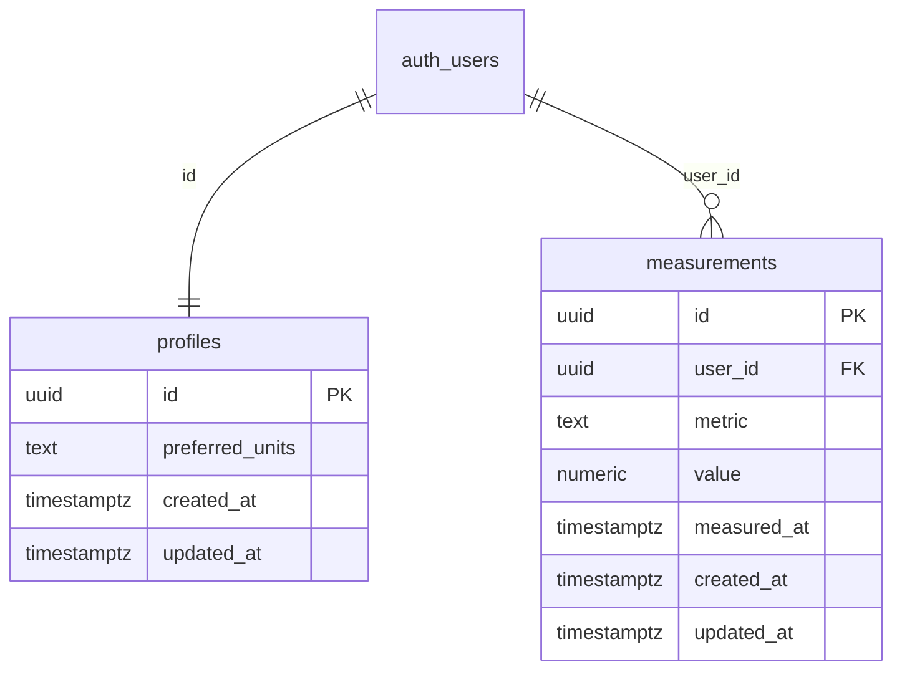

# Spec: pierwsza migracja schematu (profiles + baseline RLS)

**Status:** SPEC ONLY — **nie zastosowana** na Cloud `dev` ani lokalnie.  
**Issue:** [#6](https://github.com/MarekBiolik/GymManager/issues/6)  
**Apply (1:1 z tego specu):** [#21](https://github.com/MarekBiolik/GymManager/issues/21) (po [#14](https://github.com/MarekBiolik/GymManager/issues/14) — katalog `supabase/`)  
**Draft SQL:** [sql/0001_profiles_baseline_rls.sql](sql/0001_profiles_baseline_rls.sql) — oznaczony `NOT APPLIED`

Ten dokument jest **jedynym źródłem prawdy** dla treści pierwszej migracji. Scaffold (#14) nie wymyśla schematu; #21 kopiuje SQL do `supabase/migrations/` bez dryfu.

## Cele

1. Minimalny `profiles` (1:1 z `auth.users`, minimum PII — [ADR 0007](../decisions/0007-auth-providers-minimum-pii.md)).
2. Baseline pod sync: `updated_at` + LWW na wiersz ([ADR 0008](../decisions/0008-sync-strategy-online-first.md)).
3. RLS per użytkownik na każdej tabeli.
4. 1 tabela domenowa (`measurements`) do smoke RLS / hello-sync — bez pełnego modelu żywienia/treningu.

## Non-goals

| Poza zakresem | Gdzie |
|---------------|--------|
| Apply / `supabase db push` | [#21](https://github.com/MarekBiolik/GymManager/issues/21) |
| Pusty scaffold monorepo | [#14](https://github.com/MarekBiolik/GymManager/issues/14) |
| Auth UI / IdP Google+Apple | [#12](https://github.com/MarekBiolik/GymManager/issues/12), faza 2 |
| Pełne usuwanie konta (Edge Function, UI) | [#13](https://github.com/MarekBiolik/GymManager/issues/13); tu tylko `ON DELETE CASCADE` |
| `foods`, `food_entries`, `exercises`, `sessions`, `sets`, `tags` | fazy 3–5; ten sam wzorzec RLS + `updated_at` |
| Tombstone / soft-delete | poza MVP ([ADR 0008](../decisions/0008-sync-strategy-online-first.md)) |
| Storage buckets | później |

## Decyzje schematu (zamknięte w tym specu)

| Temat | Decyzja |
|-------|---------|
| PK | `uuid` (`gen_random_uuid()`); nie ULID |
| Czas | `timestamptz`, domyślnie `now()` |
| `updated_at` | Trigger `BEFORE UPDATE` ustawia `now()` — jedna konwencja; klient **może** też wysłać wartość, ale serwer nadpisuje przy UPDATE |
| LWW | Klient porównuje / wybiera wiersz z późniejszym `updated_at` ([ADR 0008](../decisions/0008-sync-strategy-online-first.md)); brak merge per-pole |
| Soft-delete | Brak; hard delete |
| `profiles` ↔ Auth | `profiles.id` = `auth.users.id`, FK `ON DELETE CASCADE` |
| Auto-profil | Trigger `AFTER INSERT ON auth.users` → wiersz w `profiles` |
| Tabele domenowe | tylko `measurements` (smoke); `user_id` → `auth.users(id)` `ON DELETE CASCADE` |
| RLS | włączone; polityki `SELECT/INSERT/UPDATE/DELETE` tylko dla własnych wierszy |
| Grant | `authenticated` — CRUD; brak grantów `anon` na tabele użytkownika |

## Tabele

### `public.profiles`

Rekord aplikacji 1:1 z kontem Auth. Zgodność: [glossary](../domain/glossary.md), [data-model](../domain/data-model.md), [auth](../architecture/auth.md).

| Kolumna | Typ | Constraints | Uwagi |
|---------|-----|-------------|--------|
| `id` | `uuid` | PK, FK → `auth.users(id)` ON DELETE CASCADE | = JWT `sub` / `auth.uid()` |
| `preferred_units` | `text` | NOT NULL, DEFAULT `'kg'`, CHECK (`kg` \| `lb`) | preferencja UI, nie PII |
| `created_at` | `timestamptz` | NOT NULL, DEFAULT `now()` | |
| `updated_at` | `timestamptz` | NOT NULL, DEFAULT `now()` | LWW |

**Zakaz kolumn:** email, display name, avatar, imię, płeć, data urodzenia, telefon, adres.

Indeksy: tylko PK (wystarczy dla 1:1).

### `public.measurements`

Pomiar ciała — [glossary — Measurement](../domain/glossary.md). Wystarcza do weryfikacji RLS + sync bez czekania na fazę 5.

| Kolumna | Typ | Constraints | Uwagi |
|---------|-----|-------------|--------|
| `id` | `uuid` | PK, DEFAULT `gen_random_uuid()` | |
| `user_id` | `uuid` | NOT NULL, FK → `auth.users(id)` ON DELETE CASCADE | izolacja RLS |
| `metric` | `text` | NOT NULL | np. `body_weight_kg`, `waist_cm` |
| `value` | `numeric` | NOT NULL | |
| `measured_at` | `timestamptz` | NOT NULL | kiedy pomiar |
| `created_at` | `timestamptz` | NOT NULL, DEFAULT `now()` | |
| `updated_at` | `timestamptz` | NOT NULL, DEFAULT `now()` | LWW |

Indeks startowy: `(user_id, measured_at DESC)` — listy historii per użytkownik.

CHECK na `metric` **nie** w tej migracji (katalog metryk rozrośnie się w fazie 5).

## Trigger `updated_at`

Jedna funkcja (security definer nie jest wymagany):

```sql
CREATE OR REPLACE FUNCTION public.set_updated_at()
RETURNS trigger
LANGUAGE plpgsql
AS $$
BEGIN
  NEW.updated_at := now();
  RETURN NEW;
END;
$$;
```

Podpięta `BEFORE UPDATE` na `profiles` i `measurements`.

## Trigger auto-`profiles`

Po rejestracji Auth tworzy pusty profil (preferencje = default `kg`):

```sql
CREATE OR REPLACE FUNCTION public.handle_new_user()
RETURNS trigger
LANGUAGE plpgsql
SECURITY DEFINER
SET search_path = public
AS $$
BEGIN
  INSERT INTO public.profiles (id) VALUES (NEW.id);
  RETURN NEW;
END;
$$;

CREATE TRIGGER on_auth_user_created
  AFTER INSERT ON auth.users
  FOR EACH ROW EXECUTE FUNCTION public.handle_new_user();
```

Uwaga implementacyjna (#21): w starszych wersjach Postgres/Supabase składnia to `EXECUTE PROCEDURE`; CLI wygeneruje właściwą formę — zachować semantykę.

## Polityki RLS

RLS **włączone** na obu tabelach. Wzorzec: `auth.uid()` musi być równy właścicielowi wiersza.

### `profiles`

| Operacja | Nazwa (propozycja) | Wyrażenie |
|----------|-------------------|-----------|
| SELECT | `profiles_select_own` | `USING (id = auth.uid())` |
| INSERT | `profiles_insert_own` | `WITH CHECK (id = auth.uid())` |
| UPDATE | `profiles_update_own` | `USING` + `WITH CHECK (id = auth.uid())` |
| DELETE | `profiles_delete_own` | `USING (id = auth.uid())` |

INSERT z klienta jest rzadki (trigger Auth); polityka i tak istnieje, żeby nie blokować świadomego upsertu przy edge case.

### `measurements`

| Operacja | Nazwa (propozycja) | Wyrażenie |
|----------|-------------------|-----------|
| SELECT | `measurements_select_own` | `USING (user_id = auth.uid())` |
| INSERT | `measurements_insert_own` | `WITH CHECK (user_id = auth.uid())` |
| UPDATE | `measurements_update_own` | `USING` + `WITH CHECK (user_id = auth.uid())` |
| DELETE | `measurements_delete_own` | `USING (user_id = auth.uid())` |

**Zasada dla przyszłych tabel użytkownika:** te same cztery polityki na `user_id` (lub `id` dla `profiles`), migracja **razem** z RLS — [data-and-sync](../architecture/data-and-sync.md#row-level-security-rls).

## Diagram (zakres tej migracji)



## Smoke po apply (#21) — checklista

Nie część tego PR (docs only). Po wdrożeniu SQL na `dev`:

1. Utwórz użytkownika testowego (Dashboard Auth lub OAuth gdy #12 gotowe).
2. Potwierdź automatyczny wiersz w `profiles` (`id` = user, `preferred_units` = `kg`).
3. Jako ten JWT: INSERT/SELECT/UPDATE/DELETE własnego `measurements` — OK.
4. Jako inny JWT: brak wierszy pierwszego użytkownika (SELECT puste; UPDATE/DELETE 0 rows).
5. UPDATE `profiles.preferred_units` → `updated_at` zmienia się przez trigger.
6. Usuń użytkownika w Auth → CASCADE usuwa `profiles` + `measurements`.

## Mapowanie na playbook / fazę 1

| Artefakt | Rola |
|----------|------|
| Ten spec + draft SQL | Output [#6](https://github.com/MarekBiolik/GymManager/issues/6) |
| [phase-1 playbook](../plans/phase-1-scaffold-playbook.md) | #14 może iść bez apply; treść migracji = tu; apply = #21 |
| [#21](https://github.com/MarekBiolik/GymManager/issues/21) | Skopiuj draft → `supabase/migrations/…sql`, apply na `dev`, CI lint |

## Powiązane

- [ADR 0007](../decisions/0007-auth-providers-minimum-pii.md), [ADR 0008](../decisions/0008-sync-strategy-online-first.md)
- [postgres-invariants](../architecture/postgres-invariants.md) — checklista RLS / CHECK przy migracjach
- [auth](../architecture/auth.md), [data-and-sync](../architecture/data-and-sync.md)
- [data-model](../domain/data-model.md), [glossary](../domain/glossary.md)
- [roadmap — faza 1](../roadmap.md)
