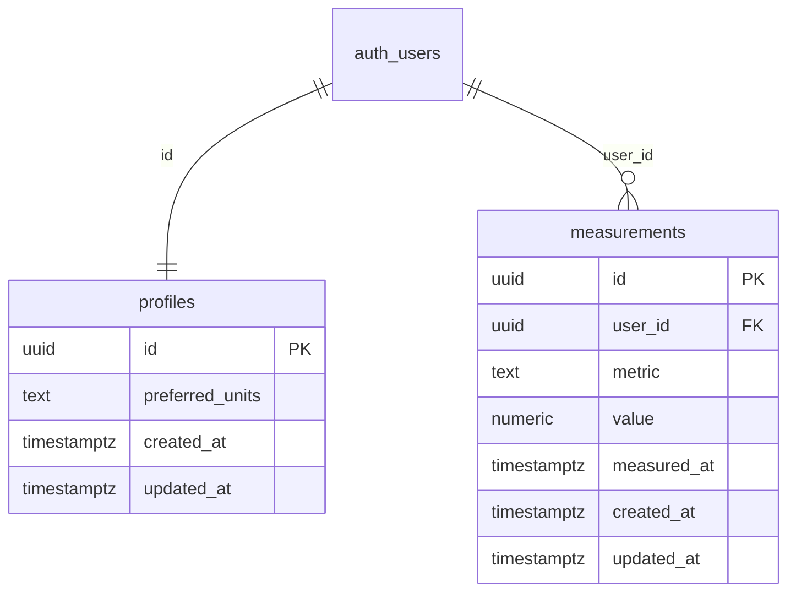

# Spec: first schema migration (profiles + baseline RLS)

**Status:** SPEC ONLY — **not applied** on Cloud `dev` or locally.  
**Issue:** [#6](https://github.com/MarekBiolik/GymManager/issues/6)  
**Apply (1:1 with this spec):** [#21](https://github.com/MarekBiolik/GymManager/issues/21) (after [#14](https://github.com/MarekBiolik/GymManager/issues/14) — `supabase/` directory)  
**Draft SQL:** [sql/0001_profiles_baseline_rls.sql](sql/0001_profiles_baseline_rls.sql) — marked `NOT APPLIED`

This document is the **sole source of truth** for the first migration’s content. Scaffold (#14) does not invent schema; #21 copies SQL into `supabase/migrations/` without drift.

## Goals

1. Minimal `profiles` (1:1 with `auth.users`, minimum PII — [ADR 0007](../decisions/0007-auth-providers-minimum-pii.md)).
2. Sync baseline: `updated_at` + LWW per row ([ADR 0008](../decisions/0008-sync-strategy-online-first.md)).
3. Per-user RLS on every table.
4. One domain table (`measurements`) for RLS / hello-sync smoke — without the full nutrition/training model.

## Non-goals

| Out of scope | Where |
|--------------|--------|
| Apply / `supabase db push` | [#21](https://github.com/MarekBiolik/GymManager/issues/21) |
| Empty monorepo scaffold | [#14](https://github.com/MarekBiolik/GymManager/issues/14) |
| Auth UI / Google+Apple IdP | [idp-config-checklist](idp-config-checklist.md) / [#12](https://github.com/MarekBiolik/GymManager/issues/12), phase 2 |
| Full account deletion (Edge Function, UI) | [#13](https://github.com/MarekBiolik/GymManager/issues/13); here only `ON DELETE CASCADE` |
| `foods`, `food_entries`, `exercises`, `sessions`, `sets`, `tags` | phases 3–5; same RLS + `updated_at` pattern |
| Tombstone / soft-delete | beyond MVP ([ADR 0008](../decisions/0008-sync-strategy-online-first.md)) |
| Storage buckets | later |

## Schema decisions (closed in this spec)

| Topic | Decision |
|-------|----------|
| PK | `uuid` (`gen_random_uuid()`); not ULID |
| Time | `timestamptz`, default `now()` |
| `updated_at` | `BEFORE UPDATE` trigger sets `now()` — one convention; client **may** also send a value, but the server overwrites on UPDATE |
| LWW | Client compares / picks the row with later `updated_at` ([ADR 0008](../decisions/0008-sync-strategy-online-first.md)); no per-field merge |
| Soft-delete | None; hard delete |
| `profiles` ↔ Auth | `profiles.id` = `auth.users.id`, FK `ON DELETE CASCADE` |
| Auto-profile | Trigger `AFTER INSERT ON auth.users` → `profiles` row |
| Domain tables | only `measurements` (smoke); `user_id` → `auth.users(id)` `ON DELETE CASCADE` |
| RLS | enabled; `SELECT/INSERT/UPDATE/DELETE` policies only for own rows |
| Grant | `authenticated` — CRUD; no `anon` grants on user tables |

## Tables

### `public.profiles`

App record 1:1 with the Auth account. Alignment: [glossary](../domain/glossary.md), [data-model](../domain/data-model.md), [auth](../architecture/auth.md).

| Column | Type | Constraints | Notes |
|--------|------|-------------|--------|
| `id` | `uuid` | PK, FK → `auth.users(id)` ON DELETE CASCADE | = JWT `sub` / `auth.uid()` |
| `preferred_units` | `text` | NOT NULL, DEFAULT `'kg'`, CHECK (`kg` \| `lb`) | UI preference, not PII |
| `created_at` | `timestamptz` | NOT NULL, DEFAULT `now()` | |
| `updated_at` | `timestamptz` | NOT NULL, DEFAULT `now()` | LWW |

**Forbidden columns:** email, display name, avatar, name, gender, date of birth, phone, address.

Indexes: PK only (enough for 1:1).

### `public.measurements`

Body measurement — [glossary — Measurement](../domain/glossary.md). Enough to verify RLS + sync without waiting for phase 5.

| Column | Type | Constraints | Notes |
|--------|------|-------------|--------|
| `id` | `uuid` | PK, DEFAULT `gen_random_uuid()` | |
| `user_id` | `uuid` | NOT NULL, FK → `auth.users(id)` ON DELETE CASCADE | RLS isolation |
| `metric` | `text` | NOT NULL | e.g. `body_weight_kg`, `waist_cm` |
| `value` | `numeric` | NOT NULL | |
| `measured_at` | `timestamptz` | NOT NULL | when measured |
| `created_at` | `timestamptz` | NOT NULL, DEFAULT `now()` | |
| `updated_at` | `timestamptz` | NOT NULL, DEFAULT `now()` | LWW |

Starting index: `(user_id, measured_at DESC)` — per-user history lists.

CHECK on `metric` is **not** in this migration (metric catalog grows in phase 5).

## `updated_at` trigger

One function (security definer not required):

```sql
CREATE OR REPLACE FUNCTION public.set_updated_at()
RETURNS trigger
LANGUAGE plpgsql
AS $$
BEGIN
  NEW.updated_at := now();
  RETURN NEW;
END;
$$;
```

Attached `BEFORE UPDATE` on `profiles` and `measurements`.

## Auto-`profiles` trigger

After Auth registration creates an empty profile (preferences = default `kg`):

```sql
CREATE OR REPLACE FUNCTION public.handle_new_user()
RETURNS trigger
LANGUAGE plpgsql
SECURITY DEFINER
SET search_path = public
AS $$
BEGIN
  INSERT INTO public.profiles (id) VALUES (NEW.id);
  RETURN NEW;
END;
$$;

CREATE TRIGGER on_auth_user_created
  AFTER INSERT ON auth.users
  FOR EACH ROW EXECUTE FUNCTION public.handle_new_user();
```

Implementation note (#21): older Postgres/Supabase versions use `EXECUTE PROCEDURE`; the CLI will emit the right form — keep the semantics.

## RLS policies

RLS **enabled** on both tables. Pattern: `auth.uid()` must equal the row owner.

### `profiles`

| Operation | Name (proposal) | Expression |
|-----------|-----------------|------------|
| SELECT | `profiles_select_own` | `USING (id = auth.uid())` |
| INSERT | `profiles_insert_own` | `WITH CHECK (id = auth.uid())` |
| UPDATE | `profiles_update_own` | `USING` + `WITH CHECK (id = auth.uid())` |
| DELETE | `profiles_delete_own` | `USING (id = auth.uid())` |

Client INSERT is rare (Auth trigger); the policy still exists so a deliberate upsert is not blocked in edge cases.

### `measurements`

| Operation | Name (proposal) | Expression |
|-----------|-----------------|------------|
| SELECT | `measurements_select_own` | `USING (user_id = auth.uid())` |
| INSERT | `measurements_insert_own` | `WITH CHECK (user_id = auth.uid())` |
| UPDATE | `measurements_update_own` | `USING` + `WITH CHECK (user_id = auth.uid())` |
| DELETE | `measurements_delete_own` | `USING (user_id = auth.uid())` |

**Rule for future user tables:** the same four policies on `user_id` (or `id` for `profiles`), migration **together** with RLS — [data-and-sync](../architecture/data-and-sync.md#row-level-security-rls).

## Diagram (this migration’s scope)



## Smoke after apply (#21) — checklist

Not part of this PR (docs only). After SQL is deployed on `dev`:

1. Create a test user (Auth Dashboard or OAuth when #12 is ready).
2. Confirm automatic `profiles` row (`id` = user, `preferred_units` = `kg`).
3. As that JWT: INSERT/SELECT/UPDATE/DELETE own `measurements` — OK.
4. As another JWT: no first user’s rows (SELECT empty; UPDATE/DELETE 0 rows).
5. UPDATE `profiles.preferred_units` → `updated_at` changes via trigger.
6. Delete user in Auth → CASCADE removes `profiles` + `measurements`.

## Mapping to playbook / phase 1

| Artifact | Role |
|----------|------|
| This spec + draft SQL | Output of [#6](https://github.com/MarekBiolik/GymManager/issues/6) |
| [roadmap phase 1](../roadmap.md) / [supabase/APPLY_DEV.md](../../supabase/APPLY_DEV.md) | Migration content = here; apply = #21 |
| [#21](https://github.com/MarekBiolik/GymManager/issues/21) | Copy draft → `supabase/migrations/…sql`, apply on `dev`, CI lint |

## Related

- [ADR 0007](../decisions/0007-auth-providers-minimum-pii.md), [ADR 0008](../decisions/0008-sync-strategy-online-first.md)
- [postgres-invariants](../architecture/postgres-invariants.md) — RLS / CHECK checklist for migrations
- [auth](../architecture/auth.md), [data-and-sync](../architecture/data-and-sync.md)
- [data-model](../domain/data-model.md), [glossary](../domain/glossary.md)
- [roadmap — phase 1](../roadmap.md)
