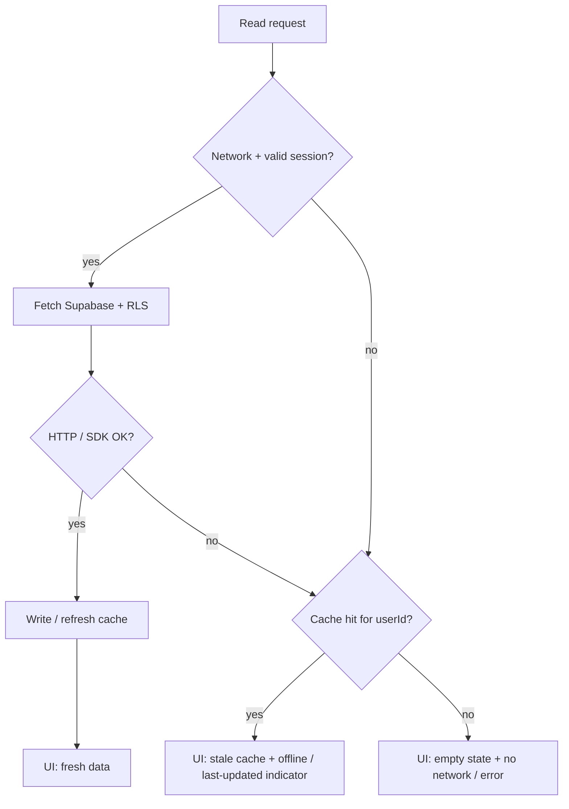

# Spec: read-cache and hello-sync contract (phase 2)

**Status:** SPEC ONLY — client contract; **no** application code.  
**Issue:** [#19](https://github.com/MarekBiolik/GymManager/issues/19)  
**Parent decision:** [ADR 0008](../decisions/0008-sync-strategy-online-first.md)  
**Smoke schema:** [first-migration-profiles-rls](first-migration-profiles-rls.md) (`profiles`, `measurements`)  
**Client split:** [ADR 0006](../decisions/0006-web-supabase-js-without-kmp-js.md), [shared-core](../architecture/shared-core.md), [clients](../architecture/clients.md)

This document refines the **operational contract** for the read cache and minimal “hello sync” under ADR 0008. Realtime is **not** required to accept this baseline.

## Goals

1. One explicit list of entities / queries in **hello sync** scope (phase-2 smoke).
2. Cache **invalidation** rules after insert / update / delete and after re-login / logout.
3. Offline UX: write blocked with a message; read from stale cache (or empty state).
4. Explicit split: what lives in `core` (mobile) vs thin web layer (`supabase-js`).
5. Smoke acceptance criteria without an offline-write engine and without Realtime.

## Non-goals

| Out of scope | Where |
|--------------|--------|
| Application code (repositories, UI, storage) | phase-2 code — after this spec |
| Offline-write / queue / optimistic commit | [#20](https://github.com/MarekBiolik/GymManager/issues/20); separate ADR |
| Mandatory Supabase Realtime | ADR 0008 — optional improvement after hello sync |
| Full nutrition / training model in cache | phases 3–4; same pattern as below |
| Per-field merge / “resolve conflict” UI | beyond MVP; LWW per row |
| Shared web↔mobile sync binary | ADR 0006 — web without KMP-JS |

## Hello sync — smoke definition

**Hello sync** = after sign-in, on **one** client (mobile or web), the user:

1. Reads their own `profiles` row (1 row) and their own `measurements` list (may be empty).
2. Creates / updates / deletes at least one `measurements` row **when online**.
3. Sees the refreshed result in the UI (from network or from cache after a successful write).
4. Without network: still sees last cached data (if any); writes are **rejected** with a message — no queue.

Auth / IdP / login UI is a separate phase-2 track; this spec assumes a **valid JWT session** (see [auth](../architecture/auth.md)).

## Cache scope (entities / queries)

### In hello sync (required)

| Entity / query | Logical cache key | Notes |
|----------------|-------------------|--------|
| `profiles` — current user row | `profile:{userId}` | `userId` = JWT `sub` = `profiles.id` |
| `measurements` — own row list | `measurements:list:{userId}` | Sort by `measured_at DESC` (as in migration #6 index) |
| `measurements` — single row (optional for detail) | `measurements:item:{id}` | Invalidate with the list after mutating that `id` |

### Outside hello sync (deliberately later)

| Entity | Status |
|--------|--------|
| `foods`, `food_entries`, `exercises`, `sessions` / sets, `tags` | same key + invalidation pattern when they arrive in phases 3–5 |
| SQL aggregations / views | **do not** cache locally in MVP; compute online or materialize later |
| Storage files | outside this contract |

### What a cache entry holds

Minimal shape (platform-independent):

| Field | Meaning |
|-------|---------|
| `payload` | Row / list of rows matching the Postgres schema (DTO) |
| `fetchedAt` | Local time of successful fetch (for UI “last updated”) |
| `userId` | Owner — **must** match the current session; on mismatch → treat as miss |

The cache does **not** store offline write drafts or a mutation queue.

## Read policy (online-first)



Rules:

1. **Online + success:** network result is the UI source; cache is overwritten.
2. **Online + network error / timeout:** if cache exists for this `userId` → show **stale**; otherwise empty state + error / offline message.
3. **Offline:** never pretend fresh SoT — show cache or empty state.
4. **No valid session:** no reads of protected tables; clear the user’s cache (see invalidation).

LWW when two copies of the same row exist (e.g. list vs detail response): the row with later `updated_at` wins ([ADR 0008](../decisions/0008-sync-strategy-online-first.md), [migration spec](first-migration-profiles-rls.md)).

## Write policy (online only)

| Condition | Behavior |
|-----------|----------|
| Online + valid session | `INSERT` / `UPDATE` / `DELETE` via API + RLS; on **success** → invalidate / upsert cache (below) |
| Offline or network loss mid-request | **Reject** the mutation; UI shows a message; **do not** queue; **do not** mutate cache as if the write succeeded |
| RLS / 4xx / 5xx error | Error message; no optimistic cache commit |

Hard delete: after a successful `DELETE` the row disappears from Postgres and from cache (no tombstone in MVP).

## Invalidation

### After a successful mutation (same client)

| Mutation | Cache action |
|----------|--------------|
| `INSERT measurements` | Upsert row in `measurements:item:{id}`; **insert / refresh** list `measurements:list:{userId}` (prefer list re-fetch when cheap; otherwise local merge + sort) |
| `UPDATE measurements` | Upsert item + refresh / merge list; on local conflict apply LWW by `updated_at` |
| `DELETE measurements` | Remove `measurements:item:{id}`; remove row from list |
| `UPDATE profiles` | Overwrite `profile:{userId}` with server response (or re-fetch) |

Rule: **do not** leave the UI on pre-write state if the server confirmed different content — cache follows ACK.

### After re-login / session change

| Event | Action |
|-------|--------|
| Logout | **Clear all** read-cache tied to the previous `userId` (memory + durable client storage) |
| Login as a different user on the device | Clear previous user’s cache **before** the first new read; never show another user’s rows from a stale store |
| Re-login of the **same** `userId` | Cold start with empty cache **or** keep previous-session cache **only** if `userId` is verified; hello-sync recommendation: after a fresh login, **re-fetch** `profile` + `measurements` list when online |
| Token refresh / session renew without `userId` change | **No** mandatory wipe; reads as usual |
| Session expiry (no valid JWT) | Treat as no access to protected data; do not serve cache as a “signed-in” view — banner / redirect to login; clear on logout |

### On app start

- Valid session + network: lifecycle refresh (re-fetch hello-sync keys) — baseline instead of Realtime.
- Valid session + no network: show stale cache with indicator; do not blank the whole UI when cache exists.

## UX (message contract)

Texts below are **semantics**, not final brand copy.

| Situation | UI |
|-----------|-----|
| Offline read, cache hit | Data visible; persistent / non-intrusive indicator: offline or “last updated: {fetchedAt}” |
| Offline read, cache miss | Empty state + “No network” (or equivalent); CTA: retry when online |
| Offline write attempt | Block submit / disabled + message like: “A network connection is required to save” — **no** silent “saved locally” |
| Online write failed | Error message; form remains; cache does not fake success |
| Hello sync online OK | List / profile reflects Postgres after fetch or write ACK |

MVP forbid: optimistic UI that after app restart looks like a confirmed write without server ACK.

## Split: `core` vs thin web layer

Per [ADR 0006](../decisions/0006-web-supabase-js-without-kmp-js.md) and [ADR 0008](../decisions/0008-sync-strategy-online-first.md) — **same behavior**, two I/O implementations.

| Responsibility | Mobile (`core` / KMP) | Web (`apps/web`) |
|----------------|----------------------|------------------|
| SoT / RLS / JWT | Supabase (`supabase-kt`) | Supabase (`supabase-js`) |
| Read-cache store | `core/sync/` — thin helper (memory + optional SQLDelight / DataStore); **not** a write queue | Thin TS helper: memory + optional `sessionStorage` / `localStorage`; **no** “domain sync engine” package parallel to core |
| Invalidation / cache keys | Logic in `core/sync` + repositories | Same rules (this document) implemented thinly next to `supabase-js` calls — no business use-cases in TS |
| LWW by `updated_at` | Compare in core when merging cache | Same when merging responses / cache; server remains SoT |
| UI banner / empty state / write block | Compose / SwiftUI over core API | React over session state + query results |
| Domain rules (macros, session completeness, …) | Core only | **Not** in TS; shared invariants in Postgres — [postgres-invariants](../architecture/postgres-invariants.md) |

```
Mobile:  UI → core (application / data / sync) → supabase-kt → Postgres
Web:     UI → thin TS glue (cache helper) → supabase-js → Postgres
```

Both clients write to the **same** Postgres under the same `user_id`. Web↔mobile offline-write parity is **not** a goal of this spec.

## Acceptance criteria (docs / later code smoke)

- [ ] Hello-sync cache scope = `profiles` + `measurements` (list ± item) as in the table above.
- [ ] Invalidation after insert/update/delete and wipe / re-fetch on re-login described and consistent with ADR 0008.
- [ ] UX: message on offline write; read from stale cache or empty state.
- [ ] Explicit core vs web split without a shared sync binary.
- [ ] Realtime is not required for “hello sync done”.
- [ ] Linked from [phase-2 roadmap](../roadmap.md) and [data-and-sync](../architecture/data-and-sync.md).

## Related

- [ADR 0008](../decisions/0008-sync-strategy-online-first.md) — strategy decision
- [data-and-sync](../architecture/data-and-sync.md) — sync overview
- [first-migration-profiles-rls](first-migration-profiles-rls.md) — smoke tables
- [ADR 0006](../decisions/0006-web-supabase-js-without-kmp-js.md), [ADR 0007](../decisions/0007-auth-providers-minimum-pii.md)
- Offline-write follow-up: [#20](https://github.com/MarekBiolik/GymManager/issues/20)
