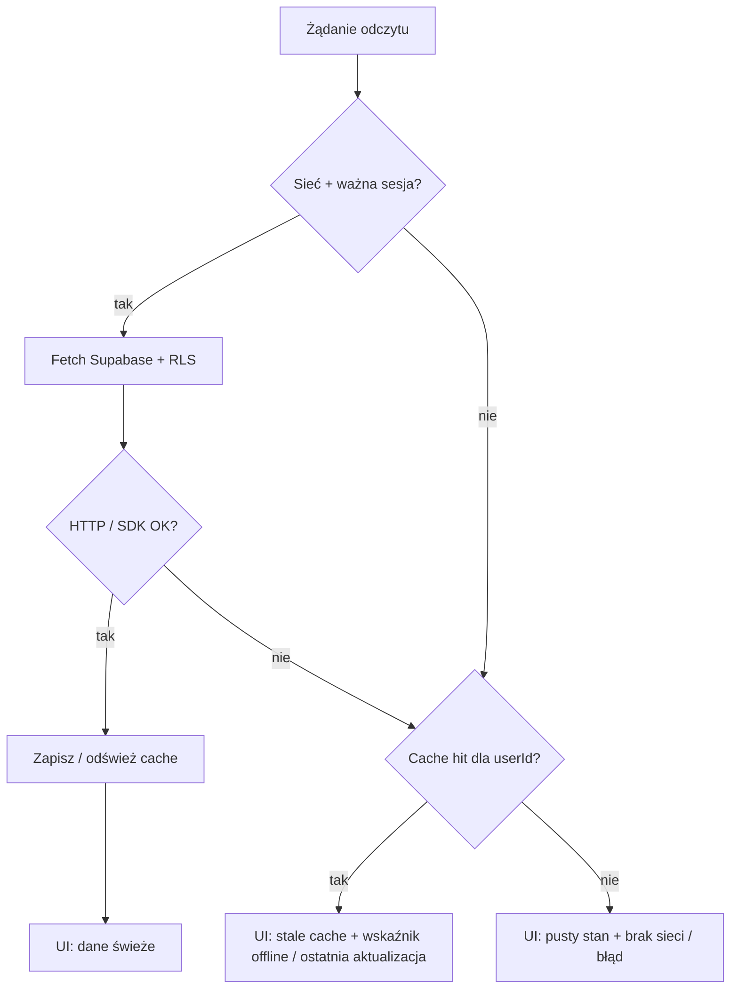

# Spec: kontrakt read-cache i hello sync (faza 2)

**Status:** SPEC ONLY — kontrakt klienta; **bez** implementacji kodu aplikacji.  
**Issue:** [#19](https://github.com/MarekBiolik/GymManager/issues/19)  
**Decyzja nadrzędna:** [ADR 0008](../decisions/0008-sync-strategy-online-first.md)  
**Schemat smoke:** [first-migration-profiles-rls](first-migration-profiles-rls.md) (`profiles`, `measurements`)  
**Podział klientów:** [ADR 0006](../decisions/0006-web-supabase-js-without-kmp-js.md), [shared-core](../architecture/shared-core.md), [clients](../architecture/clients.md)

Ten dokument doprecyzowuje **operacyjny kontrakt** cache odczytu i minimalnego „hello sync” pod ADR 0008. Realtime **nie** jest wymagane do akceptacji tego baseline.

## Cele

1. Jedna, jawna lista encji / zapytań w zakresie **hello sync** (smoke fazy 2).
2. Reguły **invalidacji** cache po insert / update / delete oraz po re-login / wylogowaniu.
3. UX offline: zapis zablokowany z komunikatem; odczyt ze stale cache (lub pusty stan).
4. Jawny podział: co żyje w `core` (mobile) vs cienka warstwa web (`supabase-js`).
5. Kryteria smoke akceptacji bez silnika offline-write i bez Realtime.

## Non-goals

| Poza zakresem | Gdzie |
|---------------|--------|
| Implementacja kodu (repozytoria, UI, storage) | faza 2 kod — po tym specu |
| Offline-write / kolejka / optimistic commit | [#20](https://github.com/MarekBiolik/GymManager/issues/20); osobny ADR |
| Obowiązkowy Supabase Realtime | ADR 0008 — opcjonalne ulepszenie po hello sync |
| Pełny model żywienia / treningu w cache | fazy 3–4; ten sam wzorzec co poniżej |
| Merge per-pole / UI „resolve conflict” | poza MVP; LWW na wiersz |
| Wspólny binary sync web↔mobile | ADR 0006 — web bez KMP-JS |

## Hello sync — definicja smoke

**Hello sync** = po zalogowaniu użytkownik na **jednym** kliencie (mobile lub web):

1. Odczytuje własny `profiles` (1 wiersz) oraz listę własnych `measurements` (może być pusta).
2. Tworzy / aktualizuje / usuwa co najmniej jeden wiersz `measurements` **gdy online**.
3. Widzi odświeżony wynik w UI (z sieci lub z cache po udanym zapisie).
4. Przy braku sieci: nadal widzi ostatnio zcache’owane dane (jeśli są); zapis jest **odrzucany** z komunikatem — bez kolejki.

Auth / IdP / login UI to osobny tor fazy 2; ten spec zakłada **ważną sesję JWT** (patrz [auth](../architecture/auth.md)).

## Zakres cache (encje / zapytania)

### W hello sync (obowiązkowe)

| Encja / zapytanie | Klucz cache (logiczny) | Uwagi |
|-------------------|------------------------|--------|
| `profiles` — wiersz bieżącego użytkownika | `profile:{userId}` | `userId` = JWT `sub` = `profiles.id` |
| `measurements` — lista własnych wierszy | `measurements:list:{userId}` | Sort wg `measured_at DESC` (jak indeks w migracji #6) |
| `measurements` — pojedynczy wiersz (opcjonalnie przy szczegółach) | `measurements:item:{id}` | Invalidacja razem z listą po mutacji tego `id` |

### Poza hello sync (świadomie później)

| Encja | Status |
|-------|--------|
| `foods`, `food_entries`, `exercises`, `sessions` / `worksets`, `tags` | ten sam wzorzec kluczy + invalidacji gdy dojdą w fazach 3–5 |
| Agregacje SQL / widoki | **nie** cache’ować lokalnie w MVP; liczyć online lub materializować później |
| Pliki Storage | poza tym kontraktem |

### Co trzymamy w wpisie cache

Minimalny kształt (niezależny od platformy):

| Pole | Znaczenie |
|------|-----------|
| `payload` | Wiersz / lista wierszy zgodna ze schematem Postgres (DTO) |
| `fetchedAt` | Czas lokalny udanego fetch (do UI „ostatnia aktualizacja”) |
| `userId` | Właściciel — **musi** zgadzać się z bieżącą sesją; przy mismatch → traktuj jako miss |

Cache **nie** przechowuje draftów zapisów offline ani kolejki mutacji.

## Polityka odczytu (online-first)



Reguły:

1. **Online + sukces:** wynik z sieci jest źródłem UI; cache jest nadpisywany.
2. **Online + błąd sieci / timeout:** jeśli jest cache dla tego `userId` → pokaż **stale**; w przeciwnym razie pusty stan + komunikat błędu / braku sieci.
3. **Offline:** nigdy nie udawaj świeżego SoT — pokaż cache lub pusty stan.
4. **Bez ważnej sesji:** brak odczytu chronionych tabel; wyczyść cache użytkownika (patrz invalidacja).

LWW przy dwóch kopiach tego samego wiersza (np. odpowiedź listy vs szczegół): wygrywa wiersz z późniejszym `updated_at` ([ADR 0008](../decisions/0008-sync-strategy-online-first.md), [spec migracji](first-migration-profiles-rls.md)).

## Polityka zapisu (tylko online)

| Warunek | Zachowanie |
|---------|------------|
| Online + ważna sesja | `INSERT` / `UPDATE` / `DELETE` przez API + RLS; po **sukcesie** → invalidacja / upsert cache (poniżej) |
| Offline lub brak sieci w trakcie requestu | **Odrzuć** mutację; UI pokazuje komunikat; **nie** kolejkuj; **nie** mutuj cache jakby zapis się udał |
| Błąd RLS / 4xx / 5xx | Komunikat błędu; cache bez optymistycznego commit |

Hard delete: po udanym `DELETE` wiersz znika z Postgresa i z cache (brak tombstone w MVP).

## Invalidacja

### Po udanej mutacji (ten sam klient)

| Mutacja | Działanie na cache |
|---------|-------------------|
| `INSERT measurements` | Upsert wiersza w `measurements:item:{id}`; **wstaw / odśwież** listę `measurements:list:{userId}` (preferuj re-fetch listy gdy tani; w przeciwnym razie merge lokalny + sort) |
| `UPDATE measurements` | Upsert item + odśwież / merge listy; przy konflikcie lokalnym stosuj LWW po `updated_at` |
| `DELETE measurements` | Usuń `measurements:item:{id}`; usuń wiersz z listy |
| `UPDATE profiles` | Nadpisz `profile:{userId}` odpowiedzią serwera (lub re-fetch) |

Zasada: **nie** zostawiaj UI na stanie sprzed zapisu, jeśli serwer potwierdził inną treść — cache podąża za ACK.

### Po re-login / zmianie sesji

| Zdarzenie | Działanie |
|-----------|-----------|
| Wylogowanie | **Wyczyść cały** read-cache powiązany z poprzednim `userId` (pamięć + trwały storage klienta) |
| Login innego użytkownika na tym urządzeniu | Wyczyść cache poprzedniego użytkownika **przed** pierwszym odczytem nowego; nigdy nie pokaż cudzych wierszy ze stale store |
| Re-login **tego samego** `userId` | Dopuszczalny cold start z pustym cache **albo** zachowanie cache z poprzedniej sesji **tylko** jeśli `userId` zweryfikowany; zalecenie hello sync: po świeżym loginie wykonać **re-fetch** `profile` + listy `measurements` gdy online |
| Refresh token / odnowienie sesji bez zmiany `userId` | **Bez** obowiązkowego wipe; odczyty jak zwykle |
| Wygaśnięcie sesji (brak ważnego JWT) | Traktuj jak brak dostępu do chronionych danych; nie serwuj cache jako „zalogowany” widok — banner / redirect do logowania; przy wylogowaniu wyczyść |

### Po starcie aplikacji

- Jeśli jest ważna sesja i sieć: lifecycle refresh (re-fetch kluczy hello sync) — baseline zamiast Realtime.
- Jeśli jest sesja i brak sieci: pokaż stale cache z wskaźnikiem; nie blokuj całego UI pustym ekranem gdy cache istnieje.

## UX (kontrakt komunikatów)

Teksty poniżej to **semantyka**, nie finalny copy brandingu.

| Sytuacja | UI |
|----------|-----|
| Odczyt offline, cache hit | Dane widoczne; trwały / nieinwazyjny wskaźnik: offline lub „ostatnia aktualizacja: {fetchedAt}” |
| Odczyt offline, cache miss | Pusty stan + „Brak sieci” (lub równoważne); CTA: spróbuj ponownie gdy online |
| Próba zapisu offline | Blokada submit / disabled + komunikat w stylu: „Aby zapisać, potrzebne jest połączenie z siecią” — **bez** cichego „zapisano lokalnie” |
| Zapis online nieudany | Komunikat błędu; formularz pozostaje; cache nie udaje sukcesu |
| Hello sync online OK | Lista / profil odzwierciedla Postgres po fetch lub po ACK zapisu |

Zakaz MVP: optimistic UI, które po restarcie aplikacji wygląda jak potwierdzony zapis bez ACK serwera.

## Podział: `core` vs cienka warstwa web

Zgodnie z [ADR 0006](../decisions/0006-web-supabase-js-without-kmp-js.md) i [ADR 0008](../decisions/0008-sync-strategy-online-first.md) — **to samo zachowanie**, dwie implementacje I/O.

| Odpowiedzialność | Mobile (`core` / KMP) | Web (`apps/web`) |
|------------------|----------------------|------------------|
| SoT / RLS / JWT | Supabase (`supabase-kt`) | Supabase (`supabase-js`) |
| Read-cache store | `core/sync/` — cienki helper (pamięć + opcjonalnie SQLDelight / DataStore); **nie** kolejka zapisów | Cienki helper w TS: pamięć + opcjonalnie `sessionStorage` / `localStorage`; **bez** pakietu „domain sync engine” równoległego do core |
| Invalidacja / klucze cache | Logika w `core/sync` + repozytoria | Te same reguły (ten dokument) zaimplementowane cienko przy wywołaniach `supabase-js` — bez use-case’ów biznesowych w TS |
| LWW po `updated_at` | Porównanie w core przy merge cache | To samo przy merge odpowiedzi / cache; serwer i tak jest SoT |
| UI banner / pusty stan / blokada zapisu | Compose / SwiftUI nad API core | React nad stanem sesji + wynikami zapytań |
| Reguły domenowe (makra, kompletność sesji, …) | Tylko core | **Nie** w TS; wspólne niezmienniki w Postgres — [postgres-invariants](../architecture/postgres-invariants.md) |

```
Mobile:  UI → core (application / data / sync) → supabase-kt → Postgres
Web:     UI → cienki glue TS (cache helper) → supabase-js → Postgres
```

Oba klienci piszą do **tego samego** Postgresa pod tym samym `user_id`. Parity offline-write web↔mobile **nie** jest celem tego specu.

## Kryteria akceptacji (docs / późniejszy smoke kodu)

- [ ] Zakres cache hello sync = `profiles` + `measurements` (lista ± item) jak w tabeli powyżej.
- [ ] Invalidacja po insert/update/delete oraz wipe / re-fetch przy re-login opisane i spójne z ADR 0008.
- [ ] UX: komunikat przy zapisie offline; odczyt ze stale cache lub pusty stan.
- [ ] Jawny podział core vs web bez wspólnego binary sync.
- [ ] Realtime nie jest wymagane do „hello sync done”.
- [ ] Link z [roadmapy fazy 2](../roadmap.md) i [data-and-sync](../architecture/data-and-sync.md).

## Powiązane

- [ADR 0008](../decisions/0008-sync-strategy-online-first.md) — decyzja strategii
- [data-and-sync](../architecture/data-and-sync.md) — przegląd sync
- [first-migration-profiles-rls](first-migration-profiles-rls.md) — tabele smoke
- [ADR 0006](../decisions/0006-web-supabase-js-without-kmp-js.md), [ADR 0007](../decisions/0007-auth-providers-minimum-pii.md)
- Follow-up offline-write: [#20](https://github.com/MarekBiolik/GymManager/issues/20)
