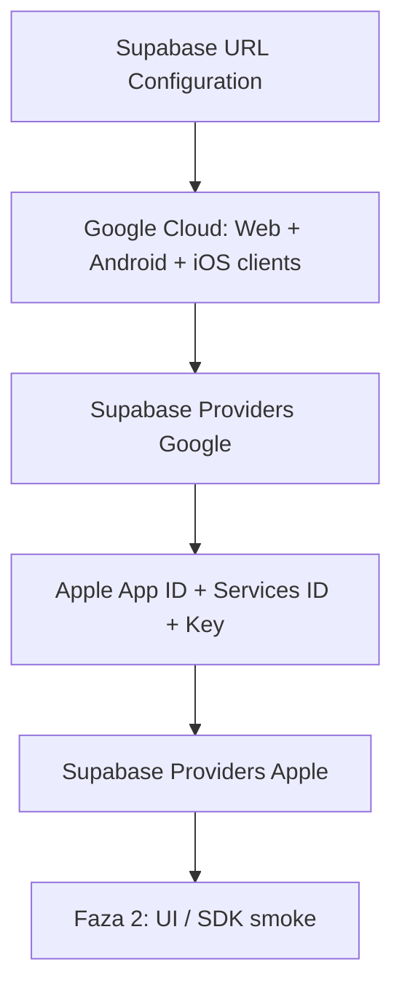

# Spec: checklista konfiguracji IdP (Google + Apple + Supabase)

**Status:** SPEC / runbook konsol — **bez kodu SDK**, bez sekretów w repo.  
**Issue:** [#12](https://github.com/MarekBiolik/GymManager/issues/12)  
**Decyzja product:** [ADR 0007](../decisions/0007-auth-providers-minimum-pii.md)  
**Zachowanie auth:** [architecture/auth.md](../architecture/auth.md)

Checklista dla maintainer’a przed / na początku fazy 2 (login UI). Scaffold fazy 1 (#14) **nie** wymaga zielonego OAuth — ten dokument zamyka „co kliknąć w konsolach”, nie implementację przycisków.

## Cele

1. Google Cloud: OAuth client IDs per platforma (Android / iOS / web) + SHA-1 Android gdy dotyczy.
2. Apple Developer: App ID + capability Sign in with Apple, Services ID, klucz `.p8` pod Supabase (iOS MVP).
3. Supabase Auth: providerzy włączeni, redirect URI / deep linki per klient.
4. Jasna mapa sekretów: Dashboard vs GitHub Secrets vs zakaz w repo/klientach.

## Non-goals

| Poza zakresem | Gdzie |
|---------------|--------|
| Kod `signInWithIdToken` / OAuth UI w apkach | faza 2 (po tej checkliście) |
| Magic link, email+hasło, anon | poza MVP — ADR 0007 |
| Apple na Android / web | poza MVP — ADR 0007 |
| Usuwanie konta (Edge Function / UI) | [#13](https://github.com/MarekBiolik/GymManager/issues/13) |
| Prawdziwe Client ID / sekrety / SHA w git lub PR | **zakaz** — tylko placeholdery |

## Placeholdery (używaj w docs / PR)

| Placeholder | Znaczenie |
|-------------|-----------|
| `YOUR_PROJECT_REF` | Ref projektu Supabase Cloud (`dev`) |
| `https://YOUR_PROJECT_REF.supabase.co` | URL API projektu |
| `https://YOUR_PROJECT_REF.supabase.co/auth/v1/callback` | Callback OAuth **dostawcy → Supabase** |
| `com.YOURORG.gymmanager` | Application ID Android / Bundle ID iOS (ustalić przy scaffoldzie) |
| `com.YOURORG.gymmanager://auth/callback` | Deep link powrotu do apki (scheme + path — jedna konwencja w projekcie) |
| `http://localhost:5173` | Origin / Site URL web lokalnie (dostosuj do portu Vite) |
| `https://YOUR_WEB_ORIGIN` | Deployed web (gdy będzie) |

Oficjalne przewodniki (źródło prawdy procedur klikania):  
[Supabase — Google](https://supabase.com/docs/guides/auth/social-sign-in/auth-google) · [Supabase — Apple](https://supabase.com/docs/guides/auth/social-sign-in/auth-apple) · [Redirect URLs](https://supabase.com/docs/guides/auth/redirect-urls) · [Native deep linking](https://supabase.com/docs/guides/auth/native-mobile-deep-linking)

---

## 1. Supabase Auth — URL Configuration (najpierw)

W Dashboard projektu `dev`: **Authentication → URL Configuration**.

| Pole | Wartość (dev) | Uwagi |
|------|---------------|--------|
| **Site URL** | `http://localhost:5173` (lub origin web) | Domyślny redirect gdy brak `redirectTo` |
| **Additional Redirect URLs** | patrz tabela poniżej | Dokładne match; wildcards tylko świadomie |

### Redirect URI / deep link per klient

Dwie warstwy — nie mylić:

1. **Dostawca → Supabase:** zawsze `https://YOUR_PROJECT_REF.supabase.co/auth/v1/callback` (Google Authorized redirect URI; Apple Services ID return URL). Local CLI: `http://127.0.0.1:54321/auth/v1/callback`.
2. **Supabase → aplikacja** (`redirectTo` / Additional Redirect URLs):

| Klient | IdP w MVP | Typ powrotu | Przykład w Additional Redirect URLs |
|--------|-----------|-------------|-------------------------------------|
| **Web** | Google | HTTPS origin / path | `http://localhost:5173/**`, `https://YOUR_WEB_ORIGIN/**` |
| **Android** | Google | Custom scheme (lub App Links później) | `com.YOURORG.gymmanager://auth/callback` |
| **iOS** | Google + Apple | Custom scheme (lub Universal Links później) | `com.YOURORG.gymmanager://auth/callback` |

Native: ten sam scheme musi być zadeklarowany w manifeście Android / URL Types iOS (implementacja fazy 2 — tu tylko **ustal i wpisz** w Supabase).

Lokalny stack (`supabase start`): osobny callback `127.0.0.1:54321` w Google/Apple **oraz** te same Additional Redirect URLs dla klientów.

- [ ] Site URL ustawiony pod aktualny web/dev
- [ ] Additional Redirect URLs zawierają web + deep link mobile
- [ ] Brak produkcyjnych URL „na zapas” z cudzymi sekretami

---

## 2. Google Cloud — OAuth clients

Konsola: [Google Cloud Console](https://console.cloud.google.com/) → APIs & Services → Credentials (OAuth consent screen najpierw, jeśli pusty).

### 2.1 Wspólne

- [ ] Projekt GCP powiązany z GymManager (może być osobny od innych aptek)
- [ ] OAuth consent screen: External (lub Internal gdy Workspace); scopes minimum (`email`, `profile`, `openid` — to co wymaga flow Supabase/Google)
- [ ] Test users dodani na czas developmentu (gdy app w Testing)

### 2.2 Client IDs per platforma

| Typ klienta Google | Do czego | Co podać w konsoli | Gdzie ląduje wartość |
|--------------------|----------|--------------------|----------------------|
| **Web application** | Provider Google w **Supabase Dashboard** (Client ID + **Client Secret**) oraz flow web | Authorized JavaScript origins: `http://localhost:5173`, `https://YOUR_WEB_ORIGIN`. Authorized redirect URIs: `https://YOUR_PROJECT_REF.supabase.co/auth/v1/callback` (+ local CLI callback gdy używasz) | Supabase → Authentication → Providers → Google |
| **Android** | Native Google Sign-In → `id_token` → Supabase | Package name = `com.YOURORG.gymmanager`; **SHA-1** certyfikatu debug **i** release (osobne fingerprinty) | Client ID (bez secret) w configu apki / core — **nie** secret; opcjonalnie lista Client IDs w Dashboard Google provider (audience) |
| **iOS** | Native Google Sign-In na iOS | Bundle ID = `com.YOURORG.gymmanager` (+ Team ID / App Store ID gdy opublikowane) | Jak Android — Client ID publiczny w kliencie |

Uwagi SHA-1 (Android):

- Debug: `keytool -list -v -keystore …` (lub z Gradle signing report) — fingerprint **debug**.
- Release / Play App Signing: SHA-1 z Play Console (App signing key), nie tylko lokalnego keystore.
- Każdy SHA-1 → zwykle osobny wpis / ten sam Android client z wieloma fingerprintami — trzymaj spójnie z dokumentacją Google; **wszystkie** Client ID używane jako audience dodaj w Supabase Google provider gdy Dashboard na to pozwala.

- [ ] Web client: origins + redirect = callback Supabase
- [ ] Android client: package + SHA-1 debug (i release gdy jest)
- [ ] iOS client: Bundle ID
- [ ] Web Client ID + Client Secret wpisane w Supabase Providers → Google (Enable)
- [ ] Żaden Client Secret Google nie trafił do repo / `.env` commita / zrzutu ekranu w issue

---

## 3. Apple Developer — Sign in with Apple (iOS MVP)

Konto: [Apple Developer](https://developer.apple.com/) → Certificates, Identifiers & Profiles.

Per [ADR 0007](../decisions/0007-auth-providers-minimum-pii.md): Apple **wymagane na iOS** przy Google; **nie** w MVP na Android/web. Native iOS używa App ID; konfiguracja Services ID + klucz i tak jest typowa pod provider Apple w Supabase (Secret generowany z `.p8`).

### 3.1 App ID

- [ ] Identifiers → App IDs → App ID dla `com.YOURORG.gymmanager`
- [ ] Capability **Sign in with Apple** włączona
- [ ] Server-to-Server Notification Endpoint: puste (Supabase na start nie wymaga)

### 3.2 Services ID (pod Supabase / web-style callback)

Nawet gdy MVP nie robi Apple na webie, Services ID + return URL = standardowa ścieżka sekretu Apple w Dashboard Supabase.

- [ ] Nowy Services ID (np. `com.YOURORG.gymmanager.auth`)
- [ ] „Sign in with Apple” → Configure:
  - Domains: `YOUR_PROJECT_REF.supabase.co`
  - Return URLs: `https://YOUR_PROJECT_REF.supabase.co/auth/v1/callback`
- [ ] W Supabase → Providers → Apple: **Client IDs** — Services ID jako wpis używany przez OAuth; dla native dodaj też App ID (Bundle ID) na liście audience. Jeśli kiedyś web Apple: Services ID **pierwszy** na liście (wymóg Supabase dla `signInWithOAuth`).

### 3.3 Key (`.p8`)

- [ ] Keys → Key z włączonym **Sign in with Apple** → powiązanie z App ID
- [ ] Pobierz `AuthKey_XXXXXXXXXX.p8` **raz**; Key ID zapisany offline
- [ ] Team ID (Membership) znany
- [ ] Wygeneruj **Apple client secret** (JWT) narzędziem z docs Supabase (Key ID + Team ID + Services ID + `.p8`) i wklej w Dashboard → Apple → Secret
- [ ] Plik `.p8` i wygenerowany secret: tylko menedżer haseł / Dashboard — **nigdy** git, CI logi, ticket

### 3.4 Xcode / urządzenie (przypomnienie pod fazę 2)

- [ ] Entitlement Sign in with Apple na targetcie iOS
- [ ] URL scheme deep link zgodny z Additional Redirect URLs (gdy flow wraca przez browser/SDK)

---

## 4. Supabase — włączenie providerów

| Provider | Enable | Client ID(s) | Secret |
|----------|--------|--------------|--------|
| **Google** | tak | Web Client ID (+ native IDs jako audience jeśli wymagane) | Web Client Secret |
| **Apple** | tak (pod iOS) | Services ID (+ App ID dla native) | Secret z `.p8` |

- [ ] Google Enabled, test logowania odłożony do UI fazy 2
- [ ] Apple Enabled
- [ ] Redirect URLs (sekcja 1) już uzupełnione przed pierwszym smoke

---

## 5. Sekrety — mapa „gdzie wolno”

Zgodnie z [ADR 0004](../decisions/0004-supabase-hosting.md) i [auth — Role i klucze](../architecture/auth.md#role-i-klucze).

| Sekret / wartość | Dashboard Supabase Auth | GitHub Secrets (CI) | Lokalny `.env*` (gitignore) | Klient (APK/IPA/SPA) | Repo git |
|------------------|-------------------------|---------------------|-----------------------------|----------------------|----------|
| Project URL + `anon` | (projekt) | opcjonalnie e2e | tak | tak (publiczne + RLS) | **nie** commituj `.env*` |
| `service_role` | — | tylko gdy CI naprawdę potrzebuje | admin lokalnie | **zakaz** | **zakaz** |
| Google **Web** Client Secret | **tak** (Providers → Google) | zwykle nie | nie potrzebne w apce | **zakaz** | **zakaz** |
| Google Web / Android / iOS **Client ID** | tak (konfig provider / docs) | rzadko | opcjonalnie | Client ID OK (nie secret) | placeholdery OK; unikaj commitowania produkcyjnych ID bez potrzeby |
| Apple `.p8` / client secret | **tak** (Providers → Apple) | tylko jeśli automatyzacja rotacji | menedżer haseł, nie git | **zakaz** | **zakaz** |
| SHA-1 fingerprint | — | — | docs wewnętrzne OK | — | wolno (nie secret), ale nie łącz z private keystore |

Zasady:

1. W PR i w tym repo: wyłącznie placeholdery z tabeli na górze.
2. Zrzuty ekranu konsol: zamazuj ID/sekrety albo nie wklejaj.
3. Rotacja: wyciek `.p8` / Client Secret → revoke w konsoli IdP + nowy secret w Dashboard natychmiast.

---

## 6. Kolejność wykonania (zalecana)

1. URL Configuration (Site + Additional Redirects).  
2. Google Web client → Supabase Google.  
3. Google Android/iOS clients (SHA-1, Bundle ID).  
4. Apple App ID / Services ID / Key → Supabase Apple.  
5. Dopiero potem kod logowania w klientach (faza 2).

---

## 7. Definition of done (#12)

- [x] Checklista Google Cloud (client IDs per platforma, SHA-1 Android)
- [x] Checklista Apple Developer (capability, Services ID, key) pod Supabase
- [x] Redirect URI / deep link per klient (web / Android / iOS) udokumentowane
- [x] Sekrety: Dashboard vs GitHub Secrets vs zakaz w repo
- [x] Linki do [ADR 0007](../decisions/0007-auth-providers-minimum-pii.md) i [auth.md](../architecture/auth.md)

Wykonanie checkboxów w konsolach = praca maintainer’a przy podpinaniu `dev`; ten dokument nie wymaga dowodu „OAuth green” w CI.

## Powiązane

- [ADR 0007](../decisions/0007-auth-providers-minimum-pii.md), [ADR 0002](../decisions/0002-backend-supabase.md), [ADR 0004](../decisions/0004-supabase-hosting.md)
- [auth](../architecture/auth.md), [data-and-sync — sekrety](../architecture/data-and-sync.md#sekrety)
- [phase-1 scaffold playbook](../plans/phase-1-scaffold-playbook.md) — IdP poza done scaffoldu
- Follow-up implementacji UI: faza 2; usuwanie konta [#13](https://github.com/MarekBiolik/GymManager/issues/13)
