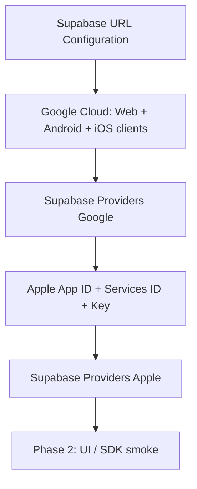

# Spec: IdP configuration checklist (Google + Apple + Supabase)

**Status:** SPEC / console runbook — **no SDK code**, no secrets in the repo.  
**Issue:** [#12](https://github.com/MarekBiolik/GymManager/issues/12)  
**Product decision:** [ADR 0007](../decisions/0007-auth-providers-minimum-pii.md)  
**Auth behavior:** [architecture/auth.md](../architecture/auth.md)

Checklist for the maintainer before / at the start of phase 2 (login UI). Phase-1 scaffold (#14) does **not** require green OAuth — this document closes “what to click in the consoles”, not button implementation.

## Goals

1. Google Cloud: OAuth client IDs per platform (Android / iOS / web) + Android SHA-1 when applicable.
2. Apple Developer: App ID + Sign in with Apple capability, Services ID, `.p8` key for Supabase (iOS MVP).
3. Supabase Auth: providers enabled, redirect URI / deep links per client.
4. Clear secrets map: Dashboard vs GitHub Secrets vs forbidden in repo/clients.

## Non-goals

| Out of scope | Where |
|--------------|--------|
| `signInWithIdToken` / OAuth UI code in apps | phase 2 (after this checklist) |
| Magic link, email+password, anon | beyond MVP — ADR 0007 |
| Apple on Android / web | beyond MVP — ADR 0007 |
| Account deletion (Edge Function / UI) | [account-deletion spec](account-deletion.md) / [#13](https://github.com/MarekBiolik/GymManager/issues/13) |
| Real Client IDs / secrets / SHA in git or PRs | **forbidden** — placeholders only |

## Placeholders (use in docs / PRs)

| Placeholder | Meaning |
|-------------|---------|
| `YOUR_PROJECT_REF` | Supabase Cloud project ref (`dev`) |
| `https://YOUR_PROJECT_REF.supabase.co` | Project API URL |
| `https://YOUR_PROJECT_REF.supabase.co/auth/v1/callback` | OAuth callback **provider → Supabase** |
| `com.YOURORG.gymmanager` | Android application ID / iOS Bundle ID (fix at scaffold) |
| `com.YOURORG.gymmanager://auth/callback` | App return deep link (scheme + path — one project convention) |
| `http://localhost:5173` | Local web origin / Site URL (adjust to Vite port) |
| `https://YOUR_WEB_ORIGIN` | Deployed web (when it exists) |

Official guides (source of truth for click procedures):  
[Supabase — Google](https://supabase.com/docs/guides/auth/social-sign-in/auth-google) · [Supabase — Apple](https://supabase.com/docs/guides/auth/social-sign-in/auth-apple) · [Redirect URLs](https://supabase.com/docs/guides/auth/redirect-urls) · [Native deep linking](https://supabase.com/docs/guides/auth/native-mobile-deep-linking)

---

## 1. Supabase Auth — URL Configuration (first)

In the `dev` project Dashboard: **Authentication → URL Configuration**.

| Field | Value (dev) | Notes |
|-------|-------------|--------|
| **Site URL** | `http://localhost:5173` (or web origin) | Default redirect when `redirectTo` is missing |
| **Additional Redirect URLs** | see table below | Exact match; wildcards only deliberately |

### Redirect URI / deep link per client

Two layers — do not confuse them:

1. **Provider → Supabase:** always `https://YOUR_PROJECT_REF.supabase.co/auth/v1/callback` (Google Authorized redirect URI; Apple Services ID return URL). Local CLI: `http://127.0.0.1:54321/auth/v1/callback`.
2. **Supabase → app** (`redirectTo` / Additional Redirect URLs):

| Client | IdP in MVP | Return type | Example in Additional Redirect URLs |
|--------|------------|-------------|-------------------------------------|
| **Web** | Google | HTTPS origin / path | `http://localhost:5173/**`, `https://YOUR_WEB_ORIGIN/**` |
| **Android** | Google | Custom scheme (or App Links later) | `com.YOURORG.gymmanager://auth/callback` |
| **iOS** | Google + Apple | Custom scheme (or Universal Links later) | `com.YOURORG.gymmanager://auth/callback` |

Native: the same scheme must be declared in the Android manifest / iOS URL Types (phase-2 implementation — here only **decide and enter** in Supabase).

Local stack (`supabase start`): separate `127.0.0.1:54321` callback in Google/Apple **and** the same Additional Redirect URLs for clients.

- [ ] Site URL set for current web/dev
- [ ] Additional Redirect URLs include web + mobile deep link
- [ ] No spare production URLs carrying someone else’s secrets

---

## 2. Google Cloud — OAuth clients

Console: [Google Cloud Console](https://console.cloud.google.com/) → APIs & Services → Credentials (OAuth consent screen first if empty).

### 2.1 Shared

- [ ] GCP project linked to GymManager (may be separate from other apps)
- [ ] OAuth consent screen: External (or Internal on Workspace); minimum scopes (`email`, `profile`, `openid` — what the Supabase/Google flow needs)
- [ ] Test users added during development (when the app is in Testing)

### 2.2 Client IDs per platform

| Google client type | Purpose | What to enter in the console | Where the value lands |
|--------------------|---------|------------------------------|------------------------|
| **Web application** | Google provider in **Supabase Dashboard** (Client ID + **Client Secret**) and web flow | Authorized JavaScript origins: `http://localhost:5173`, `https://YOUR_WEB_ORIGIN`. Authorized redirect URIs: `https://YOUR_PROJECT_REF.supabase.co/auth/v1/callback` (+ local CLI callback when used) | Supabase → Authentication → Providers → Google |
| **Android** | Native Google Sign-In → `id_token` → Supabase | Package name = `com.YOURORG.gymmanager`; **SHA-1** of debug **and** release certs (separate fingerprints) | Client ID (no secret) in app / core config — **not** a secret; optionally list Client IDs in Dashboard Google provider (audience) |
| **iOS** | Native Google Sign-In on iOS | Bundle ID = `com.YOURORG.gymmanager` (+ Team ID / App Store ID when published) | Like Android — public Client ID in the client |

SHA-1 notes (Android):

- Debug: `keytool -list -v -keystore …` (or Gradle signing report) — **debug** fingerprint.
- Release / Play App Signing: SHA-1 from Play Console (App signing key), not only the local keystore.
- Each SHA-1 → usually a separate entry / same Android client with multiple fingerprints — keep consistent with Google docs; add **all** Client IDs used as audience in the Supabase Google provider when the Dashboard allows it.

- [ ] Web client: origins + redirect = Supabase callback
- [ ] Android client: package + SHA-1 debug (and release when available)
- [ ] iOS client: Bundle ID
- [ ] Web Client ID + Client Secret entered in Supabase Providers → Google (Enable)
- [ ] No Google Client Secret landed in the repo / committed `.env` / issue screenshot

---

## 3. Apple Developer — Sign in with Apple (iOS MVP)

Account: [Apple Developer](https://developer.apple.com/) → Certificates, Identifiers & Profiles.

Per [ADR 0007](../decisions/0007-auth-providers-minimum-pii.md): Apple is **required on iOS** when offering Google; **not** in MVP on Android/web. Native iOS uses the App ID; Services ID + key configuration is still the usual path for the Apple provider in Supabase (Secret generated from `.p8`).

### 3.1 App ID

- [ ] Identifiers → App IDs → App ID for `com.YOURORG.gymmanager`
- [ ] **Sign in with Apple** capability enabled
- [ ] Server-to-Server Notification Endpoint: empty (Supabase does not require it at start)

### 3.2 Services ID (for Supabase / web-style callback)

Even when MVP does not do Apple on web, Services ID + return URL is the standard Apple secret path in the Supabase Dashboard.

- [ ] New Services ID (e.g. `com.YOURORG.gymmanager.auth`)
- [ ] “Sign in with Apple” → Configure:
  - Domains: `YOUR_PROJECT_REF.supabase.co`
  - Return URLs: `https://YOUR_PROJECT_REF.supabase.co/auth/v1/callback`
- [ ] In Supabase → Providers → Apple: **Client IDs** — Services ID as the OAuth entry; for native also add App ID (Bundle ID) to the audience list. If web Apple ever lands: Services ID **first** on the list (Supabase requirement for `signInWithOAuth`).

### 3.3 Key (`.p8`)

- [ ] Keys → Key with **Sign in with Apple** enabled → linked to App ID
- [ ] Download `AuthKey_XXXXXXXXXX.p8` **once**; Key ID stored offline
- [ ] Team ID (Membership) known
- [ ] Generate **Apple client secret** (JWT) with the tool from Supabase docs (Key ID + Team ID + Services ID + `.p8`) and paste into Dashboard → Apple → Secret
- [ ] `.p8` file and generated secret: password manager / Dashboard only — **never** git, CI logs, or tickets

### 3.4 Xcode / device (reminder for phase 2)

- [ ] Sign in with Apple entitlement on the iOS target
- [ ] URL scheme deep link matches Additional Redirect URLs (when the flow returns via browser/SDK)

---

## 4. Supabase — enable providers

| Provider | Enable | Client ID(s) | Secret |
|----------|--------|--------------|--------|
| **Google** | yes | Web Client ID (+ native IDs as audience if required) | Web Client Secret |
| **Apple** | yes (for iOS) | Services ID (+ App ID for native) | Secret from `.p8` |

- [ ] Google Enabled; login test deferred to phase-2 UI
- [ ] Apple Enabled
- [ ] Redirect URLs (section 1) already filled before first smoke

---

## 5. Secrets — where they may live

Aligned with [ADR 0004](../decisions/0004-supabase-hosting.md) and [auth — Roles and keys](../architecture/auth.md#roles-and-keys).

| Secret / value | Supabase Auth Dashboard | GitHub Secrets (CI) | Local `.env*` (gitignore) | Client (APK/IPA/SPA) | Git repo |
|----------------|-------------------------|---------------------|---------------------------|----------------------|----------|
| Project URL + `anon` | (project) | optionally e2e | yes | yes (public + RLS) | **do not** commit `.env*` |
| `service_role` | — | only when CI truly needs it | local admin | **forbidden** | **forbidden** |
| Google **Web** Client Secret | **yes** (Providers → Google) | usually no | not needed in the app | **forbidden** | **forbidden** |
| Google Web / Android / iOS **Client ID** | yes (provider config / docs) | rarely | optionally | Client ID OK (not a secret) | placeholders OK; avoid committing production IDs without need |
| Apple `.p8` / client secret | **yes** (Providers → Apple) | only if rotation is automated | password manager, not git | **forbidden** | **forbidden** |
| SHA-1 fingerprint | — | — | internal docs OK | — | allowed (not a secret), but do not pair with a private keystore |

Rules:

1. In PRs and this repo: placeholders from the table at the top only.
2. Console screenshots: redact IDs/secrets or do not paste.
3. Rotation: leaked `.p8` / Client Secret → revoke in the IdP console + new secret in the Dashboard immediately.

---

## 6. Recommended execution order

1. URL Configuration (Site + Additional Redirects).  
2. Google Web client → Supabase Google.  
3. Google Android/iOS clients (SHA-1, Bundle ID).  
4. Apple App ID / Services ID / Key → Supabase Apple.  
5. Only then login code in clients (phase 2).

---

## 7. Definition of done (#12)

- [x] Google Cloud checklist (client IDs per platform, Android SHA-1)
- [x] Apple Developer checklist (capability, Services ID, key) for Supabase
- [x] Redirect URI / deep link per client (web / Android / iOS) documented
- [x] Secrets: Dashboard vs GitHub Secrets vs forbidden in repo
- [x] Links to [ADR 0007](../decisions/0007-auth-providers-minimum-pii.md) and [auth.md](../architecture/auth.md)

Ticking the console checkboxes is maintainer work when wiring `dev`; this document does not require “OAuth green” proof in CI.

## Related

- [ADR 0007](../decisions/0007-auth-providers-minimum-pii.md), [ADR 0002](../decisions/0002-backend-supabase.md), [ADR 0004](../decisions/0004-supabase-hosting.md)
- [auth](../architecture/auth.md), [data-and-sync — secrets](../architecture/data-and-sync.md#secrets)
- [phase-1 scaffold playbook](../plans/phase-1-scaffold-playbook.md) — IdP outside scaffold done criteria
- Follow-up UI implementation: phase 2; account deletion [spec](account-deletion.md) / [#13](https://github.com/MarekBiolik/GymManager/issues/13)
